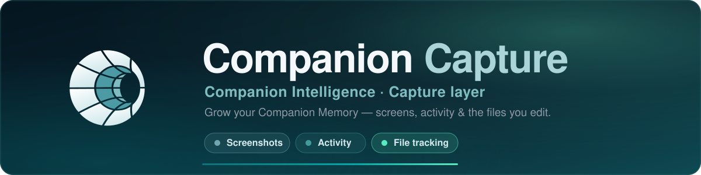
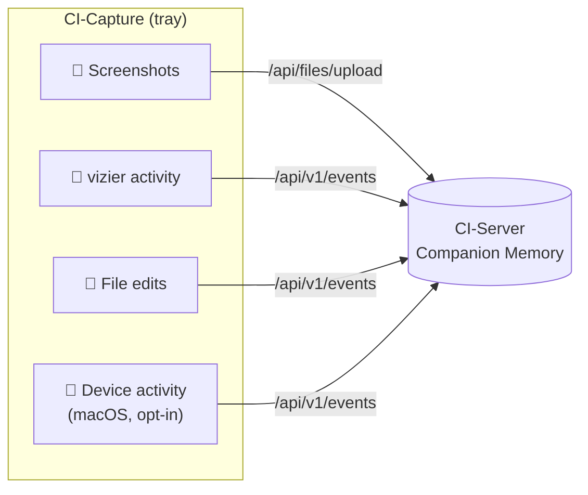
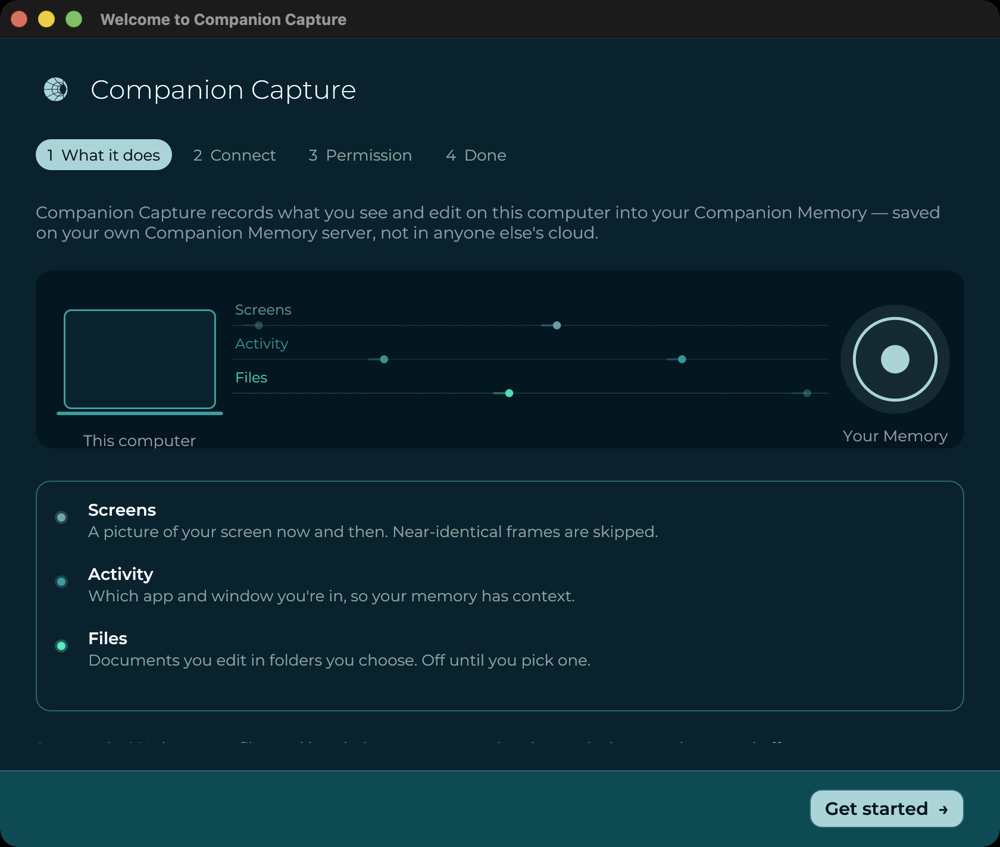
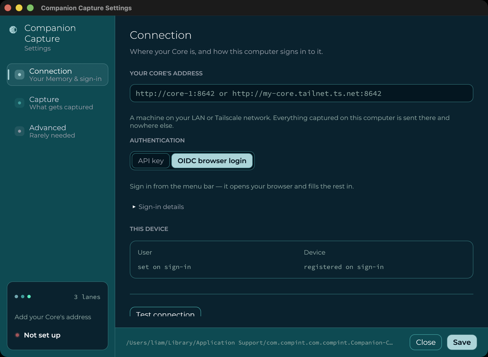
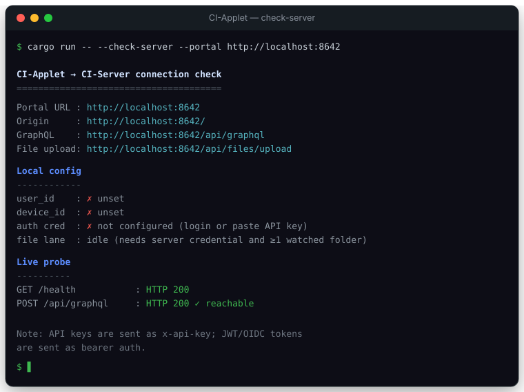
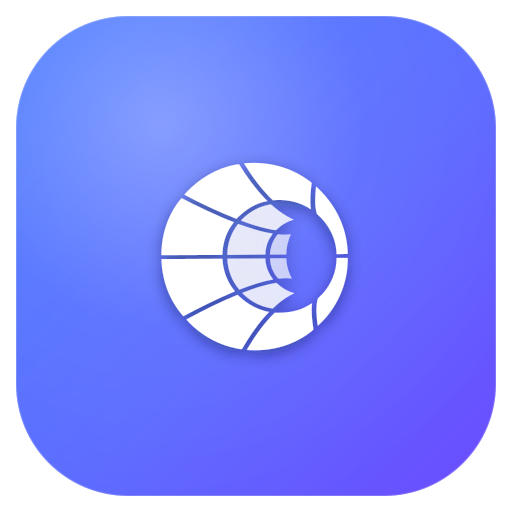
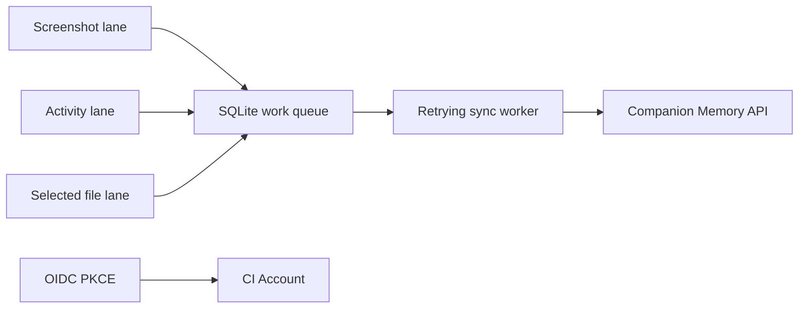
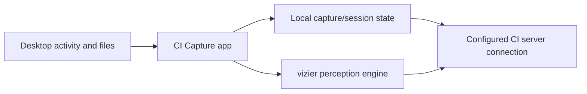

<p align="center">
  
</p>

[](https://github.com/companionintelligence/CI-Capture/releases/latest)
[](https://github.com/companionintelligence/CI-Capture)
[](LICENSE.md)
[](https://discord.com/invite/yQp9hwpzAa)

<p align="center"><a href="https://ci.computer/download">Website</a> · <a href="#documentation">Documentation</a> · <a href="#install">Get started</a> · <a href="https://docs.ci.computer/docs/reference/open-source-systems">Systems map</a></p>

<p align="center">
  <a href="https://github.com/companionintelligence/CI-Capture/releases/latest"></a>
  <a href="https://github.com/companionintelligence/CI-Capture/releases/latest"></a>
  <a href="https://github.com/companionintelligence/CI-Capture/releases/latest"></a>
</p>


<p align="center"><b>Companion Desktop Capture — macOS · Windows · Linux</b></p>

<p align="center">
  <a href="https://github.com/companionintelligence/CI-Capture/actions/workflows/ci.yml"></a>

  
  

</p>

> **Companion Intelligence — Capture layer.** [PolyForm Noncommercial 1.0.0](LICENSE.md). © 2019–2026 LifeScope Inc. See the [License FAQ](docs/License-FAQ.md).

**Companion Capture** is a lightweight **cross‑platform** menu‑bar / system‑tray app (macOS, Windows, Linux) that grows your **Companion Memory** by perceiving your desktop and streaming it to your CI‑Server.

## What it captures

| Feature | What it provides |
|---|---|
| **Screen capture** | Diff-gate screenshots and skip near-identical frames. |
| **Activity snapshots** | Run the `vizier` perception lane for foreground app and system context. |
| **File tracking** | Watch selected folders, fingerprint edits and convert supported files. |
| **Durable sync** | Queue each lane and retry against the configured Memory API. |


- **Screenshots** of the primary display on an interval — diff‑gated (skips near‑identical frames), screensaver‑aware, then run through vision analysis.
- **System activity** via the embedded **`vizier`** perception engine — structured snapshots of the machine/user/environment: foreground app & window, working directory, network connections, and live filesystem deltas.
- **File edits** in folders you choose — the Capture watches them, fingerprints changed files, converts the ones it can to Markdown, and streams the result so **your AI can remember the files you work on**. See [File tracking](#file-tracking).
- **Device activity** (macOS, off by default) — reads the Mac's own first‑party activity log (`knowledgeC.db`) for which app was frontmost and for how long, media playback, notifications received, and Bluetooth connections, and adds a daily per‑app digest ("Chrome for 5 h 12 min across 231 sessions"). Needs Full Disk Access; never reads URLs, MAC addresses, or notification bodies. See [`docs/plan/06-knowledge.md`](docs/plan/06-knowledge.md).

All four streams go to your CI‑Server's Companion Memory portal over an OIDC‑issued bearer token.



## Screenshots

<table>
<tr>
<td width="50%" valign="top">

**First run** — the setup assistant names the three lanes, and what each one records, before anything is captured.



</td>
<td width="50%" valign="top">

**Settings → Connection** — point this computer at your Core, and choose how it signs in.



</td>
</tr>
<tr>
<td colspan="2" valign="top">

**`--check-server`** — the built‑in connectivity self‑test, run against a live Core: `HTTP 200` on both probes, with the local config and OIDC state it resolved on the way.



</td>
</tr>
</table>

> Captures of the current build, not mockups — see [brand & assets](docs/assets/brand.md#screenshots)
> for how they're taken. The tray menu is the one gap: it needs a real click to
> open, so [`tray-menu.svg`](docs/assets/tray-menu.svg) is still an illustration
> and is out of date (old product name, and the menu has grown six items since).

## Install

Download the installer for your OS from the [**Releases**](https://github.com/companionintelligence/CI-Capture/releases) page — a real `.dmg` / `.exe` / `.deb` / `.AppImage` / Arch pacman package, like CI-Hub.

<details open>
<summary><b>macOS</b> — <code>CI-Capture_*_aarch64.dmg</code> (Apple Silicon) or <code>CI-Capture_*_x64.dmg</code> / <code>*x86_64*.dmg</code> (Intel)</summary>

Open the `.dmg` and drag **CI-Capture** to **Applications**. Production builds are Developer ID signed and notarized when Apple release secrets are configured. It lives in the menu bar (no Dock icon). Grant **Screen Recording** and **Accessibility** in *System Settings → Privacy & Security* when prompted.
</details>

<details>
<summary><b>Windows</b> — <code>CI-Capture_*_x64-setup.exe</code></summary>

Run the installer (**per‑user**, no admin needed). SmartScreen may warn about an unrecognized app — choose **More info → Run anyway**. The Capture then appears in the system tray; screen capture uses the Desktop Duplication API.
</details>

<details>
<summary><b>Linux</b> — <code>ci-Capture_*_amd64.deb</code> · <code>CI-Capture_*_x86_64.AppImage</code> · Arch <code>*.tar.gz</code>/<code>PKGBUILD</code></summary>

Debian/Ubuntu: `sudo apt install ./ci-Capture_*_amd64.deb`. Arch: build/install with the release `PKGBUILD`, or install the generated pacman archive with `sudo pacman -U ./CI-Capture_*.tar.gz`. Any distro: `chmod +x CI-Capture_*.AppImage && ./CI-Capture_*.AppImage`. Needs an **X11** session and an AppIndicator/StatusNotifier tray host (GNOME needs the *AppIndicator* extension). The `.deb` pulls in GTK 3, `libayatana-appindicator3`, `libxdo`, and xcb.
</details>

> **Known limitations off macOS:** the Activity lane, Wayland screenshots, and the Device-activity / iMessage lanes are stubbed or macOS-only today, and Linux has no idle detection. Lock detection, idle-skip (macOS/Windows), start-at-login and the single-instance guard now work on all three — see [`docs/plan/07-cross-platform.md`](docs/plan/07-cross-platform.md) for the per-OS table and plan.
>
> Prefer building from source? See [Build](#build).

### Container image (GitHub Packages)

A Linux image is published to **[GitHub Packages](https://github.com/orgs/companionintelligence/packages?repo_name=CI-Capture)** at `ghcr.io/companionintelligence/ci-Capture`. The CLI works headless:

```bash
docker run --rm ghcr.io/companionintelligence/ci-Capture:latest --check-server
```

For the tray GUI, forward an X11 display and persist config:

```bash
docker run --rm \
  -e DISPLAY="$DISPLAY" -v /tmp/.X11-unix:/tmp/.X11-unix \
  -v ~/.config/com.compint:/home/app/.config/com.compint \
  ghcr.io/companionintelligence/ci-Capture:latest
```

> For desktop use, prefer the native installers above — the container targets `linux/amd64` and headless/automation use.

## File tracking

The file‑tracking lane is the answer to *"track the important files I edit and let my AI remember them."* It runs alongside the screenshot + vizier lanes:


- **Off until you opt in.** Nothing is watched until you add a folder to `file_tracker.watched_paths`.
- **Privacy‑first ignores.** Disable‑able defaults (`node_modules`, `.git`, build dirs, caches, browser profiles, VM images) plus a **non‑disableable** sensitive list (`.ssh`, keychains, `.aws/credentials`, `.gnupg`, password vaults) enforced *before* any file is hashed.
- **Durable.** Events persist in a local SQLite queue (`file-tracker-queue.db`) and drain with exponential backoff — a network outage or hard kill never loses a tracked change.
- **Markdown conversion.** Text, Markdown, JSON, CSV/TSV, and **source‑code/config** files are converted to language‑aware Markdown so the content (not just "a file changed") reaches your memory. HTML/EML/EPUB are available with `--features rich-extractors`.

Events ride CI-Server's unified capture ingest endpoint (`POST /api/v1/events`) with `kind = "file_event"` and converted Markdown carried in the payload. See [`docs/architecture.md`](docs/architecture.md) for diagrams (pipeline, sequence, lifecycle) and [`docs/plan/00-overview.md`](docs/plan/00-overview.md) for the rollout plan.

### Check the server connection

```bash
cargo run -- --check-server                                # probe the configured portal
cargo run -- --check-server --portal https://your-ci-server.example.com
```

Reports resolved endpoints, local identity/token state, and a live reachability probe.
The Capture probes both common route shapes (`/api/...` and bare API routes), so
the same setting can work for reverse-proxied and direct CI-Server deployments.

## `vizier` — the perception engine

The Capture depends on the **`vizier`** crate (vendored in‑tree at `vizier/`), a Rust system‑perception library (CLI binary: `vz`) that emits structured JSON observations for two modes:

- **`wake`** — cold‑start machine/user/environment orientation (`WakeObservation`)
- **`snapshot` / `watch`** — live state tracking (`Observation`), with `watch --diff` streaming an initial full snapshot followed by **RFC‑6902 JSON‑Patch** diff envelopes

It also reports filesystem delta events (create/modify/delete/rename) via `notify`, and ships macOS and Linux backends with a shared baseline collector and per‑platform enrichments (macOS accessibility; Hyprland IPC on Linux). Collectors are best‑effort and fail open to preserve reliability.

The Capture consumes vizier's `create_observer`, `Observation`, and `diff::create_diff_envelope` to capture activity and ship compact diffs.

## Stack

- Rust / Cargo (edition 2024)
- **egui + eframe** (glow) — tray UI
- **tao + tray-icon** — menu‑bar shell
- **screenshots** — display capture
- **vizier** (`vizier/`, vendored) — system/activity perception
- **notify** — cross‑platform filesystem watching (file‑tracking lane)
- **rusqlite** (bundled) — durable local event queue
- **globset** + **sha2** — ignore rules + content fingerprinting
- **csv** (+ optional `html2md` / `mail-parser` / `epub`) — Markdown conversion
- **reqwest** (rustls) — HTTPS to the portal

> No Tauri, no Screenpipe, no audio capture — those were earlier descriptions and no longer reflect the code.

## Build

The **`vizier`** crate is vendored in‑tree at `vizier/`, so the Capture builds standalone — no external checkout required. macOS and Windows build with just a Rust toolchain; **Linux** also needs the GTK/AppIndicator/X11 dev headers:

```bash
# Debian/Ubuntu build deps (Linux only)
sudo apt-get install -y libgtk-3-dev libxdo-dev libayatana-appindicator3-dev \
  libxcb1-dev libxcb-render0-dev libxcb-shape0-dev libxcb-xfixes0-dev libxcb-randr0-dev \
  libxkbcommon-dev libxkbcommon-x11-dev libwayland-dev
```

```bash
cargo build                            # debug
cargo build --release                  # optimized
cargo run                              # launch the tray Capture
cargo test                             # unit + e2e suite
cargo test --features rich-extractors  # + HTML/EML/EPUB extractors (212 tests)
```

Every push and PR is built and tested on **macOS, Linux, and Windows** by [`.github/workflows/ci.yml`](.github/workflows/ci.yml).

### Build & release with GitHub Actions

CI-Capture builds installers the same way CI-Hub does — per-OS runners,
`cargo-packager`, signing/notarization, and `dev`/`production` channels. The
**Desktop Release** workflow ([`release.yml`](.github/workflows/release.yml))
produces `.dmg` (macOS arm64 + Intel), `-setup.exe` (Windows), and
`.deb` / `.AppImage` / Arch packages (Linux), attached to a GitHub Release with
`latest.json`, `SHA256SUMS`, and provenance attestations.

**Quick paths:**

```bash
# Dev build (no secrets; installers for all OSes off any branch):
#   1. set Cargo.toml  version = "0.1.0-dev.1"  and commit
#   2. Actions → Desktop Release → Run workflow →
#      tag: v0.1.0-dev.1 · prerelease: true · environment: dev · platforms: all

# Production release (signed + notarized; requires signing secrets):
#   set Cargo.toml  version = "0.1.0"  and commit, then:
git tag v0.1.0 && git push origin v0.1.0
```

> The preflight requires `Cargo.toml`'s `version` to match the tag **exactly**,
> including any `-dev.N` suffix. Dev tags must be prereleases (contain a `-`).

**Full runbook** — step-by-step dev/prod flows, signing tiers, local builds,
and troubleshooting — is in [`docs/RELEASING.md`](docs/RELEASING.md). Signing
**secrets** (shared with CI-Hub) are in [`docs/DESKTOP-RELEASE-SECRETS.md`](docs/DESKTOP-RELEASE-SECRETS.md).

## Sign in & configure

Click **Login via …** from the tray to run the configured **OpenID Connect
Authorization Code + PKCE** flow. The Capture opens `oidc.issuer`, captures the
loopback redirect, and stores the issued **`id_token`** as the bearer credential
for CI-Server uploads.

You can bypass browser login by pasting a CI-Server bearer token or API key into
**Settings → Identity → Bearer Token / API Key**. JWT/OIDC tokens are sent as
`Authorization: Bearer …`; CI-Server API keys are sent as `x-api-key`.

Configuration lives in the app config directory as `config.json`. Key fields:

- `server.portal_url` — CI‑Server URL that receives captures. Use the server origin, not a page route such as `/feed`. The Capture probes both `/api/...` and bare API routes.
- `server.Capture_auth_token` — JWT bearer token or 64-character CI-Server API key used for CI-Server calls (set by login or pasted in settings)
- `oidc.issuer` — OIDC issuer opened by the tray login (blank by default; optional when using an API key)
- `oidc.client_id` — registered client (default `ci-Capture`)
- `oidc.redirect_uri` — loopback callback (default `http://127.0.0.1:0/callback`; port `0` means the OS picks a free port at sign-in, so a busy port can't block login — the resolved port is what's sent to the issuer, which must accept any `127.0.0.1` port)
- `screenshot_interval_secs` (default 300, floored to 30) and `diff_threshold_percent` (default 10)
- `file_tracker.watched_paths` — folders to watch recursively (**empty = file tracking off**); plus `ignore_globs`, `max_file_bytes`, `send_content`, `max_content_bytes`

After sign-in the Capture stores the tokens + identity, best-effort registers the
device (`POST {portal}/api/devices`, bearer-authed), and streams:

- screenshots → CI-Server file upload endpoint (multipart)
- activity + file snapshots → CI-Server event ingest endpoint

A background task keeps OIDC sessions alive: it **refreshes the `id_token`**
with the stored `refresh_token` before it expires (honouring rotation) and
retries device registration if CI‑Server was unreachable at sign-in —
persisting both to `config.json` and pushing them to the capture worker live.
API-key installs are unaffected.

> **Auth setup:** `server.portal_url` and `oidc.issuer` are intentionally
> separate. Point `server.portal_url` at the CI-Server that receives captures.
> Point `oidc.issuer` at the auth issuer you want the browser login to use
> (the `ci-Capture` client must be registered there with the loopback redirect
> above), or paste a CI-Server API key into settings and skip OIDC entirely.

## Privacy

Capture is local‑first and streamed only to the CI‑Server you sign in to. Screenshots are diff‑gated and suppressed while the macOS screensaver is running; nothing is captured until an identity is configured.

One exception, and it is diagnostics rather than capture: **crash reporting**. Release builds send scrubbed panic reports to Sentry — panics only, no logs and no breadcrumbs, with paths, hosts, credentials and your machine's names rewritten first, and no capture payload on the path at all. It is on by default and off in one click — **Settings → Advanced → Crash reporting** — or from the app's environment with `CI_TELEMETRY=off`, or `CI_LOCAL_ONLY=true` for the fleet‑wide no‑egress posture. Builds made outside the release workflow have no endpoint compiled in and send nothing regardless. What it does and does not send, in full: [crash reporting](docs/crash-reporting.md).

## Documentation

- [**Architecture**](docs/architecture.md) — diagrams: system context, file pipeline, edit sequence, lane lifecycle, server contract
- [**User flows**](docs/user-flows.md) — every screen mapped to use cases and user stories, with a story→screen→test traceability table
- [**Memory integration**](docs/memory-integration.md) — how captures reach CI‑Server's Companion Memory, and what Hermes and OpenClaw can then read
- [**Test plan**](docs/test-plan.md) — coverage map, gaps, and the per‑platform manual QA script for a release build
- [**Screenpipe comparison**](docs/screenpipe-comparison.md) — what we kept, what diverged, and where upstream is still ahead
- [**Crash reporting**](docs/crash-reporting.md) — the Sentry path: what it sends, how the scrubber works, how to turn it off, and where its guarantees stop
- [**Rollout plan**](docs/plan/00-overview.md) — what shipped, the design records, and what's next
- [**Brand & assets**](docs/assets/brand.md) — logo, palette, and the screenshots above

## Multi-agent safety

Multiple AI agents work these repos in parallel. Never use `git reset --hard`, `git clean -f`, or any destructive git command without explicit confirmation from the user.

---

<p align="center">
  <br>
  <sub><b>Companion Intelligence</b> · Capture layer · © 2019–2026 LifeScope Inc.</sub>
</p>

<!-- companion-hub-readme-deep-review -->


## How it fits together

Capture lanes write durable work locally and then sync lane-specific event or file payloads to the configured Memory server; OIDC sign-in and data delivery are separate paths.



## Capture and sync flow



The app's capture scope and privacy controls are described in the Privacy section. Review those settings before enabling file tracking or perception features, and verify the server connection before assuming a session has synced. The release instructions distinguish unsigned development installers from signed and notarized production releases.

