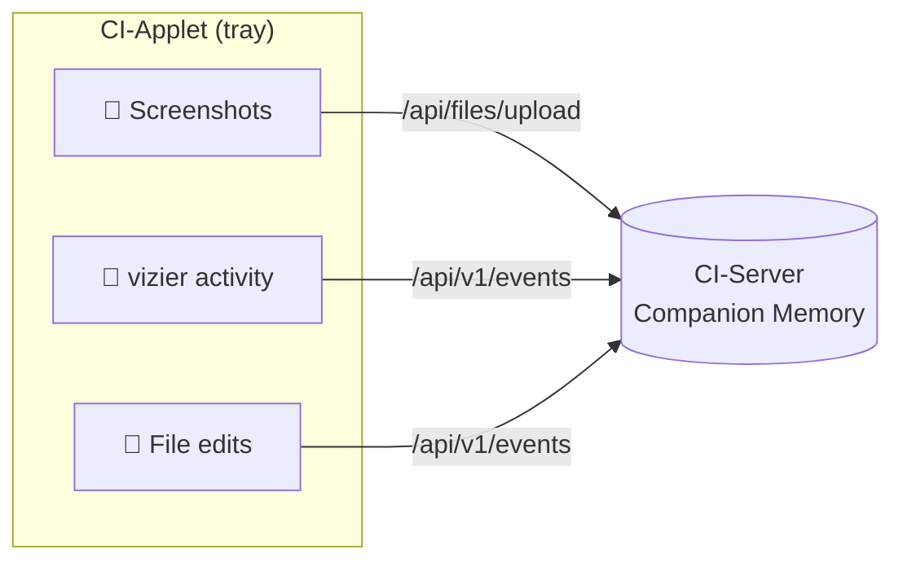
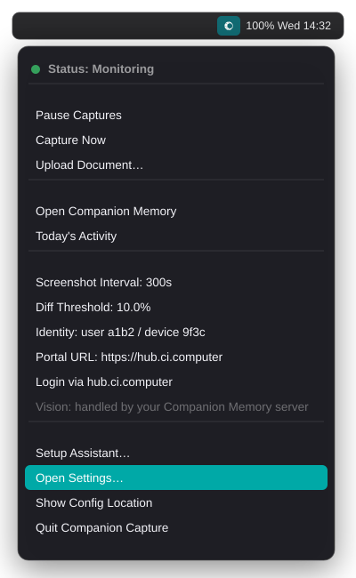
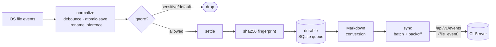

<p align="center">
  
</p>

<p align="center"><b>Companion Desktop Applet — macOS · Windows · Linux</b></p>

<p align="center">
  <a href="https://github.com/companionintelligence/CI-Applet/actions/workflows/ci.yml"></a>
  
  
  
  
</p>

> **Companion Intelligence — Capture layer.** Licensed under CI-Commercial-1.0. © 2019–2026 LifeScope Inc.

A lightweight **cross‑platform** menu‑bar / system‑tray applet (macOS, Windows, Linux) that grows your **Companion Memory** by perceiving your desktop and streaming it to your CI‑Server.

## What it captures

- **Screenshots** of the primary display on an interval — diff‑gated (skips near‑identical frames), screensaver‑aware, then run through vision analysis.
- **System activity** via the embedded **`vizier`** perception engine — structured snapshots of the machine/user/environment: foreground app & window, working directory, network connections, and live filesystem deltas.
- **File edits** in folders you choose — the applet watches them, fingerprints changed files, converts the ones it can to Markdown, and streams the result so **your AI can remember the files you work on**. See [File tracking](#file-tracking).

All three streams go to your CI‑Server's Companion Memory portal over an OIDC‑issued bearer token.



## Screenshots

<table>
<tr>
<td width="40%" valign="top">

**Menu‑bar tray** — live status across the three lanes, with quick actions one click away.



</td>
<td valign="top">

**`--check-server`** — a built‑in connectivity self‑test, shown here verified live against a running CI‑Server gateway.


</td>
</tr>
</table>

## Install

Download the installer for your OS from the [**Releases**](https://github.com/companionintelligence/CI-Applet/releases) page — a real `.dmg` / `.exe` / `.deb` / `.AppImage` / Arch pacman package, like CI-Hub.

<details open>
<summary><b>macOS</b> — <code>CI-Applet_*_aarch64.dmg</code> (Apple Silicon) or <code>CI-Applet_*_x64.dmg</code> / <code>*x86_64*.dmg</code> (Intel)</summary>

Open the `.dmg` and drag **CI-Applet** to **Applications**. Production builds are Developer ID signed and notarized when Apple release secrets are configured. It lives in the menu bar (no Dock icon). Grant **Screen Recording** and **Accessibility** in *System Settings → Privacy & Security* when prompted.
</details>

<details>
<summary><b>Windows</b> — <code>CI-Applet_*_x64-setup.exe</code></summary>

Run the installer (**per‑user**, no admin needed). SmartScreen may warn about an unrecognized app — choose **More info → Run anyway**. The applet then appears in the system tray; screen capture uses the Desktop Duplication API.
</details>

<details>
<summary><b>Linux</b> — <code>ci-applet_*_amd64.deb</code> · <code>CI-Applet_*_x86_64.AppImage</code> · Arch <code>*.tar.gz</code>/<code>PKGBUILD</code></summary>

Debian/Ubuntu: `sudo apt install ./ci-applet_*_amd64.deb`. Arch: build/install with the release `PKGBUILD`, or install the generated pacman archive with `sudo pacman -U ./CI-Applet_*.tar.gz`. Any distro: `chmod +x CI-Applet_*.AppImage && ./CI-Applet_*.AppImage`. Needs an **X11** session and an AppIndicator/StatusNotifier tray host (GNOME needs the *AppIndicator* extension). The `.deb` pulls in GTK 3, `libayatana-appindicator3`, `libxdo`, and xcb.
</details>

> Prefer building from source? See [Build](#build).

### Container image (GitHub Packages)

A Linux image is published to **[GitHub Packages](https://github.com/orgs/companionintelligence/packages?repo_name=CI-Applet)** at `ghcr.io/companionintelligence/ci-applet`. The CLI works headless:

```bash
docker run --rm ghcr.io/companionintelligence/ci-applet:latest --check-server
```

For the tray GUI, forward an X11 display and persist config:

```bash
docker run --rm \
  -e DISPLAY="$DISPLAY" -v /tmp/.X11-unix:/tmp/.X11-unix \
  -v ~/.config/com.compint:/home/app/.config/com.compint \
  ghcr.io/companionintelligence/ci-applet:latest
```

> For desktop use, prefer the native installers above — the container targets `linux/amd64` and headless/automation use.

## File tracking

The file‑tracking lane is the answer to *"track the important files I edit and let my AI remember them."* It runs alongside the screenshot + vizier lanes:



- **Off until you opt in.** Nothing is watched until you add a folder to `file_tracker.watched_paths`.
- **Privacy‑first ignores.** Disable‑able defaults (`node_modules`, `.git`, build dirs, caches, browser profiles, VM images) plus a **non‑disableable** sensitive list (`.ssh`, keychains, `.aws/credentials`, `.gnupg`, password vaults) enforced *before* any file is hashed.
- **Durable.** Events persist in a local SQLite queue (`file-tracker-queue.db`) and drain with exponential backoff — a network outage or hard kill never loses a tracked change.
- **Markdown conversion.** Text, Markdown, JSON, CSV/TSV, and **source‑code/config** files are converted to language‑aware Markdown so the content (not just "a file changed") reaches your memory. HTML/EML/EPUB are available with `--features rich-extractors`.

Events ride CI-Server's unified capture ingest endpoint (`POST /api/v1/events`) with `kind = "file_event"` and converted Markdown carried in the payload. See [`docs/architecture.md`](docs/architecture.md) for diagrams (pipeline, sequence, lifecycle) and [`docs/plan/00-overview.md`](docs/plan/00-overview.md) for the rollout plan.

### Check the server connection

```bash
cargo run -- --check-server                                # probe the configured portal
cargo run -- --check-server --portal https://your-ci-server.example.com
```

Reports resolved endpoints, local identity/token state, and a live reachability probe.
The applet probes both common route shapes (`/api/...` and bare API routes), so
the same setting can work for reverse-proxied and direct CI-Server deployments.

## `vizier` — the perception engine

The applet depends on the **`vizier`** crate (vendored in‑tree at `vizier/`), a Rust system‑perception library (CLI binary: `vz`) that emits structured JSON observations for two modes:

- **`wake`** — cold‑start machine/user/environment orientation (`WakeObservation`)
- **`snapshot` / `watch`** — live state tracking (`Observation`), with `watch --diff` streaming an initial full snapshot followed by **RFC‑6902 JSON‑Patch** diff envelopes

It also reports filesystem delta events (create/modify/delete/rename) via `notify`, and ships macOS and Linux backends with a shared baseline collector and per‑platform enrichments (macOS accessibility; Hyprland IPC on Linux). Collectors are best‑effort and fail open to preserve reliability.

The applet consumes vizier's `create_observer`, `Observation`, and `diff::create_diff_envelope` to capture activity and ship compact diffs.

## Stack

- Rust / Cargo (edition 2024)
- **egui + eframe** (glow) — tray UI
- **tao + tray-icon** — menu‑bar shell
- **screenshots** — display capture
- **vizier** (`vizier/`, vendored) — system/activity perception
- **notify** — cross‑platform filesystem watching (file‑tracking lane)
- **rusqlite** (bundled) — durable local event queue
- **globset** + **sha2** — ignore rules + content fingerprinting
- **csv** (+ optional `html2md` / `mail-parser` / `epub`) — Markdown conversion
- **reqwest** (rustls) — HTTPS to the portal

> No Tauri, no Screenpipe, no audio capture — those were earlier descriptions and no longer reflect the code.

## Build

The **`vizier`** crate is vendored in‑tree at `vizier/`, so the applet builds standalone — no external checkout required. macOS and Windows build with just a Rust toolchain; **Linux** also needs the GTK/AppIndicator/X11 dev headers:

```bash
# Debian/Ubuntu build deps (Linux only)
sudo apt-get install -y libgtk-3-dev libxdo-dev libayatana-appindicator3-dev \
  libxcb1-dev libxcb-render0-dev libxcb-shape0-dev libxcb-xfixes0-dev libxcb-randr0-dev \
  libxkbcommon-dev libxkbcommon-x11-dev libwayland-dev
```

```bash
cargo build                            # debug
cargo build --release                  # optimized
cargo run                              # launch the tray applet
cargo test                             # unit + e2e suite
cargo test --features rich-extractors  # + HTML/EML/EPUB extractors (185 tests)
```

Every push and PR is built and tested on **macOS, Linux, and Windows** by [`.github/workflows/ci.yml`](.github/workflows/ci.yml).

### Build & release with GitHub Actions

CI-Applet builds installers the same way CI-Hub does — per-OS runners,
`cargo-packager`, signing/notarization, and `dev`/`production` channels. The
**Desktop Release** workflow ([`release.yml`](.github/workflows/release.yml))
produces `.dmg` (macOS arm64 + Intel), `-setup.exe` (Windows), and
`.deb` / `.AppImage` / Arch packages (Linux), attached to a GitHub Release with
`latest.json`, `SHA256SUMS`, and provenance attestations.

**Quick paths:**

```bash
# Dev build (no secrets; installers for all OSes off any branch):
#   1. set Cargo.toml  version = "0.1.0-dev.1"  and commit
#   2. Actions → Desktop Release → Run workflow →
#      tag: v0.1.0-dev.1 · prerelease: true · environment: dev · platforms: all

# Production release (signed + notarized; requires signing secrets):
#   set Cargo.toml  version = "0.1.0"  and commit, then:
git tag v0.1.0 && git push origin v0.1.0
```

> The preflight requires `Cargo.toml`'s `version` to match the tag **exactly**,
> including any `-dev.N` suffix. Dev tags must be prereleases (contain a `-`).

**Full runbook** — step-by-step dev/prod flows, signing tiers, local builds,
and troubleshooting — is in [`docs/RELEASING.md`](docs/RELEASING.md). Signing
**secrets** (shared with CI-Hub) are in [`docs/DESKTOP-RELEASE-SECRETS.md`](docs/DESKTOP-RELEASE-SECRETS.md).

## Sign in & configure

On first launch the **setup assistant** opens automatically (and stays available
from the tray as *Setup Assistant*). It asks for one thing — your CI-Server URL
— derives the portal sign-in URL from it (`<server>/api/auth`), checks both
before you sign in, walks the macOS permission grants, and ends with a **test
capture** that pushes one real screenshot through the normal ingest path so you
leave setup knowing it works rather than hoping. A split portal/server
deployment can set the issuer by hand under *Advanced*.

Click **Login via …** from the tray to re-run the configured **OpenID Connect
Authorization Code + PKCE** flow at any time. The applet opens `oidc.issuer`,
captures the loopback redirect, and stores the issued **`id_token`** as the
bearer credential for CI-Server uploads.

You can bypass browser login by pasting a CI-Server bearer token or API key into
**Settings → Identity → Bearer Token / API Key**. JWT/OIDC tokens are sent as
`Authorization: Bearer …`; CI-Server API keys are sent as `x-api-key`.

Configuration lives in the app config directory as `config.json`. Key fields:

- `server.portal_url` — CI‑Server URL that receives captures. Use the server origin, not a page route such as `/feed`. The applet probes both `/api/...` and bare API routes.
- `server.applet_auth_token` — JWT bearer token or 64-character CI-Server API key used for CI-Server calls (set by login or pasted in settings)
- `oidc.issuer` — OIDC issuer opened by the tray login (blank by default; optional when using an API key)
- `oidc.client_id` — registered client (default `ci-applet`)
- `oidc.redirect_uri` — loopback callback (default `http://127.0.0.1:49473/callback`)
- `screenshot_interval_secs` (default 300, floored to 30) and `diff_threshold_percent` (default 10)
- `file_tracker.watched_paths` — folders to watch recursively (**empty = file tracking off**); plus `ignore_globs`, `max_file_bytes`, `send_content`, `max_content_bytes`

After sign-in the applet stores the tokens + identity, best-effort registers the
device (`POST {portal}/api/devices`, bearer-authed), and streams:

- screenshots → CI-Server file upload endpoint (multipart)
- activity + file snapshots → CI-Server event ingest endpoint

A background task keeps OIDC sessions alive: it **refreshes the `id_token`**
with the stored `refresh_token` before it expires (honouring rotation) and
retries device registration if CI‑Server was unreachable at sign-in —
persisting both to `config.json` and pushing them to the capture worker live.
API-key installs are unaffected.

> **Auth setup:** `server.portal_url` and `oidc.issuer` are intentionally
> separate. Point `server.portal_url` at the CI-Server that receives captures.
> Point `oidc.issuer` at the auth issuer you want the browser login to use
> (the `ci-applet` client must be registered there with the loopback redirect
> above), or paste a CI-Server API key into settings and skip OIDC entirely.

## Privacy

Capture is local‑first and streamed only to the CI‑Server you sign in to. Screenshots are diff‑gated and suppressed while the macOS screensaver is running; nothing is captured until an identity is configured.

## Documentation

- [**Architecture**](docs/architecture.md) — diagrams: system context, file pipeline, edit sequence, lane lifecycle, server contract
- [**Rollout plan**](docs/plan/00-overview.md) — what shipped, the design records, and what's next
- [**Brand & assets**](docs/assets/brand.md) — logo, palette, and the screenshots above

## Multi-agent safety

Multiple AI agents work these repos in parallel. Never use `git reset --hard`, `git clean -f`, or any destructive git command without explicit confirmation from the user.

---

<p align="center">
  <br>
  <sub><b>Companion Intelligence</b> · Capture layer · © 2019–2026 LifeScope Inc.</sub>
</p>
