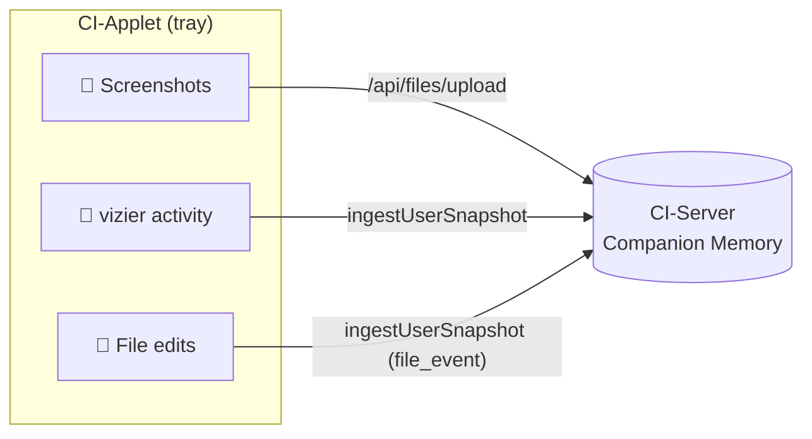
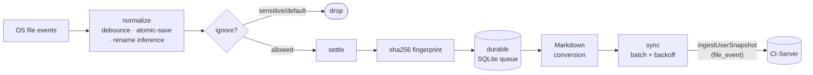

# Companion Desktop Applet - tested for MacOS

> **Companion Intelligence — Capture layer.** Licensed under CI-Commercial-1.0. © 2019–2026 LifeScope Inc.

A lightweight macOS menu‑bar (tray) applet that grows your **Companion Memory** by perceiving your desktop and streaming it to your CI‑Server.

## What it captures

- **Screenshots** of the primary display on an interval — diff‑gated (skips near‑identical frames), screensaver‑aware, then run through vision analysis.
- **System activity** via the embedded **`vizier`** perception engine — structured snapshots of the machine/user/environment: foreground app & window, working directory, network connections, and live filesystem deltas.
- **File edits** in folders you choose — the applet watches them, fingerprints changed files, converts the ones it can to Markdown, and streams the result so **your AI can remember the files you work on**. See [File tracking](#file-tracking).

All three streams go to your CI‑Server's Companion Memory portal over a paired bearer token.



## File tracking

The file‑tracking lane is the answer to *"track the important files I edit and let my AI remember them."* It runs alongside the screenshot + vizier lanes:



- **Off until you opt in.** Nothing is watched until you add a folder to `file_tracker.watched_paths`.
- **Privacy‑first ignores.** Disable‑able defaults (`node_modules`, `.git`, build dirs, caches, browser profiles, VM images) plus a **non‑disableable** sensitive list (`.ssh`, keychains, `.aws/credentials`, `.gnupg`, password vaults) enforced *before* any file is hashed.
- **Durable.** Events persist in a local SQLite queue (`file-tracker-queue.db`) and drain with exponential backoff — a network outage or hard kill never loses a tracked change.
- **Markdown conversion.** Text, Markdown, JSON, CSV/TSV, and **source‑code/config** files are converted to language‑aware Markdown so the content (not just "a file changed") reaches your memory. HTML/EML/EPUB are available with `--features rich-extractors`.

Events ride the existing `ingestUserSnapshot` GraphQL channel as `snapshot_kind = "file_event"` — no new server endpoints required. See [`docs/architecture.md`](docs/architecture.md) for diagrams (pipeline, sequence, lifecycle) and [`docs/plan/00-overview.md`](docs/plan/00-overview.md) for the rollout plan.

### Check the server connection

```bash
cargo run -- --check-server                                # probe the configured portal
cargo run -- --check-server --portal http://localhost:8642  # probe a specific origin
```

Reports resolved endpoints, local identity/token state, and a live reachability probe.

## `vizier` — the perception engine

The applet depends on the **`vizier`** crate (vendored at `../../vizier`), a Rust system‑perception library (CLI binary: `vz`) that emits structured JSON observations for two modes:

- **`wake`** — cold‑start machine/user/environment orientation (`WakeObservation`)
- **`snapshot` / `watch`** — live state tracking (`Observation`), with `watch --diff` streaming an initial full snapshot followed by **RFC‑6902 JSON‑Patch** diff envelopes

It also reports filesystem delta events (create/modify/delete/rename) via `notify`, and ships macOS and Linux backends with a shared baseline collector and per‑platform enrichments (macOS accessibility; Hyprland IPC on Linux). Collectors are best‑effort and fail open to preserve reliability.

The applet consumes vizier's `create_observer`, `Observation`, and `diff::create_diff_envelope` to capture activity and ship compact diffs.

## Stack

- Rust / Cargo (edition 2024)
- **egui + eframe** (glow) — tray UI
- **tao + tray-icon** — menu‑bar shell
- **screenshots** — display capture
- **vizier** (`vizier/`, vendored) — system/activity perception
- **notify** — cross‑platform filesystem watching (file‑tracking lane)
- **rusqlite** (bundled) — durable local event queue
- **globset** + **sha2** — ignore rules + content fingerprinting
- **csv** (+ optional `html2md` / `mail-parser` / `epub`) — Markdown conversion
- **reqwest** (rustls) — HTTPS to the portal

> No Tauri, no Screenpipe, no audio capture — those were earlier descriptions and no longer reflect the code.

## Build

Requires the **`vizier`** crate at `../../vizier` (a sibling of the `ci/` workspace, i.e. `/Users/<you>/devel/vizier`). Without it `cargo` fails at dependency resolution.

```bash
cargo build                            # debug
cargo build --release                  # optimized
cargo run                              # launch the tray applet
cargo test                             # 112 tests
cargo build --features rich-extractors # + HTML/EML/EPUB extractors (139 tests)
```

## Configure & pair

Configuration lives in the app config directory as `config.json`. Key fields:

- `server.portal_url` — your CI‑Server Companion Memory portal (default `https://memory.ci.localhost`)
- `identity.user_id` + `identity.device_id` — **capture is a no‑op until both are set**
- `screenshot_interval_secs` (default 300, floored to 30) and `diff_threshold_percent` (default 10)
- `file_tracker.watched_paths` — folders to watch recursively (**empty = file tracking off**); plus `ignore_globs`, `max_file_bytes`, `send_content`, `max_content_bytes`

**Pairing:** the applet runs a GraphQL pairing handshake (`startAppletPairing` → poll `appletPairingStatus`) to obtain a bearer token, then sends:

- screenshots → `POST {portal}/api/files/upload` (multipart, bearer auth)
- activity snapshots → `ingestUserSnapshot` GraphQL mutation (bearer auth)

A **legacy fallback** (no token configured) writes screenshots straight to MinIO and rows into Postgres.

## Privacy

Capture is local‑first and streamed only to the CI‑Server you pair with. Screenshots are diff‑gated and suppressed while the macOS screensaver is running; nothing is captured until an identity is configured.

## Multi-agent safety

Multiple AI agents work these repos in parallel. Never use `git reset --hard`, `git clean -f`, or any destructive git command without explicit confirmation from the user.
