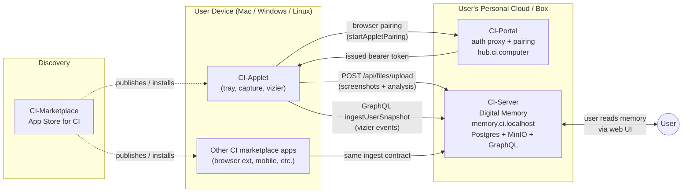
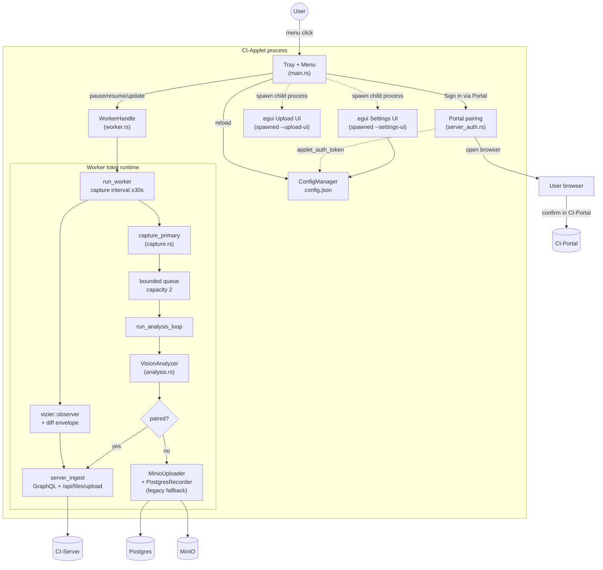
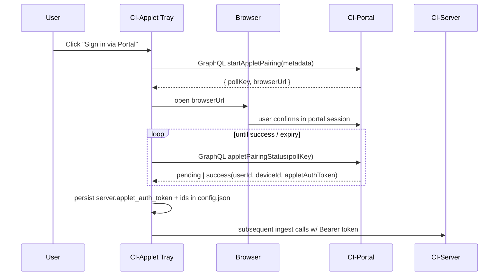

# CI-Applet — Architecture

> A lightweight, cross-platform desktop tray app that captures user activity (screenshots + machine state) and ships it to the user's personal Companion Intelligence memory server.

---

## 1. What it is, in one paragraph

**CI-Applet** is the on-device sensor for the Companion Intelligence (CI) stack. It runs as a system-tray utility on macOS / Windows / Linux, periodically captures the primary display, asks a vision LLM to summarize what the user is doing, captures lower-level OS observations through the embedded **`vizier`** crate, and persists both streams to the user's [CI-Server](https://github.com/companionintelligence/CI-Server) ("digital memory"). It authenticates via a browser-based pairing handshake against the user's [CI-Portal](https://github.com/companionintelligence/CI-Portal). It is one of several first-party apps in the [CI-Marketplace](https://github.com/companionintelligence/CI-Marketplace) ecosystem.

---

## 2. Role in the Companion Intelligence stack

| System | Repo | Role relative to CI-Applet |
|---|---|---|
| **CI-Portal** | [companionintelligence/CI-Portal](https://github.com/companionintelligence/CI-Portal) | "Portal" — the user-facing auth/proxy front door. The applet opens the portal in a browser to complete the pairing handshake and receive its long-lived bearer token. |
| **CI-Server** | [companionintelligence/CI-Server](https://github.com/companionintelligence/CI-Server) | "Companion Memory" — the personal digital-twin backend (Postgres + MinIO + GraphQL). All applet output (files, screen captures, vizier snapshots) lands here. |
| **CI-Marketplace** | [companionintelligence/CI-Marketplace](https://github.com/companionintelligence/CI-Marketplace) | "App Store" for CI. The applet is one of several capture/companion apps that will be discoverable and installable from here. |
| **vizier** (sibling crate) | local path `../../vizier` (Cargo) | Embedded observation engine. Generates filesystem/focus/diff snapshots that ride alongside each screen capture. |

---

## 3. Repository / source-tree audit

The applet is a single Rust binary (`Cargo.toml` → `CI-Applet`, edition 2024). All source lives in [src/](src). Each module has a sibling `.md` file describing purpose, components, and contracts — those are authoritative and were used to build this overview.

| Module | LOC | Doc | Responsibility | Key contracts |
|---|---:|---|---|---|
| [main.rs](src/main.rs) | 20,642 | [main.md](src/main.md) | Tray lifecycle, menu, config reload, **portal pairing entrypoint**, sub-windows (`--settings-ui`, `--upload-ui`). | `AppController`, `launch_portal_login`, `pair_with_portal`, `ensure_device_registration`. |
| [worker.rs](src/worker.rs) | 15,581 | [worker.md](src/worker.md) | Background capture loop: drives screenshot interval, runs `vizier` snapshot/diff alongside each capture, dispatches analysis + upload. | `WorkerHandle`, `run_worker`, `capture_once`, `capture_vizier`, bounded `ANALYSIS_QUEUE_CAPACITY=2`, `MIN_INTERVAL_SECS=30`. |
| [capture.rs](src/capture.rs) | 2,279 | _(no doc)_ | Primary-display screen capture, PNG encoding, diff% between frames. | `capture_primary`, `CapturedImage`, `diff_percent`, `save_to_path`. |
| [analysis.rs](src/analysis.rs) | 11,941 | [analysis.md](src/analysis.md) | Vision LLM client. Sends frame → OpenAI-compatible `/chat/completions`, parses strict JSON into `AnalysisResult`. | `VisionAnalyzer::analyze`, strict JSON schema, prose-tolerant fallback parser. |
| [config.rs](src/config.rs) | 5,627 | [config.md](src/config.md) | `AppConfig` schema, on-disk `config.json`, defaults. Owns `ServerConfig` (portal URL + paired bearer token) and `VizierConfig`. | `AppConfig`, `ConfigManager::{load_or_default, save}`, default portal `https://memory.ci.localhost`. |
| [server_auth.rs](src/server_auth.rs) | 8,042 | [server_auth.md](src/server_auth.md) | GraphQL pairing client: `startAppletPairing` → browser → `appletPairingStatus` polling → applet bearer token. | `start_pairing`, `wait_for_pairing`, `PairingLaunch`, `PairingCompletion`. |
| [server_ingest.rs](src/server_ingest.rs) | 7,571 | [server_ingest.md](src/server_ingest.md) | Post-pairing GraphQL/REST ingest: `POST /api/files/upload?inventoryCapture=true` for screenshots, `ingestUserSnapshot` mutation for vizier events. | `is_configured`, `ingest_capture`, `ingest_vizier_event`. |
| [server_common.rs](src/server_common.rs) | 725 | _(no doc)_ | Shared URL helpers: `server_origin`, `graphql_url`. | Used by both `server_auth` and `server_ingest`. |
| [server_upload.rs](src/server_upload.rs) | 10,396 | _(no doc)_ | Legacy/manual file-upload helpers backing the upload UI. | Powers `upload_ui`. |
| [db.rs](src/db.rs) | 9,141 | [db.md](src/db.md) | **Legacy** direct-Postgres fallback for users without portal pairing. Writes `ci.files`, `ci.screen_captures`, `ci.user_snapshots`. | `PostgresRecorder::{record_capture, record_vizier_event}`. |
| [minio.rs](src/minio.rs) | 3,265 | _(no doc)_ | Legacy direct-S3/MinIO uploader (also superseded by `server_ingest`). | `MinioUploader`. |
| [settings_ui.rs](src/settings_ui.rs) | 14,133 | [settings_ui.md](src/settings_ui.md) | Standalone `egui` window (spawned via `--settings-ui`) for portal URL / manual UUID override / capture cadence. | `SettingsApp::{save, validate}`, identity tab, clears stale bearer token on manual identity change. |
| [upload_ui.rs](src/upload_ui.rs) | 13,876 | _(no doc)_ | Standalone `egui` window (spawned via `--upload-ui`) for one-off file uploads. | Pairs with `server_upload`. |
| [svg_icon.rs](src/svg_icon.rs) | 1,566 | [svg_icon.md](src/svg_icon.md) | Renders the embedded `2024 CI Logo Mark.svg` to an RGBA tray icon; macOS template normalization. | `load_svg_icon`, `normalize_template_icon`. |

### Notable dependencies (`Cargo.toml`)

| Crate | Why |
|---|---|
| `tao` + `tray-icon` | Cross-platform event loop & native tray. |
| `eframe` / `egui` | Settings + upload sub-windows. |
| `screenshots` | Primary-display capture. |
| `image` (PNG-only) | Encode captured frames. |
| `tokio` + `reqwest` (rustls) | Async runtime & HTTPS to portal/server. |
| `tokio-postgres` + `deadpool-postgres` | Legacy direct-DB fallback path. |
| `aws-sdk-s3` | Legacy MinIO fallback path. |
| `vizier` (path = `../../vizier`) | Embedded observation engine (sibling crate). |
| `resvg` + `usvg` | Rasterize tray SVG. |
| `tinyfiledialogs` | Native error/confirm dialogs. |
| `whoami` | Bootstrap device hostname/user metadata. |

---

## 4. Runtime architecture

### Capture loop, step by step

| # | Step | Module | Notes |
|---|---|---|---|
| 1 | Tick fires (`MIN_INTERVAL_SECS = 30`, user-tunable). | `worker.rs::run_worker` | Uses `MissedTickBehavior` so paused/laggy intervals don't burst. |
| 2 | Skip if macOS screensaver active. | `worker.rs::capture_once` | Avoids ingesting lock-screen frames. |
| 3 | Capture primary display → PNG bytes + dimensions. | `capture.rs::capture_primary` | |
| 4 | Compute `diff_percent` vs previous frame. | `capture.rs` | Used downstream to dedupe near-identical screens. |
| 5 | Snapshot config into the queued capture. | `worker.rs::capture_once` | Lets later config edits apply without restart. |
| 6 | Push onto bounded queue (cap = 2). Drop if backlogged. | `worker.rs` | Bounded memory under analysis stalls. |
| 7 | Capture `vizier` observation; build diff envelope vs last snapshot. | `worker.rs::capture_vizier`, `vizier::diff` | Embedded in-process — no subprocess. |
| 8 | Vizier write: `ingestUserSnapshot` GraphQL if paired, else `db::record_vizier_event`. | `server_ingest.rs` / `db.rs` | |
| 9 | Analysis worker dequeues PNG → `VisionAnalyzer::analyze`. | `analysis.rs` | OpenAI-compat `/chat/completions`, `response_format: json_schema`. |
| 10 | Strict JSON parse with prose-tolerant fallback. | `analysis.rs` | |
| 11 | Upload: paired → `server_ingest::ingest_capture` (`POST /api/files/upload?inventoryCapture=true`); else → `MinioUploader` + `PostgresRecorder::record_capture`. | `server_ingest.rs` / `minio.rs` + `db.rs` | Server route owns blob storage in paired mode. |

---

## 5. Auth + identity

| Mode | When used | Auth |
|---|---|---|
| **Paired (default)** | After first successful portal pairing. | `server.applet_auth_token` Bearer on every CI-Server call. |
| **Manual UUID fallback** | Legacy path; user pastes a `user_id` in the settings window. | Direct Postgres/MinIO credentials, no portal involvement. Editing the manual identity **clears the bearer token** so the worker never uploads under a mismatched session. |

---

## 6. Data contracts with CI-Server

| Direction | Contract | Owner | Notes |
|---|---|---|---|
| Pairing handshake | GraphQL `startAppletPairing` / `appletPairingStatus` | CI-Portal | camelCase, returns raw UUIDs + `appletAuthToken`. |
| Screenshot ingest | `POST /api/files/upload?inventoryCapture=true` (multipart) | CI-Server | Bearer-token authed; server is responsible for placing the blob in storage and creating `ci.files` / `ci.screen_captures` rows. |
| Vizier ingest | GraphQL `ingestUserSnapshot` mutation | CI-Server | `IngestUserSnapshotInput` (deviceId, sessionId, snapshotKind, observedAt, monotonicMs, payload JSON, focusApp/title, cwd, fsEventCount). |
| Legacy direct DB | `ci.files`, `ci.screen_captures`, `ci.user_snapshots` (Timescale hypertable) | CI-Server migrations | Only used in fallback mode. Applet creates `ci.screen_captures` on demand if missing; `ci.user_snapshots` is server-owned. |

---

## 7. Configuration surface

`config.json` is loaded by `ConfigManager` from the OS-standard app config dir. Top-level sections:

| Section | Fields (selected) | Purpose |
|---|---|---|
| `server` | `portal_url`, `applet_auth_token?` | Where to talk to the user's CI deployment (default `https://memory.ci.localhost`). |
| `identity` | `user_id?`, `device_id?` | Populated by pairing; `user_id` editable as manual fallback. |
| `capture` | interval, diff thresholds | Drives the screenshot cadence. |
| `vizier` | enabled, watched paths | Whether/where the embedded observer runs. |
| `postgres` / `minio` | legacy credentials | Only used in unpaired fallback mode. |
| `analysis` | model / endpoint / API key | Vision-model target. |

Older `config.json` files must still deserialize — `applet_auth_token` is intentionally optional, all new fields must default-on-load.

---

## 8. Cross-cutting concerns

| Concern | Where it's enforced |
|---|---|
| **Bounded memory** | Analysis queue cap (2); capture drops when backlogged ([worker.rs:24](src/worker.rs:24)). |
| **Bounded latency** | `reqwest` connection + overall timeouts in `VisionAnalyzer` ([analysis.rs](src/analysis.rs)). |
| **Idle behaviour** | Skip capture while macOS screensaver active ([worker.md](src/worker.md)). |
| **Schema drift tolerance** | Strict-JSON LLM parse + balanced-object fallback ([analysis.rs](src/analysis.rs)). |
| **Identity hygiene** | Manual identity edit invalidates paired bearer token ([settings_ui.md](src/settings_ui.md)). |
| **Hot-reloadable config** | Capture loops snapshot config per tick; tray fires `ReloadConfig` events into the worker. |
| **macOS tray UX** | SVG icon normalized to template (alpha-preserved white pixels) for status-bar correctness. |

---

## 9. Known architectural seams (read this before changing things)

1. **Paired path is canonical; legacy direct-DB/MinIO path is a fallback that must keep working.** `worker.rs` branches on token presence; both branches must produce equivalent `ci.files` / `ci.screen_captures` / `ci.user_snapshots` semantics.
2. **`vizier` is a sibling local crate**, not a registry dep (`../../vizier`). Bumping or vendoring it is a coordinated change with that repo.
3. **GraphQL field names are an exact-match contract** with CI-Server's schema (`startAppletPairing`, `appletPairingStatus`, `ingestUserSnapshot`). Renames must land server-side first.
4. **`config.json` deserialization must remain forward-compatible** — never add a non-defaulted field.
5. **Sub-window processes** (`--settings-ui`, `--upload-ui`) re-load the same `ConfigManager`. Don't introduce in-memory-only state that the tray and these windows would disagree about.
6. **Screen captures are PNG-only** today (`image` crate is configured with `default-features = false, features = ["png"]`).
