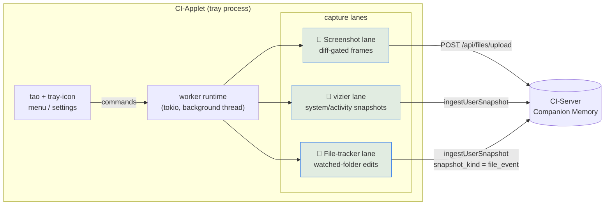
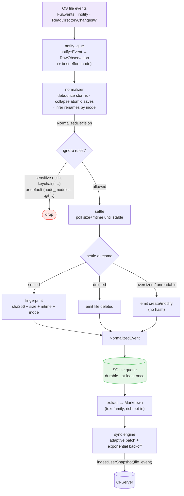
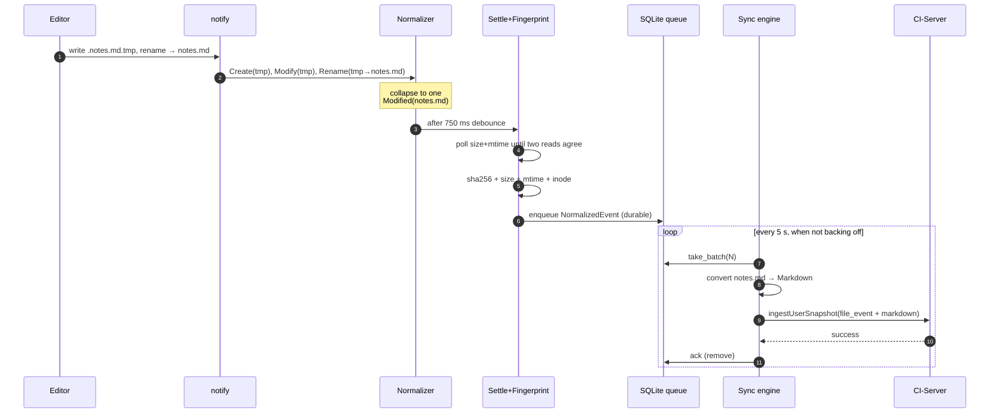
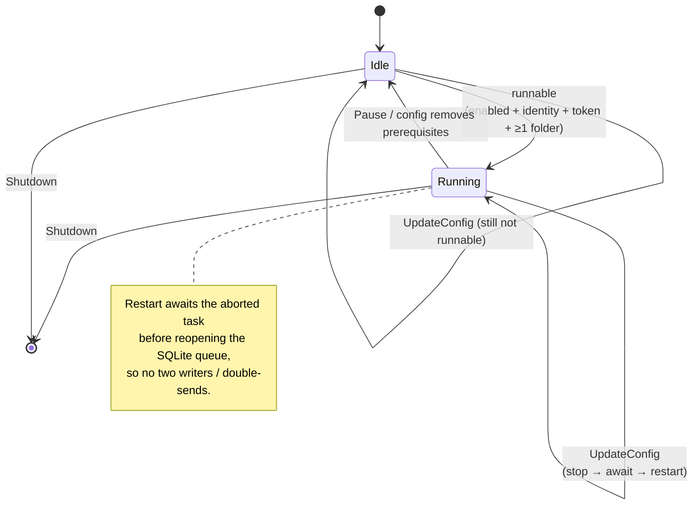
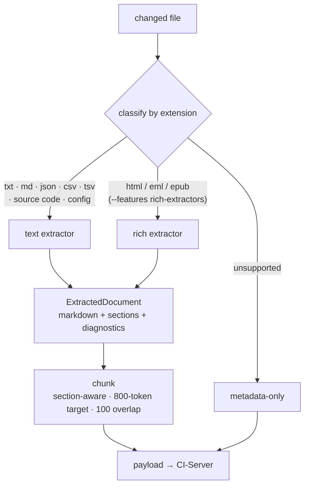
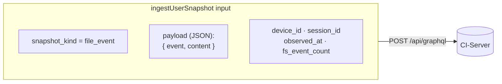

# CI-Applet — Architecture

> **Companion Intelligence — Capture layer.** This document describes how the
> applet is structured today, after the file-tracking lane landed. For the
> rollout plan and design records see [`plan/00-overview.md`](plan/00-overview.md).

CI-Applet is a macOS menu-bar (tray) applet that grows your **Companion
Memory** by perceiving your desktop and streaming it to your CI-Server. It runs
**three capture lanes** on one shared worker runtime, config, identity, and
server connection.

## 1. System context



All three lanes authenticate with the same paired bearer token and target the
same portal origin. Pairing is a GraphQL handshake (`startAppletPairing` →
poll `appletPairingStatus`).

## 2. The file-tracking lane

The third lane is the answer to *"track the important files I edit and let my AI
remember them."* It is a pipeline of small, individually-tested stages.



Module map (`src/`):

| Module | Responsibility |
|--------|----------------|
| `watcher/notify_glue` | Map `notify::EventKind` → `RawObservation`, capture inode |
| `watcher/normalizer` | Debounce, collapse atomic-save sequences, infer renames |
| `watcher/settle` | Wait until a file stops being written before hashing |
| `watcher/fingerprint` | Streamed sha256 + size + mtime + inode |
| `watcher/ignore` | Two-layer rules: defaults + non-disableable sensitive list |
| `watcher/mod` | The driver that wires the above + `start_watcher` |
| `queue/rusqlite_impl` | Durable event queue (WAL SQLite) |
| `sync/batching` | `BatchController`: adaptive batch size + backoff |
| `extractors/*` | File → `ExtractedDocument` (Markdown + sections) |
| `conversion/{chunk,markdown}` | Section-aware chunking + MD assembly helpers |
| `file_tracker` | The lane runtime: owns the queue, drains, extracts, syncs |
| `server_ingest` | `ingest_file_event` → GraphQL ingest |

## 3. A single edit, end to end

An editor saving `notes.md` (atomic save: write temp, rename over target)
collapses to **one** `file.modified` event:



If the network is down, events stay in the durable queue and drain when it
returns. A permanently-rejected ("poison") event is dropped to a dead-letter
log after `MAX_ATTEMPTS` so it can't block the queue forever.

## 4. Lane lifecycle

The file-tracking lane starts, stops, and restarts in lock-step with the worker:



## 5. Conversion: file → memory-ready Markdown



Format coverage today:

| Family | Formats | Status |
|--------|---------|--------|
| Text / code | txt, md, json, csv, tsv, **30+ source/config languages** | ✅ default |
| Web / mail / book | html, eml, epub | ✅ opt-in (`rich-extractors`) |
| Office | docx, pptx, xlsx | ⬜ stub (planned) |
| PDF / image / audio | pdf (+OCR), images (EXIF/OCR), audio (Whisper) | ⬜ stub (planned) |

## 6. Robustness properties

These are the invariants the lane is built to hold (and what the code review
hardened):

- **No false deletes.** An oversized or transiently-unreadable changed file is
  reported as a create/modify *without* a hash — never as a deletion.
- **Durable & at-least-once.** Events persist in SQLite until the server acks;
  a crash or outage loses nothing. Duplicate `event_id`s are idempotent.
- **Bounded resources.** Concurrent settle+hash work is capped by a semaphore;
  the outbound event channel is bounded (overflow logs, never grows unbounded);
  each sync tick has a wall-clock budget so a slow server can't monopolize the
  lane.
- **No poison-event stalls.** A permanently-failing event is dead-lettered
  after `MAX_ATTEMPTS` instead of blocking the FIFO queue.
- **Clean reconfigure.** Restarting the lane awaits the old task's teardown
  before opening a new SQLite connection — no double-writers, no double-sends.

## 7. Server contract

The originally-planned `/history/file-events` REST endpoints do not exist on any
CI-Server branch. The lane therefore rides the **existing** `ingestUserSnapshot`
GraphQL mutation:



`IngestUserSnapshotInput` accepts an arbitrary `payload: JSON!`, so the file
event + converted Markdown ride it with **zero server changes**. The mutation
currently lives on the `CI-Server-wt-applet-pairing` branch; deploy that for
end-to-end ingest. Verify connectivity anytime:

```bash
cargo run -- --check-server                       # configured portal
cargo run -- --check-server --portal http://localhost:8642
```
