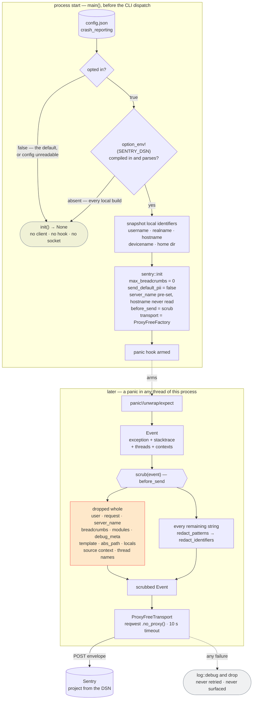

<p align="center"></p>

# Companion Capture — Crash reporting

> **Companion Intelligence — Capture layer.** Opt-in, panic-only crash reports
> to Sentry. This is the one path in the app that sends anything to a machine
> the user does not own, so it is documented in full: what it sends, what it
> refuses to send, how the scrubber works, and where the scrubber's guarantees
> stop. Implementation: [`src/telemetry.rs`](../src/telemetry.rs).

## 1. Why an exception exists, and why it is opt-in

The product claim is narrow and load-bearing: **captured data only reaches
machines the user owns.** Screenshots, file contents, and vizier snapshots go to
the user's CI-Server and nowhere else; every HTTP client in the crate is
`.no_proxy()` so an ambient `HTTPS_PROXY` cannot become a third recipient.

Crash reporting contradicts that claim by construction — it sends process state
to a vendor. The alternative is worse in a different way: a capture app that
panics on a document nobody can reproduce is a bug that is never fixed, because
the only people who can see it are the people whose data caused it. Alpha builds
of a file-watching app fail on the shapes of real filesystems, and real
filesystems are exactly what we cannot ask users to paste into an issue.

So the feature exists, and every part of it is arranged so that the privacy
claim stays **literally true for anyone who does not opt in** — not "true modulo
telemetry", not "true because we promise not to look". Five independent gates:
the first three each stop the path outright, the last two bound what survives
it.

| # | Gate | Where | Consequence when it holds |
|---|------|-------|---------------------------|
| 1 | `crash_reporting` defaults to `false` | [`config.rs`](../src/config.rs) — `#[serde(default)]` on a `bool` | No client, no panic hook, no socket. The default install never contacts Sentry. |
| 2 | Unreadable config fails **closed** | `saved_crash_reporting()` in [`main.rs`](../src/main.rs) | A corrupt or missing `config.json` yields `false`. Corruption can never switch reporting *on*. |
| 3 | The DSN is compile-time | `option_env!("SENTRY_DSN")` | A build without the secret has no endpoint to talk to, whatever the config says. Every local build is such a build. |
| 4 | The SDK is built crash-only | [`Cargo.toml`](../Cargo.toml) — `default-features = false`, features `backtrace`, `contexts`, `panic` | No tracing, no performance, no session tracking, no HTTP integration — they are not compiled in, so they cannot be enabled by configuration drift. |
| 5 | Every event passes `scrub` | `before_send` in [`telemetry.rs`](../src/telemetry.rs) | Nothing reaches the transport without being rewritten first. |

Gates 1–3 are about *whether* anything is sent. Gates 4–5 are about *what*, and
they are the ones that still matter after a user deliberately opts in.

## 2. Panic to Sentry, end to end



Two structural details this diagram encodes:

- **`init` runs before the CLI dispatch.** Each window is a separate process
  (`--settings-ui`, `--upload-ui`), so a panic in the Settings window is only
  reported because `init` ran in *that* process too. The same reason applies to
  `--check-server` and the other scriptable commands.
- **The guard is bound to a named local.** `sentry::ClientInitGuard` flushes and
  *disables* the client on drop, so `let _ = telemetry::init(…)` would switch
  reporting off on the following line. It is held for the process lifetime.

As wired today, `init` reads the opt-in once at startup. Flipping the toggle
takes effect for processes started after the change.

## 3. What is sent, and what is not

Everything in the left column is rewritten by [`scrub`](#4-the-scrubber) before
it leaves the process; nothing in the right column is filtered, because it is
never populated or is discarded whole.

| Sent (scrubbed) | Never sent |
|-----------------|------------|
| Exception type, value, module | `user` — id, email, username, IP |
| Stack frames: `filename`, `function`, `symbol`, `module`, `package` | `abs_path`, `context_line`, `pre`/`post_context`, frame locals (`vars`) |
| Mechanism type (`panic`) — the grouping key | Mechanism `data` (a natural home for a cwd or errno context) |
| Thread stacktraces (`attach_stacktrace = true`) | Thread **names** — this crate names workers after what they work on |
| Message, `logentry` + params, culprit, transaction, logger | `request` — URL, headers, cookies |
| Fingerprint (indexed; it becomes the issue title) | Breadcrumbs — `max_breadcrumbs = 0`, and cleared again in `scrub` |
| Release (`companion-capture@<version>`), `dist`, environment (`dev` / `release`) | `server_name` / hostname — pre-set to `[redacted]` so it is never read |
| Contexts, allow-listed: `os.name`, `os.version`, `runtime.name`, `runtime.version`, `device.arch` | `modules` and `debug_meta` — build paths in both keys and values |
| Tags and `extra` — **keys as well as values** | `device.name`, `device.model`, `os.kernel_version`, and any context type not on the allow-list, including free-form `Other` |
| SDK name and version | SDK `integrations` and `packages`; the deprecated top-level `stacktrace`; `template` |

Contexts are **rebuilt** rather than filtered: `safe_contexts` constructs a fresh
`OsContext`/`RuntimeContext`/`DeviceContext` with only the vetted fields set, so
a future SDK version that starts populating a new field cannot leak by default.
The same reasoning drives dropping `modules`, `debug_meta`, `request`, `user`
and `template` outright instead of scrubbing them — a field with no diagnostic
value is not worth the ongoing risk of filtering it correctly.

**No captured data is on either list**, because no capture payload is on this
path at all: screenshots, extracted Markdown, vizier snapshots, queue rows,
tokens and API keys are never attached to an event. They can only appear if some
code path interpolates them into a panic message — see the limits below.

## 4. The scrubber

`scrub_str` runs two passes over every surviving string, in order.

**Pass 1 — `redact_patterns`** walks the string once and replaces each match with
`[redacted]`, trying the most specific rule first: URL → email → bare IPv6 →
host → path. The rules that matter, and the reasoning that shaped them:

- **A path is redacted to the end of its clause, spaces included.** Stopping at
  the first space is what makes a scrubber leak, because `Application Support`,
  `Screen Shot 2026-…`, `OneDrive - Firstname Lastname` and `My Documents` are
  the *normal* shape of macOS and Windows paths — and everything after that
  first space is the part that names a person or a document. The terminators
  (`:` `,` `;` `)` `}` `"`, real or `\n`-escaped newlines) are chosen so
  anyhow's `": cause"` chains survive. `'` is deliberately **not** a terminator:
  `/Volumes/Liam's Backup/…` is a real volume name.
- **Hosts are matched with or without a scheme.** The failure most worth
  reporting is "server unreachable", and hyper/reqwest name the host
  scheme-lessly in that error's tail — a scheme-anchored rule would redact the
  URL and ship the bare host two words later.
- **A URL keeps its scheme, and its route when the route is ours.** `POST
  https://[redacted]/api/v1/events failed` still says what failed and why it
  mattered.
- **Emails are redacted anywhere.** Identity-provider error bodies used to be
  spliced into this crate's error strings verbatim; `oidc.rs` now keeps only the
  OAuth error code, so that leak is cut off at the source *as well*. The
  scrubber is the second line of defence, not the first.

**Pass 2 — `redact_identifiers`** removes whole-word, case-insensitive
occurrences of this machine's and this user's names — username, real name,
hostname, device name, home directory — plus dotted stems and the individual
words of multi-word names. The set is snapshotted once at `init` (so the panic
path does no syscalls, and so tests exercise the pattern rules on their own
merits rather than on whose machine they run).

This pass exists because patterns are blind to semantics. No rule can know that
`ci-applet-liams-macbook` in a 401 body names a person, or that `user liam not
authorised` does. Values shorter than 3–4 characters and anything on the
`GENERIC_NAMES` list (`admin`, `root`, `macbook`, `capture`, …) are excluded, so
a machine called `admin` does not turn every occurrence of the word "admin" into
`[redacted]`.

### Over-scrubbing is also a failure

A report nobody can act on is worth nothing, so four allow-lists deliberately
keep text that a naive rule would eat: `SAFE_ROUTES` (`/api`, `/v1`, `/graphql`,
`/.well-known`, …), `SAFE_SYSTEM_ROOTS` (`/usr`, `/etc`, `/System`, `/Library`,
… — user-owned roots like `/Users`, `/home`, `/Volumes`, `/tmp` are pointedly
absent), `SAFE_RELATIVE_ROOTS` (this repo's own `src/`, `tests/`, `vizier/`, …)
and `LINE_NUMBERED_EXTENSIONS`. That last one exists because `main.rs:88` and
`mydomain.com:8642` are the same shape — `<word>.<word>:<digits>` — and only the
suffix tells a panic location from a server address.

Each allow-list entry is a deliberate hole in the redaction. They are the reason
`panicked at src/main.rs:88:17`, `/api/v1/events` and `Caused by:` chains
survive intact, and the reason a report is still diagnosable at all.

### Limits — what this is and is not

**The scrubber is a best-effort text rewriter, not a proof.** It is worth being
precise about where it stops:

- **It matches shapes, not meaning.** It redacts things that *look like* paths,
  hosts, URLs, emails and known local names. Sensitive text that looks like
  ordinary prose is not one of those shapes and passes through untouched. The
  concrete worst case: a panic message that interpolates document content — an
  extractor `expect` carrying a slice of the file it was parsing — would ship
  that slice. The defence there is not the scrubber; it is not putting content
  into error strings in the first place.
- **The identifier pass only knows the five names it looked up.** A colleague's
  name, an employer, a project codename, a second user account — none are in the
  snapshot, and none are caught unless they happen to sit inside a path, host or
  email. A user whose username *is* a `GENERIC_NAMES` entry gets no identifier
  matching at all, by design.
- **New leak shapes are not covered until someone adds a rule.** Every rule in
  `redact_patterns` traces back to a real reported string. The corpus test
  (`every_reported_input_survives_the_production_composition`) runs every one of
  those inputs through the exact two-pass composition used in production against
  one broad needle list — which is a strong **regression net**, and still only a
  statement about inputs someone already thought of.
- **The allow-lists are holes on purpose** (above). `/Library/…` without a
  `/Users` prefix is kept, on the theory that a system-level path names software
  rather than a person. That theory is a judgement call, not a guarantee.
- **The transport metadata is outside the event.** `send_default_pii = false`
  means the SDK never asks Sentry to fill in the user's IP, but the ingest
  request still originates from the user's network. Sentry infers a source IP at
  ingest unless the project has **Prevent Storing of IP Addresses** enabled —
  a server-side setting the client cannot enforce. Enable it on the project.
- **Sentry itself is trusted with what does arrive.** The threat model here is
  "a crash report must not carry the user's identity, machine layout or server
  address to a third party", not "the third party is hostile". Server-side data
  scrubbing is worth turning on as defence in depth; nothing above relies on it.

The honest summary: gates 1–4 are structural and hold absolutely; gate 5 is a
filter that is good at the shapes it knows and blind to the ones it does not.
That asymmetry is exactly why the feature is opt-in rather than opt-out.

## 5. The proxy-free transport

The `sentry` dependency is declared with **no transport feature**, and
`telemetry.rs` supplies its own. Two reasons, one of which is a hard build
constraint:

1. **Privacy.** Sentry's bundled transport builds its own `reqwest` client with
   no `.no_proxy()`. An ambient `HTTPS_PROXY` would then be able to see crash
   payloads — the precise defect class that the crate-wide proxy rule exists to
   prevent. `ProxyFreeTransport` reuses the same proxy-free construction as
   every other client in this crate.
2. **It does not build on Windows.** The transport feature pulls a *second*
   `reqwest` (0.13) whose rustls enables the `aws-lc-rs` provider, which fails
   to build on Windows MSVC. This crate pins rustls + **ring** everywhere for
   that reason.

Both are load-bearing, and the second is easy to trip over while "just fixing" a
compile error. The invariant to check after any dependency change:

```bash
cargo tree -i aws-lc-sys   # must report: did not match any packages
```

The transport itself is deliberately dumb: serialize the envelope, `POST` it
with the DSN's auth header, and on any failure — non-2xx or a transport error —
log at `debug` and drop it. No retries, no queue, no user-visible error.
**Crash reporting must never become the reason the app misbehaves.**

## 6. Turning it on

**Settings → Advanced → Crash reporting.** The toggle writes the
`crash_reporting` boolean in `config.json`, which is the actual opt-in; the
in-app copy under the toggle (`settings.crash_reporting.*` in
[`locales/settings.yml`](../locales/settings.yml)) states the same limits this
document does, in the user's language. Path per platform
(`directories::ProjectDirs`, qualifier `com.compint`, application
`Companion Capture`):

| OS | `config.json` |
|----|---------------|
| macOS | `~/Library/Application Support/com.compint.com.compint.Companion-Capture/config.json` |
| Linux | `~/.config/companion-capture/config.json` |
| Windows | `%APPDATA%\com.compint\Companion Capture\config\config.json` |

```json
{ "crash_reporting": true }
```

Setting it has no effect in a build with no DSN compiled in — which includes
every build produced outside the release workflow. That is not a failure mode to
debug; it is gate 3 doing its job.

## 7. Running it locally

`SENTRY_DSN` is **never** set on a developer machine as a matter of course: a
developer's panic must not reach the shared project. To exercise the path
deliberately, bake a DSN into one build with a personal or scratch Sentry
project:

```bash
# Compile-time, so it must be set for the build that produces the binary.
SENTRY_DSN='https://<key>@<org>.ingest.sentry.io/<project>' cargo build --release

# Opt in (edit config.json, or use the Settings toggle), then trigger a panic
# in whichever process you want to test — each window is its own process.
```

Because `option_env!` is evaluated during compilation and this crate has no
`build.rs` emitting `cargo:rerun-if-env-changed`, cargo will **not** rebuild on
its own when the variable changes. Force it:

```bash
touch src/telemetry.rs   # or: cargo clean -p companion-capture
```

The same caveat applies in CI, where it is mostly defused by `Swatinem/rust-cache`
dropping workspace-member artifacts before saving the cache — dependencies are
restored, this crate is recompiled. "Mostly" is the operative word: the honest
way to confirm a release binary actually carries the DSN is to check the
artifact rather than to trust the cache, and the cheapest check is that a test
panic from that build shows up in the project.

The scrubber is testable without any of the above — it is pure string work, and
that is where its coverage lives:

```bash
cargo test telemetry             # 50+ cases, both directions
cargo test --locked              # what the release preflight runs
```

Read the tests as the specification: they pin **both** that a reported input
stops leaking and that `src/main.rs:88:17`, `/api/v1/events`, `and/or` and
`Caused by:` chains are left alone.

## 8. Release wiring

`.github/workflows/release.yml` passes `secrets.SENTRY_DSN` to the **Build
installers** step as an environment variable, alongside `CARGO_BUILD_TARGET`.
It is optional in the same sense as the signing secrets: `SENTRY_CONFIGURED`
reports its presence, a missing secret emits a `::notice::` rather than failing
the job, and the resulting installers simply have crash reporting compiled out.
An empty value expands into the build, fails `Dsn` parsing, and `init` returns
`None` — the same inert outcome as no value at all.

Secret setup, environment scoping, and why no `SENTRY_AUTH_TOKEN` is needed:
[`DESKTOP-RELEASE-SECRETS.md`](DESKTOP-RELEASE-SECRETS.md).

## Related

- [`src/telemetry.rs`](../src/telemetry.rs) — the implementation, and the module
  docs that justify each rule
- [Architecture](architecture.md) — the three capture lanes and the server contract
- [Desktop release secrets](DESKTOP-RELEASE-SECRETS.md) — `SENTRY_DSN` as an optional environment secret
- [Screenpipe comparison](screenpipe-comparison.md) — third-party integrations, and this one exception
