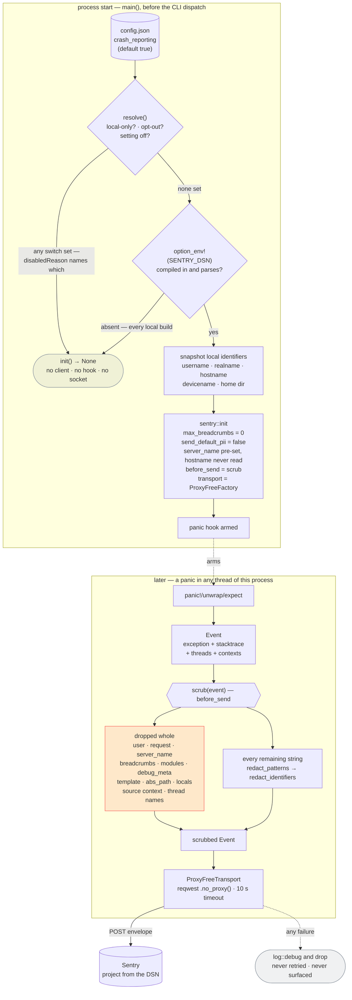

<p align="center"></p>

# Companion Capture — Crash reporting

> **Companion Intelligence — Capture layer.** Panic-only crash reports to
> Sentry, **opt-out**. This is the one path in the app that sends anything to a
> machine the user does not own, so it is documented in full: what it sends,
> what it refuses to send, how to turn it off, how the scrubber works, and where
> the scrubber's guarantees stop. Implementation:
> [`src/telemetry.rs`](../src/telemetry.rs).

## 1. Why an exception exists, and how to switch it off

The product claim is narrow and load-bearing: **captured data only reaches
machines the user owns.** Screenshots, file contents, and vizier snapshots go to
the user's CI-Server and nowhere else; every HTTP client in the crate is
`.no_proxy()` so an ambient `HTTPS_PROXY` cannot become a third recipient.

Crash reporting contradicts that claim by construction — it sends process state
to a vendor. The alternative is worse in a different way: a capture app that
panics on a document nobody can reproduce is a bug that is never fixed, because
the only people who can see it are the people whose data caused it. Alpha builds
of a file-watching app fail on the shapes of real filesystems, and real
filesystems are exactly what we cannot ask users to paste into an issue.

So the feature exists, and it ships **on** wherever a DSN was compiled in —
the fleet posture, decided 2026-08-03 and shared with CI-Server, CI-Hub and the
rest. The honest reading of that decision: a report that ships by default has to
be one that would be safe to ship to a stranger, which is why the rest of this
document is as long as it is.

### Turning it off

Four switches, any one of which is sufficient. The first is the user's, the next
two are the machine operator's, the last is the build's.

| Switch | Where | Reason reported |
|--------|-------|-----------------|
| **Settings → Advanced → Crash reporting** | the `crash_reporting` boolean in `config.json` | `setting-off` |
| `CI_TELEMETRY=off` (also `false`, `0`, `no`, `disabled`) | this process's environment | `opt-out` |
| `CI_LOCAL_ONLY=true` (also `1`, `yes`, `on`, `enabled`) | this process's environment | `local-only` |
| No `SENTRY_DSN` at build time | the release workflow | `no-dsn` |

Precedence is **local-only > opt-out > setting-off > no-dsn**, matching the rest
of the fleet. Only the *named reason* depends on the order — every branch but
the last disables reporting either way — and the reason is what makes "why is
nothing arriving?" answerable. It is logged once at startup at `debug`, and
`telemetry::env_override()` feeds it back into the Settings screen so the toggle
says when an environment switch has overruled it rather than appearing to be in
charge.

**Why both a toggle and environment variables** — the two channels answer to
different people, and neither alone is enough:

- A tray app launched from Finder, Spotlight or a login item does **not** inherit
  a shell's environment on macOS. An environment-only kill switch would be
  unreachable for the person the switch is for. The toggle is the user's channel,
  and it is the one the in-app copy points at.
- `CI_LOCAL_ONLY` is a fleet posture, not a per-app preference. An operator
  running the appliance, an MDM profile, `launchctl setenv`, a container, or one
  of this app's scriptable commands (`--check-server`, `--login`, `--search`)
  must be able to force zero egress without touching a per-user config file, and
  must get the same answer from every CI component. Honouring both spellings
  costs a `std::env::var` at startup.

### The gates, in order

Four independent gates. The first bounds *whether* anything is sent; the rest
bound *what*, and they are the ones that still matter for everyone who leaves
reporting on — which, now, is most people.

| # | Gate | Where | Consequence when it holds |
|---|------|-------|---------------------------|
| 1 | Any of the four switches above | `resolve` in [`telemetry.rs`](../src/telemetry.rs) | No client, no panic hook, no socket. |
| 2 | Only the panic hook is wired | [`Cargo.toml`](../Cargo.toml) — `default-features = false`, features `backtrace`, `contexts`, `panic` | No tracing, no performance, no session tracking, no HTTP integration, and **no `log` integration** — so not one of this crate's several hundred `log::` lines can become an event or a breadcrumb. They are not compiled in, so they cannot be enabled by configuration drift. |
| 3 | Every event passes `scrub` | `before_send` in [`telemetry.rs`](../src/telemetry.rs) | Nothing reaches the transport without being rewritten first. |
| 4 | The transport is proxy-free | `ProxyFreeTransport` | An ambient `HTTPS_PROXY` cannot become a second recipient. |

Two details of gate 1 worth stating plainly:

- **A missing config is not an unreadable one.** A fresh install has no
  `config.json`; `load_or_default` writes one with `crash_reporting: true`, which
  is the opt-out posture doing its job. A config that exists but cannot be read
  or parsed yields `false` — fail-closed, because a file we cannot read may be
  one in which the user switched reporting *off*. The cost is that the crash most
  worth seeing, one caused by a corrupt config, is the one we decline to report;
  that trade is taken knowingly.
- **The DSN is compile-time** (`option_env!("SENTRY_DSN")`), so a build without
  the secret has no endpoint at all, whatever any switch says. Every local build
  is such a build — a developer's panic must not reach the shared project.

## 2. Panic to Sentry, end to end



Two structural details this diagram encodes:

- **`init` runs before the CLI dispatch.** Each window is a separate process
  (`--settings-ui`, `--upload-ui`), so a panic in the Settings window is only
  reported because `init` ran in *that* process too. The same reason applies to
  `--check-server` and the other scriptable commands.
- **The guard is bound to a named local.** `sentry::ClientInitGuard` flushes and
  *disables* the client on drop, so `let _ = telemetry::init(…)` would switch
  reporting off on the following line. It is held for the process lifetime.

As wired today, `init` reads the setting once at startup. Flipping the toggle
takes effect for processes started after the change.

**Nothing else is wired.** The `log` and `tracing` integrations are not compiled
in (gate 2), and `env_logger` is the only logger, so the panic hook is the sole
producer of events. That is worth knowing before reading §6 — it is why the
hundreds of `log::warn!("… {path}")` and `log::error!("… {err:?}")` lines across
the crate are not part of this threat model.

## 3. What is sent, and what is not

Everything in the left column is rewritten by [`scrub`](#4-the-scrubber) before
it leaves the process; nothing in the right column is filtered, because it is
never populated or is discarded whole.

| Sent (scrubbed) | Never sent |
|-----------------|------------|
| Exception type, value, module | `user` — id, email, username, IP |
| Stack frames: `filename`, `function`, `symbol`, `module`, `package` | `abs_path`, `context_line`, `pre`/`post_context`, frame locals (`vars`) |
| Mechanism type (`panic`) — the grouping key | Mechanism `data` (a natural home for a cwd or errno context) |
| Thread stacktraces (`attach_stacktrace = true`) | Thread **names** — this crate names workers after what they work on |
| Message, `logentry` + params, culprit, transaction, logger | `request` — URL, headers, cookies |
| Fingerprint (indexed; it becomes the issue title) | Breadcrumbs — `max_breadcrumbs = 0`, and cleared again in `scrub` |
| Release (`companion-capture@<version>`), `dist`, environment (`dev` / `release`) | `server_name` / hostname — pre-set to `[redacted]` so it is never read |
| Contexts, allow-listed: `os.name`, `os.version`, `runtime.name`, `runtime.version`, `device.arch` | `modules` and `debug_meta` — build paths in both keys and values |
| Tags and `extra` — **keys as well as values**, and the value dropped outright when the *key* is sensitive | `device.name`, `device.model`, `os.kernel_version`, and any context type not on the allow-list, including free-form `Other` |
| SDK name and version | SDK `integrations` and `packages`; the deprecated top-level `stacktrace`; `template` |

Contexts are **rebuilt** rather than filtered: `safe_contexts` constructs a fresh
`OsContext`/`RuntimeContext`/`DeviceContext` with only the vetted fields set, so
a future SDK version that starts populating a new field cannot leak by default.
The same reasoning drives dropping `modules`, `debug_meta`, `request`, `user`
and `template` outright instead of scrubbing them — a field with no diagnostic
value is not worth the ongoing risk of filtering it correctly.

**No captured data is on either list**, because no capture payload is on this
path at all: screenshots, extracted Markdown, vizier snapshots, queue rows,
tokens and API keys are never attached to an event. They can only appear if some
code path interpolates them into a panic message — see the limits below.

## 4. The scrubber

`scrub_str` runs four passes over every surviving string, in order. `scrub_with`
is the single function that composes them, and both it and the corpus test call
it — so a pass added later cannot end up outside the drift guard.

**Pass 1 — `truncate`** caps any single string at 8 KB. Sentry truncates some
fields itself, at sizes that vary by field and SDK version; this makes the bound
ours and uniform. It runs first because the discarded tail cannot leak, every
later rule matches to the end of its own token so a half-cut path is still
redacted, and it bounds the work the panic path does on a pathological message.

**Pass 2 — `redact_quoted_payload`** removes the string the standard library
quotes back at you when a slice goes wrong. See [§4.1](#41-the-capture-specific-leak-and-what-it-cost)
— this is the one rule that exists because of what *this* app is.

**Pass 3 — `redact_patterns`** walks the string once and replaces each match with
`[redacted]`, trying the most specific rule first: labelled credential →
self-identifying token → URL → email → bare IPv6 → host → path. The rules that
matter, and the reasoning that shaped them:

- **A labelled credential keeps its label and loses its value.**
  `api_key=[redacted]` still says what was wrong. The label is tested with the
  same `is_sensitive_key` predicate the map walker uses, so a name that is unsafe
  as a JSON field cannot be safe spelled into a message. `Bearer …` and
  `Basic …` are matched with or without an `Authorization:` in front, since a
  header value gets logged on its own often enough.
- **Self-identifying tokens need no label at all** — `tskey-…` (a working
  credential for someone else's tailnet, and this app lives on one), `eyJ…`
  (every OIDC access, refresh and id token this crate holds), `sk-…`, `ghp_…`,
  `AKIA…`. A 12-character minimum after the prefix is what keeps `sk-1` from
  being mistaken for one.
- **A path is redacted to the end of its clause, spaces included.** Stopping at
  the first space is what makes a scrubber leak, because `Application Support`,
  `Screen Shot 2026-…`, `OneDrive - Firstname Lastname` and `My Documents` are
  the *normal* shape of macOS and Windows paths — and everything after that
  first space is the part that names a person or a document. The terminators
  (`:` `,` `;` `)` `}` `"`, real or `\n`-escaped newlines) are chosen so
  anyhow's `": cause"` chains survive. `'` is deliberately **not** a terminator:
  `/Volumes/Liam's Backup/…` is a real volume name.
- **Hosts are matched with or without a scheme.** The failure most worth
  reporting is "server unreachable", and hyper/reqwest name the host
  scheme-lessly in that error's tail — a scheme-anchored rule would redact the
  URL and ship the bare host two words later.
- **A URL keeps its scheme, and its route when the route is ours.** `POST
  https://[redacted]/api/v1/events failed` still says what failed and why it
  mattered.
- **Emails are redacted anywhere.** Identity-provider error bodies used to be
  spliced into this crate's error strings verbatim; `oidc.rs` now keeps only the
  OAuth error code, so that leak is cut off at the source *as well*. The
  scrubber is the second line of defence, not the first.

**Pass 4 — `redact_identifiers`** removes whole-word, case-insensitive
occurrences of this machine's and this user's names — username, real name,
hostname, device name, home directory — plus dotted stems and the individual
words of multi-word names. The set is snapshotted once at `init` (so the panic
path does no syscalls, and so tests exercise the pattern rules on their own
merits rather than on whose machine they run).

This pass exists because patterns are blind to semantics. No rule can know that
`ci-applet-liams-macbook` in a 401 body names a person, or that `user liam not
authorised` does. Values shorter than 3–4 characters and anything on the
`GENERIC_NAMES` list (`admin`, `root`, `macbook`, `capture`, …) are excluded, so
a machine called `admin` does not turn every occurrence of the word "admin" into
`[redacted]`.

### Keys, not just values

Structured containers get a rule the free-text passes cannot provide. A bare
token matches no pattern — that is the point of a token — and no value pattern
can recognise a username, because a username is just a word. So `is_sensitive_key`
decides by **name**: `token`, `secret`, `password`, `passphrase`, `credential`,
`authorization`, `cookie`, `session`, `signature`, `privatekey`, `bearer`, `dsn`,
`email`, `username`, `forwarded`, anything starting `remote-`, and any key whose
last separated segment is `user` or `owner`. The value is replaced outright
rather than filtered.

Two details that were leaks elsewhere in the fleet:

- Matching is done on the key with `-`, `_`, `.` and spaces removed, so one
  entry covers `x-api-key`, `api_key` and `API Key` — the reason the fleet
  contract specifies `api[-_ ]?key` rather than `apikey|api_key`.
- The identity keys are **anchored on the last segment**, so `user-agent`,
  `user_id` and `owner_id` survive as the diagnostics they are, while `user`,
  `x-user` and `repo_owner` do not.

The whole object is handed to the walker, never one value at a time — scrubbing
values individually is what skips the key check and ships a bare `data.token`.
The walk is depth-guarded at 32; a JSON tree cannot be cyclic, but it can be deep
enough to overflow a stack, and a panic handler that panics is worse than a lost
field.

### 4.1 The capture-specific leak, and what it cost

This app watches the user's screen and their files, so the interesting question
is not "can a path leak" — paths are what pass 3 is for — but **can document
content leak**. An audit of every `unwrap`/`expect`/`panic!` in non-test code
(including the `vizier` crate) and of every place capture data becomes a string
found:

- **No explicit panic anywhere carries user content**, in its message or in a
  receiver whose error carries it. That is a clean result and it is load-bearing.
- **Window titles and app names** (`vizier`, `kCGWindowName`) reach
  `VizierEventRecord.focus_title` and are serialised to CI-Server as data. They
  are never formatted into an error, a log line or a panic — so they cannot reach
  a report. There is no accessibility-tree read and no browser-URL extraction at
  all.
- **OCR and vision text** (`ocr_text`, `activity_summary`, `ui_elements`) is
  never interpolated into a string; it is bound as SQL parameters on the
  `legacy-postgres` path and sent as JSON otherwise. There is no local OCR — the
  extractor is a stub.
- **Audio does not exist.** `extractors/audio.rs` is a five-line stub, there is
  no `cpal`, no transcription, and `transcription_used: false` is a literal at
  every construction site. Nothing to leak.
- **Device names** — display enumeration carries no names (`DisplayInfo` is
  numeric), and there is no audio or camera enumeration. `device_name` in this
  crate means the *Companion Memory appliance*, and reaches only a UI label.
- **Response bodies** from the local vision endpoint (`analysis.rs`) and from
  CI-Server (`server_ingest.rs`) *do* get spliced into error strings, and the
  ingest request contains up to 4 KB of extracted document Markdown. Those errors
  reach `log::` and the SQLite dead-letter table — **not** Sentry, because no log
  integration is compiled in (gate 2). They are a local-storage question, not a
  telemetry one.

That leaves exactly one live vector, and it is the reason pass 2 exists:

> **Rust's own slicing panics quote the string that failed.** Extraction runs
> `html2md`, `mail-parser` and `epub` over the user's real documents inside
> `spawn_blocking`. `file_tracker.rs` catches the resulting `JoinError` — but the
> panic hook has already fired by then, and the panic message is
> ``byte index 12 is not a char boundary; it is inside 'ñ' (bytes 11..13) of `<the document>` ``.
> Document prose matches no pattern rule.

`oidc.rs` documents this exact bug class having already happened once, when a
`&b[..300]` on a non-ASCII response body turned the whole body into a panic
payload. So the payload is removed by its **frame** rather than by its content:
std's own wording (`is not a char boundary; it is inside `, `is out of bounds of `,
`when slicing `) is the marker, and everything from the following backtick to the
end of the message goes. The index, the offending character and the byte range —
the whole diagnosis — stay.

Two things this does *not* fix, stated so nobody assumes otherwise: an extractor
that deliberately interpolated content into an error would still ship it (none
do), and a third-party crate that panics with its own bespoke message quoting the
input would not match the markers. The defence there is not the scrubber; it is
not putting content into error strings, and the 8 KB cap bounding what a miss
costs.

### Over-scrubbing is also a failure

A report nobody can act on is worth nothing, so four allow-lists deliberately
keep text that a naive rule would eat: `SAFE_ROUTES` (`/api`, `/v1`, `/graphql`,
`/.well-known`, …), `SAFE_SYSTEM_ROOTS` (`/usr`, `/etc`, `/System`, `/Library`,
… — user-owned roots like `/Users`, `/home`, `/Volumes`, `/tmp` are pointedly
absent), `SAFE_RELATIVE_ROOTS` (this repo's own `src/`, `tests/`, `vizier/`, …)
and `LINE_NUMBERED_EXTENSIONS`. That last one exists because `main.rs:88` and
`mydomain.com:8642` are the same shape — `<word>.<word>:<digits>` — and only the
suffix tells a panic location from a server address.

Each allow-list entry is a deliberate hole in the redaction. They are the reason
`panicked at src/main.rs:88:17`, `/api/v1/events` and `Caused by:` chains
survive intact, and the reason a report is still diagnosable at all.

### Limits — what this is and is not

**The scrubber is a best-effort text rewriter, not a proof.** It is worth being
precise about where it stops:

- **It matches shapes, not meaning.** It redacts things that *look like* paths,
  hosts, URLs, emails, credentials and known local names, plus values under keys
  that name a secret. Sensitive text that looks like ordinary prose is none of
  those and passes through untouched. The concrete worst case is
  [§4.1](#41-the-capture-specific-leak-and-what-it-cost): document content in a
  panic message. The known frame for that is handled; a novel one would not be.
- **The identifier pass only knows the five names it looked up.** A colleague's
  name, an employer, a project codename, a second user account — none are in the
  snapshot, and none are caught unless they happen to sit inside a path, host or
  email. A user whose username *is* a `GENERIC_NAMES` entry gets no identifier
  matching at all, by design.
- **New leak shapes are not covered until someone adds a rule.** Every rule in
  `redact_patterns` traces back to a real reported string. The corpus test
  (`every_reported_input_survives_the_production_composition`) runs every one of
  those inputs through `scrub_with` — the *same* function production calls, so a
  pass added later is inside the guard by construction — against one broad needle
  list. That is a strong **regression net**, and still only a statement about
  inputs someone already thought of.
- **The allow-lists are holes on purpose** (above). `/Library/…` without a
  `/Users` prefix is kept, on the theory that a system-level path names software
  rather than a person. That theory is a judgement call, not a guarantee.
- **The transport metadata is outside the event.** `send_default_pii = false`
  means the SDK never asks Sentry to fill in the user's IP, but the ingest
  request still originates from the user's network. Sentry infers a source IP at
  ingest unless the project has **Prevent Storing of IP Addresses** enabled —
  a server-side setting the client cannot enforce. Enable it on the project.
- **Sentry itself is trusted with what does arrive.** The threat model here is
  "a crash report must not carry the user's identity, machine layout or server
  address to a third party", not "the third party is hostile". Server-side data
  scrubbing is worth turning on as defence in depth; nothing above relies on it.

The honest summary: gates 1, 2 and 4 are structural and hold absolutely; gate 3
is a filter that is good at the shapes it knows and blind to the ones it does
not. Under opt-in, that asymmetry was carried by the user's decision to switch
the feature on. Under opt-out it is carried by us — which is the argument for
keeping the switches trivially reachable, the copy under the toggle honest about
"careful rather than certain", and this section unflattering.

## 5. The proxy-free transport

The `sentry` dependency is declared with **no transport feature**, and
`telemetry.rs` supplies its own. Two reasons, one of which is a hard build
constraint:

1. **Privacy.** Sentry's bundled transport builds its own `reqwest` client with
   no `.no_proxy()`. An ambient `HTTPS_PROXY` would then be able to see crash
   payloads — the precise defect class that the crate-wide proxy rule exists to
   prevent. `ProxyFreeTransport` reuses the same proxy-free construction as
   every other client in this crate.
2. **It does not build on Windows.** The transport feature pulls a *second*
   `reqwest` (0.13) whose rustls enables the `aws-lc-rs` provider, which fails
   to build on Windows MSVC. This crate pins rustls + **ring** everywhere for
   that reason.

Both are load-bearing, and the second is easy to trip over while "just fixing" a
compile error. The invariant to check after any dependency change:

```bash
cargo tree -i aws-lc-sys   # must report: did not match any packages
```

The transport itself is deliberately dumb: serialize the envelope, `POST` it
with the DSN's auth header, and on any failure — non-2xx or a transport error —
log at `debug` and drop it. No retries, no queue, no user-visible error.
**Crash reporting must never become the reason the app misbehaves.**

## 6. Turning it off

**Settings → Advanced → Crash reporting**, which writes the `crash_reporting`
boolean in `config.json`. The in-app copy under the toggle
(`settings.crash_reporting.*` in [`locales/settings.yml`](../locales/settings.yml))
states the same limits this document does, in the user's language, and names the
environment variable when one has overruled the toggle. Config path per platform
(`directories::ProjectDirs`, qualifier `com.compint`, application
`Companion Capture`):

| OS | `config.json` |
|----|---------------|
| macOS | `~/Library/Application Support/com.compint.com.compint.Companion-Capture/config.json` |
| Linux | `~/.config/companion-capture/config.json` |
| Windows | `%APPDATA%\com.compint\Companion Capture\config\config.json` |

```json
{ "crash_reporting": false }
```

Or from the environment, which outranks the toggle and applies to whichever
process inherits it:

```bash
CI_TELEMETRY=off  companion-capture      # this app only
CI_LOCAL_ONLY=true companion-capture     # fleet-wide: no egress at all
```

On macOS a GUI launch inherits nothing from a login shell, so for a tray app
started from Finder or a login item the environment route needs
`launchctl setenv` (or an MDM profile) — which is precisely why the toggle
exists and is the channel the in-app copy points at. The environment route is
for operators, containers and this app's scriptable commands.

Turning it *on* is not a thing you have to do; it is on. The one case where none
of this matters is a build with no DSN compiled in — which includes every build
produced outside the release workflow. That is not a failure mode to debug; it is
the last gate doing its job.

## 7. Running it locally

`SENTRY_DSN` is **never** set on a developer machine as a matter of course: a
developer's panic must not reach the shared project. To exercise the path
deliberately, bake a DSN into one build with a personal or scratch Sentry
project:

```bash
# Compile-time, so it must be set for the build that produces the binary.
SENTRY_DSN='https://<key>@<org>.ingest.sentry.io/<project>' cargo build --release

# Nothing to switch on — it is already on. Trigger a panic in whichever process
# you want to test; each window is its own process.
#
# The other three gate conditions, from the same binary:
CI_TELEMETRY=off   ./target/release/companion-capture   # reason: opt-out
CI_LOCAL_ONLY=true ./target/release/companion-capture   # reason: local-only
RUST_LOG=debug     ./target/release/companion-capture   # prints the reason
```

Because `option_env!` is evaluated during compilation and this crate has no
`build.rs` emitting `cargo:rerun-if-env-changed`, cargo will **not** rebuild on
its own when the variable changes. Force it:

```bash
touch src/telemetry.rs   # or: cargo clean -p companion-capture
```

The same caveat applies in CI, where it is mostly defused by `Swatinem/rust-cache`
dropping workspace-member artifacts before saving the cache — dependencies are
restored, this crate is recompiled. "Mostly" is the operative word: the honest
way to confirm a release binary actually carries the DSN is to check the
artifact rather than to trust the cache, and the cheapest check is that a test
panic from that build shows up in the project.

The scrubber is testable without any of the above — it is pure string work, and
that is where its coverage lives:

```bash
cargo test telemetry             # 70+ cases, both directions, gate included
cargo test --locked              # what the release preflight runs
```

Read the tests as the specification: they pin **both** that a reported input
stops leaking and that `src/main.rs:88:17`, `/api/v1/events`, `and/or` and
`Caused by:` chains are left alone.

## 8. Release wiring

`.github/workflows/release.yml` passes `secrets.SENTRY_DSN` to the **Build
installers** step as an environment variable, alongside `CARGO_BUILD_TARGET`.
It is optional in the same sense as the signing secrets: `SENTRY_CONFIGURED`
reports its presence, a missing secret emits a `::notice::` rather than failing
the job, and the resulting installers simply have crash reporting compiled out.
An empty value expands into the build, is treated as "no DSN" by `resolve`, and
`init` returns `None` — the same inert outcome as no value at all.

Note what the workflow does **not** do: it sets no `CI_TELEMETRY` or
`CI_LOCAL_ONLY`. Those are read from the *end user's* process environment at
launch, not baked in, so there is nothing about them to configure at build time.

Secret setup, environment scoping, and why no `SENTRY_AUTH_TOKEN` is needed:
[`DESKTOP-RELEASE-SECRETS.md`](DESKTOP-RELEASE-SECRETS.md).

## Related

- [`src/telemetry.rs`](../src/telemetry.rs) — the implementation, and the module
  docs that justify each rule
- [Architecture](architecture.md) — the three capture lanes and the server contract
- [Desktop release secrets](DESKTOP-RELEASE-SECRETS.md) — `SENTRY_DSN` as an optional environment secret
- [Screenpipe comparison](screenpipe-comparison.md) — third-party integrations, and this one exception
