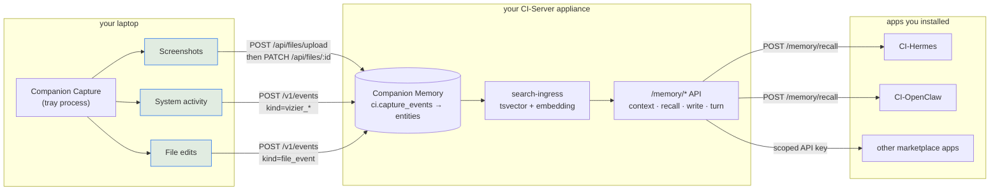
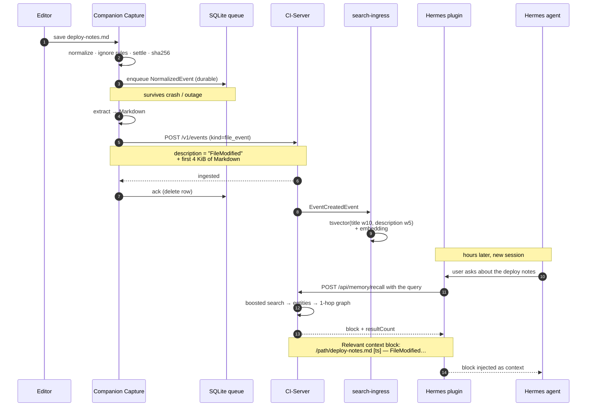

<p align="center"></p>

# Companion Capture → Companion Memory → your agents

> **Companion Intelligence — Capture layer.** This document describes how what
> Companion Capture perceives becomes something a chat agent can answer with.
> For how the applet itself is built see [`architecture.md`](architecture.md);
> for the rollout plan see [`plan/00-overview.md`](plan/00-overview.md).

Companion Capture writes; it never reads back. Everything it captures is
consumed by *other* apps — today CI-Hermes and CI-OpenClaw — through CI-Server's
**Companion Memory** API. The applet has no search index, no timeline, no local
API, and no plugin model of its own; `--search` merely opens CI-Server's
`/memory` web page in a browser
([`src/main.rs:704`](../src/main.rs), [`src/server_common.rs:179`](../src/server_common.rs)).

That split is the point. Capture and recall are separate processes with
separate credentials, and the only thing joining them is a CI-Server the user
owns. This document is mostly about the seam: what actually crosses it, and —
more usefully — what does not.

## 1. System context



Two facts about this picture are worth stating before anything else.

**The applet and the agents never talk.** They share exactly one thing: a
CI-Server origin. The applet authenticates with an OIDC `id_token` (or a pasted
CI-Server API key) held in `server.applet_auth_token`
([`src/server_common.rs:283-288`](../src/server_common.rs) —
64 lowercase hex → `x-api-key`, anything else → `Authorization: Bearer`). The
agents authenticate with their own scoped API keys, held in their own
containers. Neither can read the other's credential, and there is nothing for
an agent to connect *to*: the applet is an HTTP client only, and its sole
listening socket outside tests is the ephemeral loopback callback the OIDC
flow binds on port 0 ([`src/oidc.rs:250-256`](../src/oidc.rs)).

**Portal vs Memory credentials.** Portal sign-in yields an opaque
`access_token` (for `GET /api/users/me/apps` discovery) and an `id_token` with
`aud=ci-applet` (for Memory ingest). Do not swap them. Memory must have
`PORTAL_OIDC_ENABLED` and an audience list that includes `ci-applet`. Public
Memory hostnames also need Hub Traefik to accept that Portal Bearer; otherwise
Capture only sees a Hub login HTML page. Many Capture installs may choose the
same Memory (`bound_device_slug`); each registers its own CI-Server `device_id`.

**The `/api` prefix in every agent-side path is a proxy convention, not a
server mount.** CI-Server never calls `setGlobalPrefix`
(`CI-Server/docs/api/rest.md:11`), so
`MemoryController` is mounted at the literal path `memory`
(`CI-Server/backend/apps/api/src/domains/agent/controllers/MemoryController.ts:47`).
Both agent plugins hardcode `/api/memory/*`, which resolves because the
`ci/gateway` nginx published on host port `8642` rewrites `^/api/(.*)$ → /$1`
(`CI-Server/infrastructure/gateway/nginx.conf:69,120,128`).
That gateway URL — `http://host.docker.internal:8642` — is exactly what the
Hermes setup wizard tells the user to type
(`CI-Hermes/README.md:68-82`).

## 2. One file edit, end to end

The path a real question travels. A user edits `deploy-notes.md` in a watched
folder, and hours later asks a Hermes agent about it.



The load-bearing step is the `POST /v1/events`. `ingest_file_event` duplicates the extracted
Markdown into the **top-level `description` field**, capped at 4 KiB on a UTF-8
boundary ([`src/server_ingest.rs:267-295`](../src/server_ingest.rs)). It does
that because CI-Server's indexer reads only top-level fields —
`EventSearchIndexListener.getSearchEvent` weights `title` at 10 and
`description` at 5 and never touches `payload`
(`CI-Server/backend/apps/api/src/domains/search-ingress/listeners/EventSearchIndexListener.ts:141-180`).
Content that rides only in `payload` is stored and durable, but invisible to
recall. The applet's own source comment says it plainly: carrying the content in
`description` "is what makes the file *body* retrievable by the companion, not
just the fact that a path changed."

Note the asymmetry in what comes back. The full 4 KiB is **matchable** — it is embedded
and tsvectored — but what comes back is a lossy one-line serialization:
`SerializerService.serializeEvent` renders `"<title> [<startTime>] — <description
sliced to 120 chars>"`
(`CI-Server/backend/apps/api/src/domains/agent/services/SerializerService.ts:117-127`).
Neither plugin has a follow-up "fetch the whole event" call. So the file body
drives retrieval far better than it drives generation.

## 3. What each lane makes askable

| Lane | What it records | Endpoint (applet side) | What an agent can then ask |
|------|-----------------|------------------------|----------------------------|
| **File edits** | Absolute path, event type, sha256/size/mtime/inode, and up to 4 KiB of extracted Markdown in `description`; the same Markdown in `payload`, itself capped at `max_content_bytes` (256 KiB by default, [`src/config.rs:180,191`](../src/config.rs)) | `POST /v1/events`, fallback `/api/v1/events`, `kind=file_event` ([`src/server_ingest.rs:216-260`](../src/server_ingest.rs)) | Content questions. "What did I write in the deploy notes?" matches on the file's actual text, and the recall line returns the path plus the first 120 chars |
| **Screenshots** | The PNG (to object storage) plus a vision-model `title` and `description` written by a separate `PATCH` | `POST /api/files/upload`, fallback `/files/upload`; then `PATCH /api/files/{id}` ([`src/server_ingest.rs:132-195`, `:454`](../src/server_ingest.rs)) | Text-about-the-image questions only. "Was I in Figma this afternoon?" The image itself is never retrievable — `FilesController` has no download or thumbnail route, only `upload` and `PATCH :id` (`CI-Server/docs/api/rest.md:17`) |
| **System activity (vizier)** | `title` = focus window title, `description` = focus app. Everything substantive — the full `Observation` on a session's first event, a diff envelope on every later one ([`src/worker.rs:626-641`](../src/worker.rs)), plus `cwd`, `fs_event_count`, `monotonic_ms`, session/device ids — goes into `payload` | `POST /v1/events`, fallback `/api/v1/events`, `kind=vizier_snapshot` / `vizier_patch` ([`src/server_ingest.rs:297-343`](../src/server_ingest.rs)) | Presence questions, and only those. "Was Slack open yesterday?" The snapshot contents are unreachable, because the indexer never reads `payload` |

The screenshot row has a failure mode worth knowing. When local vision analysis
is configured, the applet uploads the PNG and *then* PATCHes title/description
as a second call. If that PATCH fails the local PNG is deliberately kept for the
sweep to retry, because the alternative — the worker's own words — is a
"recall-invisible frame with no local copy to retry from"
([`src/worker.rs:349-373`](../src/worker.rs)). A screenshot with no description
is effectively invisible to an agent.

The vizier row is the one most likely to be over-claimed. It is also the only
lane with no durable retry — the file lane has a SQLite queue, and the
screenshot lane keeps the PNG on disk for the store sweep, but an unacked vizier
send is simply lost ([`src/server_ingest.rs:340-342`](../src/server_ingest.rs)).
Rather than desync, the worker drops the baseline and mints a new session id, so
the next tick sends a full snapshot instead of a patch against state the server
never held ([`src/worker.rs:677-694`](../src/worker.rs)).

## 4. CI-Hermes

Hermes reaches Companion Memory two ways, which is unusual and worth separating.

### 4.1 The `companionintelligence` memory provider (primary)

A Python `MemoryProvider` subclass bundled at
`ci-context/plugins/companionintelligence/`, copied into
`$HERMES_HOME/plugins/companionintelligence/` at container start by
`CI-Hermes/configure-ci-server.py:105-124`. Transport
is stdlib `urllib` only — no dependencies — and every request carries
`x-api-key: <CI_SERVER_TOKEN>`
(`CI-Hermes/ci-context/plugins/companionintelligence/__init__.py:208,226`).
The base URL comes from `CI_SERVER_URL` or the plugin's `config.json`, and is
normalized by stripping a trailing `/api/mcp` so an old MCP-shaped value still
resolves (`__init__.py:106-111`).

| Hermes lifecycle hook | CI-Server call | When |
|-----------------------|----------------|------|
| `system_prompt_block` (`:460`) | `GET /api/memory/context` (`:126`) | Once per session |
| `queue_prefetch` / `prefetch` (`:499`, `:524`) | `POST /api/memory/recall` (`:130`) | Background thread on each user message; waited on ≤5 s |
| `sync_turn` / `on_session_end` (`:540`, `:570`) | `POST /api/memory/turn` (`:137`) | After each exchange and at session end, `platform="hermes"` |
| `on_pre_compress` (`:594`) | `POST /api/memory/turn` | Flushes messages about to be dropped |
| `on_memory_write` (`:622`) | `POST /api/memory/write`, falling back to `/api/memory/note` on 404 (`:146-160`) | Mirrors Hermes' own MEMORY.md/USER.md writes |

Every one is independently switchable via env flags that default on:
`CI_MEMORY_CONTEXT_ENABLED`, `CI_MEMORY_RECALL_ENABLED`,
`CI_MEMORY_TURN_ENABLED`, `CI_MEMORY_WRITE_ENABLED`, `CI_INTENTS_ENABLED`,
`CI_INTENT_TOOLS_ENABLED`.

The provider never sees an entity row or a byte of a file — `_extract_block`
pulls a single markdown string out of the response and hands it to the model.

### 4.2 The `ci_server` MCP registration (second, separate door)

`configure-ci-server.py` also writes an `mcp_servers.ci_server` block into
Hermes' `config.yaml` whenever `CI_SERVER_URL` and `CI_SERVER_TOKEN` are both
present and `CI_SERVER_ENABLED != "false"`
(`CI-Hermes/configure-ci-server.py:39,173-190`):

```yaml
mcp_servers:
  ci_server:
    url: "<CI_SERVER_URL>/api/mcp"
    headers:
      x-api-key: "<CI_SERVER_TOKEN>"
    timeout: 180
    connect_timeout: 60
```

It reconciles URL and key on every run rather than skipping when the block
exists — and rewrites only those two credential-bearing lines, leaving timeouts
and indentation untouched (`:234-264`) — so a changed install-dialog credential
does not leave stale creds behind. This reaches CI-Server's `McpController`,
which the gateway serves through a dedicated SSE-friendly
`location ~ ^/api/mcp(/?)$` block
(`CI-Server/infrastructure/gateway/nginx.conf:97`). It is a
genuinely different route to the same data — one that does not pass through
`/memory/recall` at all. **OpenClaw has no equivalent**; its only MCP server is
the Hub.

### 4.3 A caveat on `hermes memory setup`

The wizard's connection test is `GET <url>/api/health` with the entered key in
an `x-api-key` header, and it treats HTTP 200 as proof the credentials work
(`CI-Hermes/…/companionintelligence/__init__.py:356-389`).
But `GET /health` is one of only two unauthenticated routes on CI-Server
(`CI-Server/docs/api/rest.md:42`). A
mistyped key still prints `✓ Connected successfully` and gets persisted; the
symptom surfaces later as silently empty recall blocks, because the provider
swallows errors at every call site. A check against `GET /api/memory/context`
would actually exercise `ApiKeyGuard` and the `memory` scope.

## 5. CI-OpenClaw

Same wire contract, different shape at the model boundary. The plugin is an ES
module bundled at `/app/openclaw-context/plugins/companionintelligence`
declaring `kind: "memory"`
(`CI-OpenClaw/openclaw-context/plugins/companionintelligence/index.js:801`),
using `fetch` with the same `x-api-key` header (`:282`), the same
`normalizeBaseUrl` that strips a trailing `/api/mcp` (`:239`), and the same six
feature flags with the same names and defaults (`:225-228`).

| OpenClaw surface | CI-Server call | Shape delivered to the model |
|------------------|----------------|------------------------------|
| `memory_search` tool (`:571`) | `POST /api/memory/recall` (`:444`) | `buildSearchResults` (`:334`) chops the markdown block into up to N pseudo-file hits with synthetic paths `ci-server://recall#1`, `#2`, … each carrying `startLine`/`endLine`/`score`/`snippet`/`citation`. The agent sees search results, not prose |
| `memory_get` tool (`:601`) | `GET /api/memory/context` (`:440`) | Only for `ci-server://profile` and its bare aliases `profile` / `context` (`:618`); any other path returns a structured "recall-backed, not file-backed" error (`:626`) |
| `memory_store` tool (`:769`) | `POST /api/memory/write`, `/api/memory/note` on 404 (`:458-467`) | Durable note |
| `agent:bootstrap` hook (`:874`) | `GET /api/memory/context` | Injects the live profile block straight into `AGENTS.md` under a `<!-- ci-memory:user-context -->` marker (`:29,187`), so small local models get it without a tool round-trip. Opt out with `injectUserContext: false` |
| `agent_end` (`:896`) / `before_compaction` (`:908`) | `POST /api/memory/turn`, `platform: "openclaw"` (`:470-479`) | Fire-and-forget |
| `before_tool_call` (`:882`) | — | Blocks any tool touching `USER.md`, `MEMORY.md`, `memory/*.md` or OpenClaw's memory SQLite, forcing writes through `memory_store` |

Activation is handled by
`CI-OpenClaw/bootstrap-ci-memory.sh`, which
carries no data — it only decides whether the plugin is live. When
`CI_SERVER_URL` + `CI_SERVER_TOKEN` are set and `CI_SERVER_ENABLED != "false"`
(`:35-39`) it adds the plugin path to `plugins.load.paths` (`:78-82`), claims
`plugins.slots.memory`, sets `hooks.allowConversationAccess: true` — without
which OpenClaw never delivers the `agent_end` conversation hook to a
path-loaded plugin, silently killing turn-sync (`:113-120`) — disables the
bundled `session-memory` hook so two memory runtimes never run (`:143-153`), and
pushes `memory_store` into `tools.alsoAllow`, since OpenClaw's `group:memory`
profile grants reads but not writes (`:155-169`). It will not steal an explicit
user choice: it claims the memory slot only when the current slot is unset,
empty, `memory-core`, or already itself (`:95-98`). Credentials are never
written into `openclaw.json`.

`config-reconcile.cjs` in the setup server mirrors the same wiring and reads
`process.env` for the same three variables, so a Hub-injected
`CI_SERVER_ENABLED=false` wins over a stale `/data/.openclaw/.env`.

## 6. Auth: one scope tier for both

Both agents authenticate with an API key in `x-api-key`; neither uses JWT or
OIDC for the memory path. Two provisioning routes exist:

| Route | How | Scopes |
|-------|-----|--------|
| Hub-brokered connect | `ConnectService.scopesForApp` keys on the app URN | `ci-hermes` and `ci-openclaw` both get exactly `['memory','intents','mcp']` (`CI-Server/…/domains/auth/services/ConnectService.ts:31-50`) |
| Hand-made key | Companion Memory → Settings → API Keys → `+` (`CI-Hermes/README.md:38`) | An empty `scopes` array is grandfathered as full access |

The connect tier is deliberately confined off the raw data plane — no GraphQL,
no `/files`, no `/v1` bulk ingest, no `/maintenance`. The comment in
`ConnectService` says the confinement "is the whole point of scoping these
apps."

The consequence for Companion Capture is clean and worth writing down: **a
connect-minted agent key can read what Companion Capture wrote, through
`/memory/recall` (and, for Hermes, `/mcp`) — and cannot write, overwrite, or
delete any of it.** The applet's own credential and the agents' credentials
have disjoint reach.

## 7. What agents cannot see

The privacy claim is "your data only reaches your own machines," so the boundary
deserves to be precise rather than reassuring. Six things do not cross it.

**Screenshot images.** The vision-model title and description are indexed; the
PNG is not reachable. `FilesController` exposes only `POST upload` and `PATCH
:id` — there is no download or thumbnail route, and file bytes are served as
presigned MinIO URLs through a separate `/static/*` path
(`CI-Server/docs/api/rest.md:17`). Neither
plugin has any concept of fetching one.

**Vizier snapshot contents.** Window lists, cursor position, display geometry,
terminal `cwd`, network connections, filesystem deltas — all of it lives in the
event `payload`, and `EventSearchIndexListener` never reads `payload`. It reads
top-level fields plus a curated `metadata` allowlist (`Subject`, `Text`,
`Track`, `Artist`, `Album`, `Product`, `Sender`, `Book`, `Author`, `Title`,
`Name`, `Notes`, `Make`, `Model`, `Lens`, `LensModel`, `Camera`, `aliases`)
built for CI-Import-Tools' photo/message importers, none of which the applet
populates
(`CI-Server/…/search-ingress/listeners/EventSearchIndexListener.ts:182-270`).
An agent gets the window title and the app name. Nothing else.

**Anything under the sensitive-path denylist.** The file lane and the vizier
lane both filter against `SENSITIVE_PATTERNS` — `.ssh`, macOS Keychains,
`.aws/credentials`, `.aws/config`, `.gnupg`, `.config/gcloud`, `.kube/config`,
`.netrc`, `.pgpass`, `.env*`, `*.pem`, `*.key`, `*.p12`, `*.pfx`, `*.jks`,
`*.keystore`, `id_rsa*` / `id_dsa*` / `id_ecdsa*` / `id_ed25519*`, and the
`*.1pif` / `*.kdbx` / `*.agilekeychain` password vaults
([`src/watcher/ignore.rs:56-87`](../src/watcher/ignore.rs)) — **before** any file
is hashed ([`src/watcher/mod.rs:162,224`](../src/watcher/mod.rs), which gate
`settle_and_fingerprint`) and before any vizier payload or baseline is built
([`src/worker.rs:608-618`](../src/worker.rs)). The list is not
user-disableable. Files no one added to a watched folder are never seen at all:
`is_runnable` requires a non-empty `watched_paths`, which defaults to empty
([`src/file_tracker.rs:60-64`](../src/file_tracker.rs)).

**Anything captured while the macOS screensaver is running.** `is_capture_blocked`
shells out to `pgrep -x ScreenSaverEngine`, and is compiled to a constant `false`
on every other platform ([`src/worker.rs:860-879`](../src/worker.rs)). When it
fires, `capture_once` sets `capture_blocked` and returns before any screenshot is
taken ([`src/worker.rs:722-734`](../src/worker.rs)), and that same flag gates the
vizier lane for the tick ([`src/worker.rs:156-161`](../src/worker.rs)). Note the
limits of the guarantee: it is keyed on the screensaver process, not on session
lock generally, and Linux and Windows have no equivalent suppression at all.

**The L0 context block contains zero capture data.** This is the block that
lands in *every* session unconditionally — Hermes puts it in
`system_prompt_block`, OpenClaw injects it into `AGENTS.md` at bootstrap.
`MemoryController.context` composes exactly two things:
`UserContextService.formatContextForSystemPrompt` (the user's own entity, 1-hop
family relationships, the top 10 preferences and top 5 dislikes
(`CI-Server/…/domains/memory/services/UserContextService.ts:109-110`), quick
stats, and the dossier) and `ForecastContextService.getRestOfDayBlock`
(`CI-Server/…/domains/agent/controllers/MemoryController.ts:69-94`).
No screenshot, file edit, or window-focus event appears there. Everything from
Companion Capture requires an explicit recall call.

**Third parties, structurally.** Every reqwest client in the applet is built
`.no_proxy()` so an ambient `HTTP_PROXY`/`HTTPS_PROXY` export cannot silently
route screen contents or the credential through someone else
([`src/server_ingest.rs:150-154`](../src/server_ingest.rs)). The only non-CI
host any lane can talk to is an optional local vision endpoint the user types in
themselves, and the Advanced settings pane warns in amber that "a public API
endpoint here would send your screen contents to a third party"
([`src/settings_ui.rs:957-970`](../src/settings_ui.rs)).

One boundary that is *not* enforced, stated for honesty: CI-Server applies **no
PII redaction** to capture data. The vision model emits advisory
`contains_sensitive` / `contains_pii` booleans
([`src/analysis.rs:21-22`](../src/analysis.rs)) which flag but do not scrub. The
guarantee is about *where* data goes, not about what is in it.

## 8. Known rough edge: the intent catalog

Both plugins also try to fetch a curated intent catalog and execute intents, and
that half of the contract does not currently resolve through the gateway.
`IntentsController` is `@Controller('api/intents')` — it bakes `api/` into its
own path — which CI-Server's own docs call out as one of only two controllers
that do this
(`CI-Server/docs/api/rest.md:16`). The
gateway rewrites `^/api/(.*)$ → /$1`, so a plugin request for `/api/intents`
arrives at the API as `/intents` and 404s. Hermes makes it worse by probing
`/api/agent/intents` first and only then falling back to `/api/intents`
(`CI-Hermes/…/companionintelligence/intent_catalog.py:32`) — CI-Server has no
`agent/intents` controller at all, so both attempts miss. Pointing the base URL directly at the
API host would fix the catalog and break every `/api/memory/*` call — the two
halves of the plugin contract need opposite prefix behaviour.

Both plugins fail soft (Hermes logs "intent catalog unreachable; exposing no
tools this session", `CI-Hermes/…/companionintelligence/__init__.py:705`;
OpenClaw's `ci_list_intents` returns `available: false`,
`CI-OpenClaw/…/companionintelligence/index.js:643`),
so this is silent rather than loud, and it does **not** affect any of the memory
paths above. It is noted here only so the failure is not mistaken for a
Companion Capture problem.

---

Verify the applet's half of this path at any time:

```bash
cargo run -- --check-server                       # configured server
cargo run -- --check-server --portal https://your-ci-server.example.com
```
