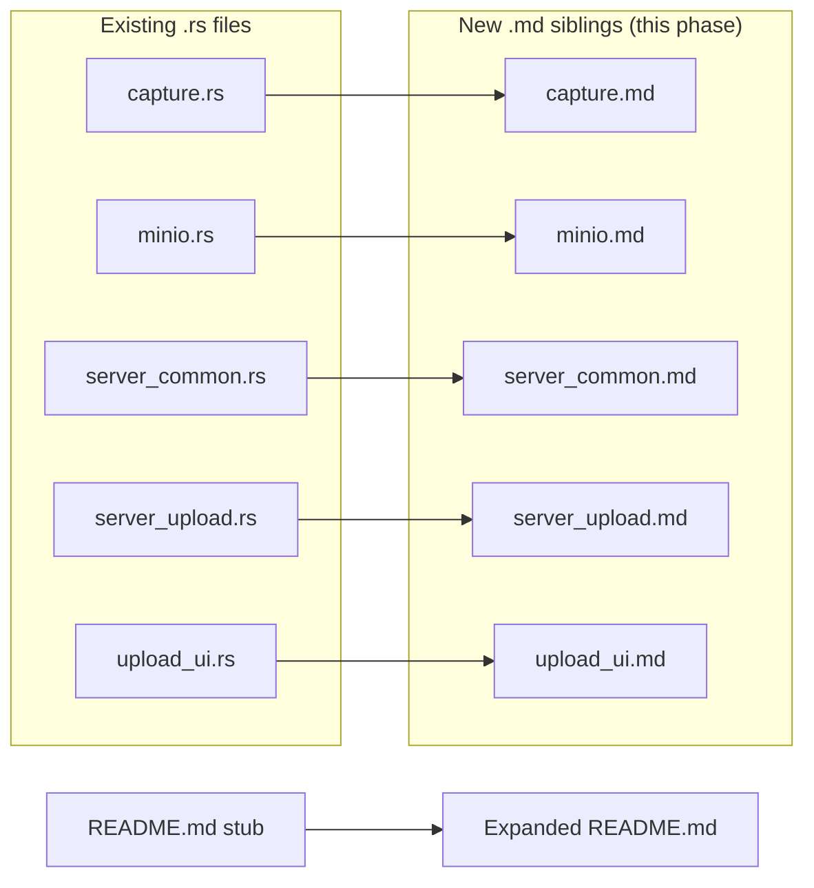

# Phase 0 — Foundation cleanup

**Tracks:** prerequisite for [#1](https://github.com/companionintelligence/CI-Applet/issues/1), [#3](https://github.com/companionintelligence/CI-Applet/issues/3), [#4](https://github.com/companionintelligence/CI-Applet/issues/4)
**Branch:** `phase-0-foundation`
**Coordinates:** none — entirely in-repo.

---

## 1. Goals

Bring the repo to a state where the bigger pivots (Tauri, file watcher, conversion pipeline) can land without dragging existing tech debt with them.

1. **Documentation parity.** Every `.rs` file in `src/` has a sibling `.md` describing purpose, components, and contracts. Today 5/14 are missing.
2. **A top-level README.** Issue #1 explicitly says "Document this applet and Build a readme."
3. **Legacy path on a deprecation path.** Direct-Postgres + direct-MinIO ingest still works, but it is gated, logged-as-deprecated, and slated for deletion after Phase 2 lands.

## 2. Deliverables

### 2.1 New files

| File | Why |
|---|---|
| [README.md](../../README.md) (expand the 12-byte stub) | First-touch doc for new contributors; pulls in architecture + roadmap. |
| `src/capture.md` | Documents `CapturedImage`, `capture_primary`, `diff_percent`, `save_to_path`. |
| `src/minio.md` | Documents `MinioUploader::{new, upload_png, ensure_bucket}` and the legacy ingest contract. Flag as deprecated. |
| `src/server_common.md` | Documents `server_origin` and `graphql_url`. |
| `src/server_upload.md` | Documents `upload_files`, `poll_parse_status`, `sanitize_parse_error`, `supported_extensions`. |
| `src/upload_ui.md` | Documents `UploadApp`, the `Phase` state machine, and the `StatusUpdate` channel protocol. |

### 2.2 Code changes

| Change | File | Reason |
|---|---|---|
| Add a `WARN`-level log line on every legacy-mode write. | [src/db.rs](../../src/db.rs), [src/minio.rs](../../src/minio.rs) | So users in legacy mode get a visible nudge to pair. Easier to remove later when we count zero warnings in telemetry. |
| Add a `#[deprecated]` attribute (or a module-level doc note if `#[deprecated]` is awkward on free functions) to the legacy entry points. | [src/db.rs](../../src/db.rs)::`record_capture`, [src/minio.rs](../../src/minio.rs)::`MinioUploader::new` | Surfaces the deprecation in rustdoc and on any callers we miss. |
| Move "create `ci.screen_captures` on demand" off and onto CI-Server migrations. | [src/db.rs](../../src/db.rs) | Schema ownership convention is set for Phase 2: server owns the schema, applet never CREATEs. (Today it does.) Note: this is a small coordinate with CI-Server — flag as a separate PR there. |

### 2.3 Non-changes (explicitly out of scope for this phase)

- Do **not** delete `db.rs` / `minio.rs` yet. They're a safety net until Phase 2 ships and the watcher-flavored ingest is proven.
- Do **not** rename or restructure existing modules. The next phases will move them; doing it twice is churn.

## 3. File-level plan



Module-doc template (matches the existing five):

```markdown
# <module>.rs

## Purpose
One-paragraph summary.

## Components

### `Name`
- **Does**: …
- **Interacts with**: …
- **Rationale**: … (only when the choice is non-obvious)

## Contracts

| Dependent | Expects | Breaking changes |
|-----------|---------|------------------|

## Notes
- Optional caveats / known seams.
```

## 4. Risks & mitigations

| Risk | Mitigation |
|---|---|
| Deprecating the legacy path scares users with old configs. | Don't break it. Just warn. Phase 2 / Phase 4 are where actual removal would happen. |
| README ends up duplicating architecture.md. | README is a *pointer document* — install + run + links. Architecture detail stays in `architecture.md`. |
| Schema-ownership move for `ci.screen_captures` lands out of order with CI-Server. | Don't ship that part of the change until the corresponding CI-Server PR is merged. Keep the in-applet `CREATE TABLE IF NOT EXISTS` until then. |

## 5. Exit criteria

- [ ] `ls src/*.rs | sed s/\.rs/.md/` matches `ls src/*.md` — no gaps.
- [ ] `README.md` is non-trivial (build, run, configure, links to architecture/roadmap).
- [ ] Every legacy-mode write emits a structured `WARN` log with a `legacy=true` field (or similar).
- [ ] CI build is green.
- [ ] PR description references this doc as the spec.
