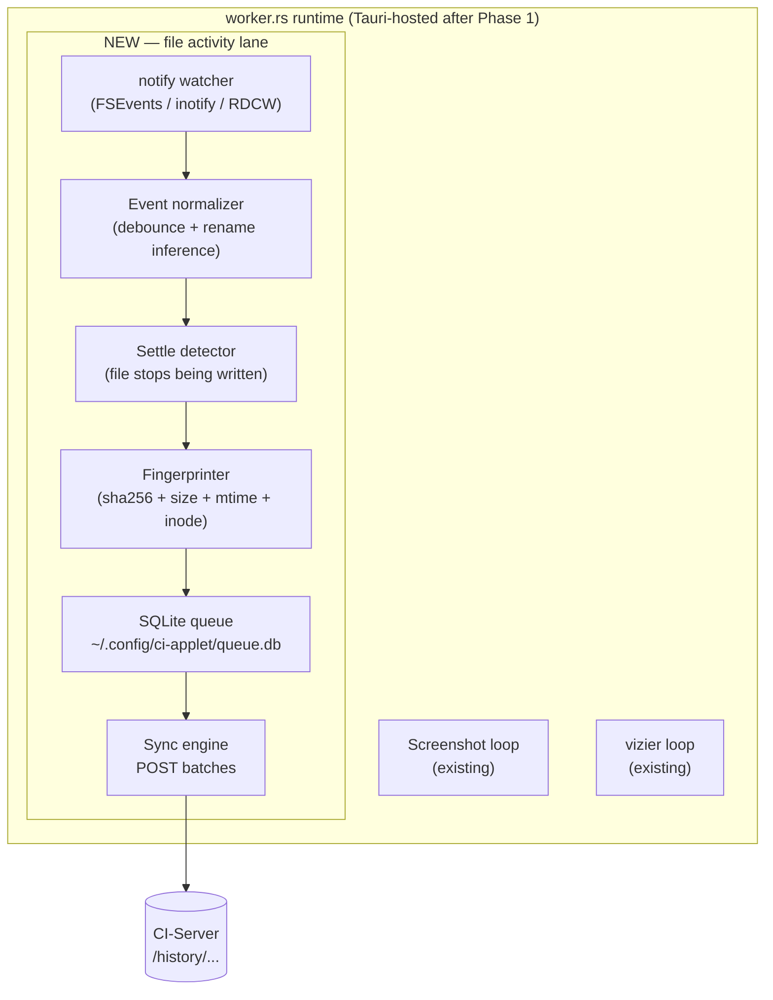

# Phase 2 — File watcher MVP

**Tracks:** [#4](https://github.com/companionintelligence/CI-Applet/issues/4) (data-model redesign), and Phase 1 of [#3](https://github.com/companionintelligence/CI-Applet/issues/3) ("Core Monitoring & Server Connection").
**Branch:** `phase-2-file-watcher`
**Coordinates:**
- **CI-Server:** new endpoints `POST /devices/register`, `POST /devices/heartbeat`, `POST /history/file-events/batch`, `POST /history/files/upsert`, `POST /history/file-versions/upsert`, and matching tables.
- **CI-Portal:** no change to pairing.

---

## 1. Goal

Add a second capture lane next to the existing screenshot+vizier lane: watch a user-selected set of folders, normalize OS file events, fingerprint the changed file, and push activity events to CI-Server. **No content extraction in this phase** — that's Phase 3.

Why split the work like this: file events are tiny, frequent, latency-sensitive; document extraction is heavy and async. Issue #4 §7.6 calls out the same split ("two sync lanes"). Shipping the cheap, fast lane first lets the timeline UI on CI-Server become useful immediately.

## 2. Scope

### In scope

- Native cross-platform watcher via the [`notify`](https://crates.io/crates/notify) crate.
- Event normalizer: debounce storms, detect rename-vs-delete+create, wait for file to settle before fingerprinting.
- Local SQLite queue: pending events, per-device cursor, retry state.
- Hash + size + mtime fingerprint per changed file (no content extraction).
- Sync engine that batch-POSTs to CI-Server's new endpoints with exponential backoff.
- Settings UI: watched-folder picker, ignore-list editor (defaults below).
- Tray menu: "Sync paused" / "Sync N events" status string.

### Out of scope (Phase 3 and later)

- Markdown conversion of any file content.
- OCR / transcription.
- Two-way sync (we never download).
- Full binary backup of every changed file (issue #4 §4).
- Browser history / keystroke / process surveillance.

## 3. Architecture slot-in



## 4. Data model on the wire

Mirrors issue #4 §8 and §9. **CI-Server owns the schema.** The applet only POSTs.

### 4.1 Device registration

`POST /devices/register`

```json
{
  "device_id": "uuid-from-config-or-newly-generated",
  "hostname": "liam-mbp",
  "platform": "darwin",
  "app_version": "0.2.0",
  "user_id": "uuid-from-pairing"
}
```

`POST /devices/heartbeat` — called every 5 min when the worker is running.

### 4.2 Activity event batch

`POST /history/file-events/batch`

```json
{
  "device_id": "…",
  "events": [
    {
      "event_id": "local-uuid",
      "event_type": "file.modified",
      "occurred_at": "2026-05-18T22:15:00Z",
      "observed_at": "2026-05-18T22:15:00.231Z",
      "file": {
        "path": "/Users/liam/Documents/CES/pitch.docx",
        "name": "pitch.docx",
        "extension": ".docx",
        "mime_type": "application/vnd.openxmlformats-officedocument.wordprocessingml.document",
        "size_bytes": 248192,
        "content_hash": "sha256:…",
        "inode": 12345678
      },
      "old_path": null,
      "new_path": null,
      "correlation_id": "settles-with-other-events-of-the-same-edit"
    }
  ]
}
```

Event types: `file.created`, `file.modified`, `file.moved`, `file.renamed`, `file.deleted`, `file.restored`, `file.metadata_changed`, `directory.created`, `directory.deleted`.

### 4.3 File / version upserts

The watcher does **not** call these directly — it sends events only. The server is responsible for deriving file/version rows from the event stream. (Rationale: simpler client, server controls dedup semantics.)

## 5. Module layout (added under `src/`)

```text
src/
├── watcher/
│   ├── mod.rs          # public surface: start_watcher(cfg) -> WatcherHandle
│   ├── notify_glue.rs  # adapter from `notify` events → normalized events
│   ├── normalizer.rs   # storm collapsing, rename inference
│   ├── settle.rs       # waits until a file stops being written
│   ├── fingerprint.rs  # sha256 + size + inode + mtime
│   ├── ignore.rs       # gitignore-style patterns + sensitive-path list
│   └── types.rs        # NormalizedEvent, FileFingerprint
├── queue/
│   ├── mod.rs          # public surface: open(path) -> Queue
│   ├── schema.sql      # CREATE TABLE events, jobs, cursors
│   └── rusqlite_impl.rs
└── sync/
    ├── mod.rs          # batches, backoff, retries
    ├── http.rs         # reqwest client; reuses server_common::server_origin
    └── batching.rs     # adaptive batch size by recent throughput
```

## 6. Event normalization rules

These are the rules that make file watchers actually usable. Lifted from issue #4 §7.3.

| Pattern | What `notify` emits | What we emit |
|---|---|---|
| Atomic save (editor writes `.foo.docx.tmp`, renames over `foo.docx`) | `Create(tmp)` + `Modify(tmp)` + `Rename(tmp → foo.docx)` + `Delete(tmp)` | One `file.modified` event for `foo.docx`. |
| User renames `a.md` → `b.md` | `Delete(a.md)` + `Create(b.md)` | One `file.renamed` with `old_path` / `new_path`. (Inode equality is the tell.) |
| Burst of writes during build | N × `Modify(out.bin)` over 500ms | One `file.modified` after the file settles. |
| File deleted while being parsed | `Delete` mid-fingerprint | Cancel the in-flight fingerprint job; emit `file.deleted` only. |
| Folder created with N files | 1× `Create(dir)` + N × `Create(file)` | 1× `directory.created` + N × `file.created`. |

Implementation notes:

- Debounce window default = 750 ms per path, capped at 5 s.
- Rename inference uses inode (Unix) / FileID (Windows) when available; falls back to `(size, mtime, hash)` proximity.
- Settle detection: poll `size + mtime` every 500 ms until two consecutive reads are equal, max 10 s.

## 7. Default ignore list

Issue #4 §12 names these explicitly; we ship them on by default and let the user disable individual entries.

| Category | Patterns |
|---|---|
| Source-control | `**/.git/**`, `**/.hg/**`, `**/.svn/**` |
| Build artifacts | `**/node_modules/**`, `**/target/**`, `**/dist/**`, `**/build/**`, `**/.next/**`, `**/__pycache__/**` |
| OS / tool caches | `**/.DS_Store`, `**/Thumbs.db`, `**/.Trash/**`, `**/Library/Caches/**`, `**/AppData/Local/Temp/**` |
| Browser profiles | `**/Library/Application Support/{Google/Chrome,Firefox,Arc}/**`, `**/AppData/Local/{Google,Mozilla}/**` |
| Sensitive | `**/Library/Keychains/**`, `**/.ssh/**`, `**/.aws/credentials`, `**/.gnupg/**`, password-manager vaults |
| Virtual machines | `**/*.vmdk`, `**/*.vdi`, `**/*.qcow2` |
| Big and uninteresting | files > 100 MB by default (configurable up to 2 GB) |

## 8. Local SQLite queue schema

```sql
CREATE TABLE events (
  event_id TEXT PRIMARY KEY,            -- uuid v4 generated locally
  event_type TEXT NOT NULL,
  payload_json TEXT NOT NULL,           -- the wire-format event
  occurred_at TEXT NOT NULL,            -- iso8601
  enqueued_at TEXT NOT NULL,
  attempts INTEGER NOT NULL DEFAULT 0,
  next_attempt_at TEXT,                 -- null = ready
  last_error TEXT
);

CREATE INDEX idx_events_ready ON events(next_attempt_at) WHERE next_attempt_at IS NULL;

CREATE TABLE fingerprints (             -- skip re-hashing unchanged files
  path TEXT PRIMARY KEY,
  inode INTEGER,
  size_bytes INTEGER NOT NULL,
  mtime TEXT NOT NULL,
  content_hash TEXT NOT NULL,
  hashed_at TEXT NOT NULL
);

CREATE TABLE cursors (
  device_id TEXT PRIMARY KEY,
  last_acked_event_id TEXT,
  last_synced_at TEXT
);

CREATE TABLE settings_overrides (
  key TEXT PRIMARY KEY,
  value_json TEXT NOT NULL
);
```

Retry policy: exponential backoff 1s → 2s → 4s … capped at 5 min; after 24h of failures on a single event, move to a dead-letter table and surface in the UI.

## 9. Risks & mitigations

| Risk | Mitigation |
|---|---|
| `notify` emits 1000s of events when a Time Machine restore runs. | Storm detection: if > 200 events/sec sustained for > 5s, switch to "summary mode" — emit one `directory.modified` per parent instead of per-file events. |
| Fingerprinting huge files blocks the worker. | Hash in chunks on a dedicated thread; max-parallel = 2. Files > size limit only record size+mtime, no hash. |
| Symlink loops. | `notify` doesn't follow symlinks by default; keep that default. |
| User watches `~/`. | Refuse to watch home root and OS root; show a clear error. The watcher is for project folders. |
| Network down for hours. | SQLite queue + backoff is exactly this case. Verify the on-disk queue survives a hard kill. |
| Sensitive paths sneak through. | The ignore list is enforced *at event time*, before fingerprinting. A second check happens before send. |
| Cross-device dedup confusion. | This phase doesn't try. Server-side `file_id` is derived from content_hash + canonical path heuristics; that's the server's job. |

## 10. Exit criteria

- [ ] User can add a watched folder in the settings UI.
- [ ] Editing a `.txt` file in that folder produces a `file.modified` row on CI-Server within 5 seconds.
- [ ] Rename across that folder produces a single `file.renamed` event (not a delete + create pair).
- [ ] Pull the network cable for 10 minutes, then plug back in — queued events drain.
- [ ] `node_modules` edits don't appear (default ignore list works).
- [ ] Idle CPU when nothing is changing < 1% on a recent laptop.
- [ ] Watcher does not panic on permission-denied paths; logs and skips.
- [ ] Daily activity timeline view on CI-Server shows events from this lane.
