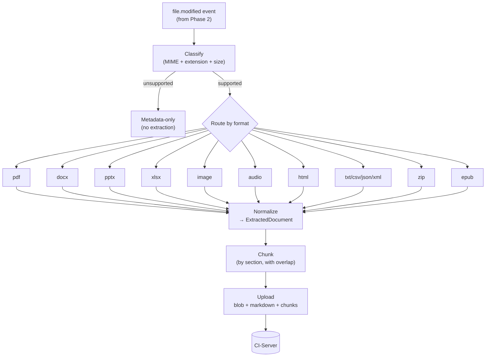

# Phase 3 — Markdown conversion pipeline

**Tracks:** [#3](https://github.com/companionintelligence/CI-Applet/issues/3) (Phases 2–3 in that issue's plan).
**Branch:** `phase-3-conversion`
**Coordinates:**
- **CI-Server:** new endpoints `POST /history/documents/upsert`, `POST /history/blobs/upload`, `POST /history/documents/{id}/chunks`; storage for raw blobs and Markdown artifacts.
- **CI-Marketplace:** none.

---

## 1. Goal

For every changed file Phase 2 already fingerprints, produce two artifacts and ship them to CI-Server:

1. **A human-readable Markdown document** that preserves the source's structural intent (headings, lists, tables, slides, sheets, page boundaries).
2. **A structured extraction payload** (JSON) that downstream embeddings / search / agents consume — Markdown alone is not the canonical ingest format (issue #4 §7.4).

This is the lane that turns the activity timeline into actual *content memory*.

## 2. Pipeline shape



## 3. Output shape

Per issue #4 §7.4, every extraction produces one `ExtractedDocument`:

```json
{
  "document_id": "uuid",
  "file_id": "stable-file-id-from-server",
  "version_id": "content-hash-or-version-id",
  "source_path": "/Users/liam/Documents/pitch.docx",
  "content_type": "application/vnd.openxmlformats-officedocument.wordprocessingml.document",
  "markdown": "# Title\n\n…",
  "sections": [
    { "heading": "Intro", "anchor": "intro", "markdown": "…", "order": 0 }
  ],
  "metadata": {
    "title": "Pitch Draft",
    "author": "Liam",
    "page_count": 12,
    "language": "en"
  },
  "diagnostics": {
    "extractor": "docx-extractor/0.1",
    "ocr_used": false,
    "transcription_used": false,
    "warnings": [],
    "extraction_time_ms": 412,
    "confidence": 0.93
  }
}
```

## 4. Per-format approach

The repo is Rust; we want to keep the client offline-capable, so we prefer Rust crates over Python sidecars where parity exists. A sidecar is acceptable only when the Rust ecosystem can't deliver acceptable quality (today: complex PDFs and audio transcription).

| Format | Approach (preferred → fallback) | Markdown shape |
|---|---|---|
| **TXT** | Direct read, normalize line endings. | Plain Markdown with frontmatter. |
| **CSV / TSV** | `csv` crate → Markdown table; if > N rows, sample head + tail. | `## Sheet 1` heading + table. |
| **JSON / XML** | Fenced code block, pretty-printed if small. | `## File` + ```` ```json ```` block. |
| **HTML** | `scraper` + `html2md` → headings/links/lists. | Headings preserved. |
| **DOCX** | `docx-rs` → walk body, map styles to MD; tables become MD tables. Fallback: `pandoc` sidecar. | Section per heading. |
| **PPTX** | `dotnetio`-style: `zip` + `quick-xml` over `ppt/slides/slide*.xml`. Slide title → `## Slide N — Title`; bullets → list; speaker notes → blockquote. | One section per slide. |
| **XLSX** | `calamine` → per-sheet table. Large sheets sampled + summarized. | `## Sheet: <name>` per worksheet. |
| **PDF** | `pdfium-render` for text + structure; **fallback** to `tesseract-rs` OCR for image-only pages. Decide page-by-page based on text-extracted character count. | Page boundaries preserved as `### Page N`. |
| **Images** (`png`, `jpg`, `heic`, `tiff`) | EXIF via `kamadak-exif` → YAML frontmatter; OCR via `tesseract-rs` for in-image text; optional vision-caption stub (uses the same `VisionAnalyzer` we already have for screenshots). | Frontmatter + OCR block + caption. |
| **Audio** (`mp3`, `wav`, `m4a`, `flac`) | Metadata via `lofty`; transcription via local Whisper sidecar (`whisper.cpp` bin) — pluggable so users can disable it. | Frontmatter + transcript with timestamps. |
| **EPUB** | `epub` crate → chapter walk; preserve TOC. | One section per chapter. |
| **ZIP** | `zip` crate iterate; recurse extraction per supported child; produce one parent doc with child links. | Tree of headings mirroring archive layout. |
| **Email** (`.eml`, `.mbox`) | `mail-parser` → headers + body (HTML → MD). | `## Subject`, frontmatter for From/To/Date. |

## 5. Module layout (added under `src/`)

```text
src/
├── extractors/
│   ├── mod.rs              # router: classify() -> Box<dyn Extractor>
│   ├── traits.rs           # trait Extractor { fn extract(&self, …) -> Result<ExtractedDocument> }
│   ├── text.rs             # txt, csv, json, xml, md
│   ├── html.rs
│   ├── docx.rs
│   ├── pptx.rs
│   ├── xlsx.rs
│   ├── pdf.rs              # + ocr_fallback() using tesseract-rs
│   ├── image.rs            # exif + ocr + optional vision caption
│   ├── audio.rs            # metadata + whisper sidecar
│   ├── epub.rs
│   ├── zip.rs              # recursive
│   └── eml.rs
├── conversion/
│   ├── mod.rs              # job runner: pulls from queue, drives extractor, posts result
│   ├── chunk.rs            # section-aware chunking with overlap
│   └── markdown.rs         # shared MD assembly helpers (headers, escapes, tables)
└── lib.rs                  # add `pub mod extractors; pub mod conversion;`
```

## 6. Concurrency + isolation model

- Extraction runs on a **bounded worker pool** (default = `num_cpus / 2`, capped at 4). Larger pools don't help — extractors are I/O- and parse-heavy, not compute-bound, and they have variable RAM cost.
- Each extractor is fed via a `tokio::sync::Semaphore` permit, so we can throttle by format (`max_concurrent_pdf = 1` when running OCR).
- **Crash isolation:** OCR + Whisper run as sidecar binaries (subprocess with timeout). Native Rust extractors run in-process — a panic in `docx-rs` brings down the worker, so we wrap each `extract()` call in `tokio::task::spawn_blocking` + `catch_unwind`.
- A file that fails extraction 3 times in a row goes to a dead-letter row in the SQLite queue (`extraction_dlq`); the UI surfaces it.

## 7. Chunking strategy

| Decision | Choice | Why |
|---|---|---|
| Granularity | Section-aware (heading boundaries), then 800-token target, 100-token overlap. | Embeds well; preserves semantic units. |
| Token counter | `tiktoken-rs` with `cl100k_base`. | Matches what most embedding models use. |
| Where chunking runs | Client. | The chunk boundaries are deterministic from the structured extraction; doing it client-side keeps the server simple and lets the client stream chunks alongside the doc. |
| Re-chunking on schema change | Server-driven, via re-upload trigger. | We don't try to be clever client-side. |

## 8. Server contract additions

| Endpoint | Body | Notes |
|---|---|---|
| `POST /history/blobs/upload` | multipart, file_id + content_hash | Idempotent on content_hash; returns blob_id or existing one. |
| `POST /history/documents/upsert` | the `ExtractedDocument` JSON above | Idempotent on (file_id, version_id, extractor). |
| `POST /history/documents/{id}/chunks` | `[ { order, token_count, markdown, section_anchor } ]` | Server is responsible for embedding + indexing. |

## 9. Privacy controls (intersects with Phase 4)

- **Metadata-only mode per folder:** in `settings_overrides`, `policy.<folder> = "metadata_only" | "full"`. When `metadata_only`, the pipeline produces only frontmatter + filename + size + hash; no body, no OCR, no transcription.
- **No-blob mode:** never upload the raw binary. The Markdown extraction still uploads, but `/history/blobs/upload` is skipped.
- **Audio off by default.** Transcription is opt-in per folder.

## 10. Risks & mitigations

| Risk | Mitigation |
|---|---|
| PDF extractors vary wildly in quality. | Two-pass design: try `pdfium-render` first; if text density per page < threshold, OCR that page only. |
| Whisper transcription is too slow / heavy on laptops. | Run it off the hot path, throttled to one job at a time, only on battery-not-discharging. Pluggable so users can point at a remote Whisper service. |
| Native crates panic on malformed inputs. | `catch_unwind` per extractor call + dead-letter on 3rd failure. |
| Markdown drifts from canonical extraction. | The Markdown is *derived from* the structured `sections[]` — never edited independently. Server stores both. |
| User opens a 2 GB PDF. | Size gate before extraction; > 200 MB → metadata-only by default; user can override per folder. |
| OCR/Whisper drag battery. | Throttle by `battery::manager().on_battery()`; allow user to gate to "AC only." |
| Local model licensing (Whisper, tesseract data files). | Both ship under permissive licenses; bundle in installer; verify per-OS. |

## 11. Exit criteria

- [ ] A Word save lands as both a binary blob and a Markdown + sections JSON on CI-Server.
- [ ] A PDF with mixed text + scanned pages gets text from native pages + OCR text from scanned pages, in correct page order.
- [ ] A 50-slide PPTX renders one section per slide with speaker notes inline.
- [ ] An EXIF-rich JPEG produces frontmatter with location + camera + datetime + OCR text.
- [ ] An MP3 with a transcript task produces a transcript with at least sentence-level timestamps (opt-in).
- [ ] Extraction failures don't block ingestion of new events.
- [ ] Metadata-only mode on a folder produces zero body content for files in it.
- [ ] Idle CPU still < 5% with extraction enabled (job-pool throttled).
