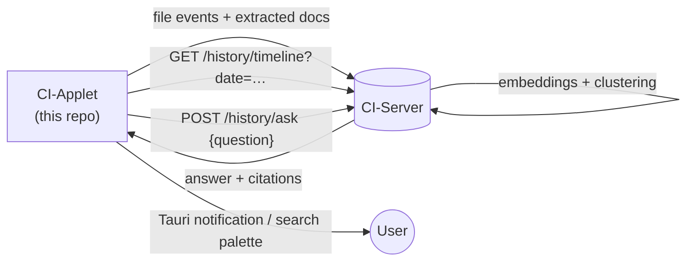

# Phase 5 — Higher-level intelligence

**Tracks:** issue #4 §19 Phase 4 + issue #3 Phase 4 (final phase).
**Branch:** n/a — this phase is mostly **cross-repo** (CI-Server + CI-Portal). The applet contributes data shape and a few small surfaces.
**Coordinates:** primary work lives in CI-Server / CI-Portal.

---

## 1. Goal

Turn the activity + content streams already landing on CI-Server (Phases 2 + 3) into the personal-memory UX promised in issue #4 §3:

- "What did I work on last Tuesday?"
- "Show me every deck I edited for CES."
- "When did I first open this spreadsheet?"
- "What changed in this folder over the past month?"

CI-Applet's job here is to (a) keep its data clean enough that these queries are answerable, and (b) provide deep-link surfaces (e.g. "open in CI-Server timeline").

## 2. What CI-Applet contributes here

| Item | Why it's on the applet |
|---|---|
| **Tray deep-links** — "Open today's activity" / "Open this folder's history" menu items. | Only the applet knows the user's local folder paths; mapping to CI-Server's canonical URLs happens locally. |
| **Per-folder summary digest** (optional, opt-in) — once a day, the applet asks CI-Server for "what changed in <folder> since yesterday" and shows a native notification. | Notification surface is OS-local. |
| **Search shortcut** — global hotkey (configurable) opens a small search palette webview that hits CI-Server's search endpoint. | Tray apps are the natural home for a global shortcut. |
| **"Recall on file open"** — when the user opens a tracked file, optionally show a Tauri toast with "you last edited this Tuesday, 3 versions exist." | Needs OS-level file-open hook; applet is the right scope. |
| **Project clustering signals** — applet annotates events with locally-observable signals (focused app at the time, working directory) that improve server-side clustering. | Already happens via vizier; just need to surface it on file events too. |

## 3. What CI-Server contributes

Bulk of the work, listed here for context:

- Timeline API + UI (chronological feed of activity events + document changes).
- Search/ask API over extracted Markdown + chunks.
- Daily-summary generation (LLM digest of "what you worked on today").
- Folder/project clustering (which paths tend to be touched together).
- Diff view per file version.

## 4. Data flow

## 5. Applet-side deliverables

| Deliverable | Where |
|---|---|
| Daily-digest opt-in toggle + schedule | Settings → Notifications tab. |
| Tray menu items: Today's activity / Recent files / Search | `src-tauri/src/main.rs` (after Phase 1). |
| Global-hotkey search palette webview | New webview window + `tauri-plugin-global-shortcut`. |
| "Recall on file open" toggle + glue (macOS LaunchServices / Windows shell hook / Linux gvfs) | Out of scope unless user demand justifies the OS hook. |
| Focused-app + cwd annotations on `file_events` | Extend Phase 2's event payload using the same vizier observation that already runs alongside screenshots. |

## 6. Out of scope (do not pull these in)

- Anything from issue #4 §4 "Out of scope" — kernel-level monitoring, browser history, keystroke logging, process surveillance.
- Generating summaries client-side. Summaries need the full corpus; do them on CI-Server.
- Storing chat history with the digital twin. CI-Portal owns the user-facing chat surface.

## 7. Risks & mitigations

| Risk | Mitigation |
|---|---|
| Toasts on every file open are annoying. | Default off. Opt-in with rate limit (one toast per file per 24h). |
| Daily-digest notifications become spam. | Default off; user-controlled hour-of-day; suppress if user hasn't opened the app today. |
| Cross-repo coordination drags. | Land applet-side surfaces behind a feature flag that turns on when the server endpoint exists. |
| Global hotkey conflicts with other apps. | Default unset; user must pick. |

## 8. Exit criteria

- [ ] User can press a hotkey, type "CES deck," and see results from across all their devices.
- [ ] Tray's "Today's activity" menu item opens the CI-Server timeline filtered to today.
- [ ] Daily-digest notification fires at the user-configured time when opted in, citing real file events from the day.
- [ ] No new cross-cutting privacy surface — every notification + remote query respects the Phase 4 pause + per-folder policies.
