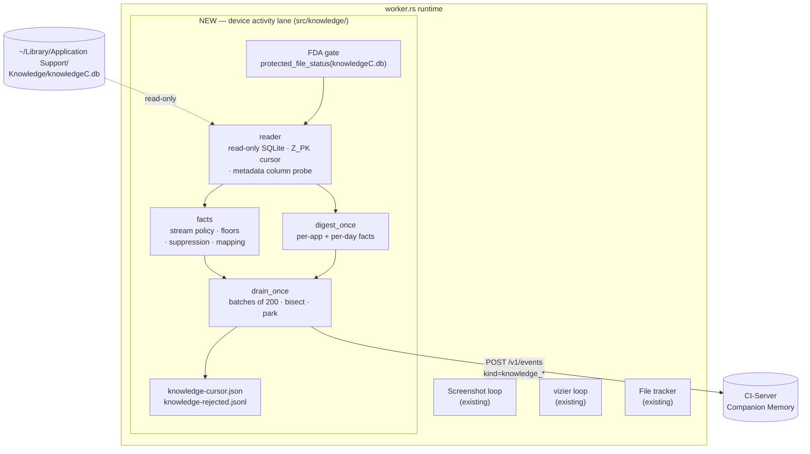

# Phase 6 — Device activity (macOS Knowledge store crawl)

**Tracks:** the "interesting facts" thread of [#3](https://github.com/companionintelligence/CI-Capture/issues/3) ("Core Monitoring & Server Connection") — a fourth capture lane that turns the Mac's own first-party activity log into memory events.
**Branch:** `clau/macos-knowledge-db-crawl-8551c8`
**Coordinates:**
- **CI-Server:** no change. Rides the existing unified capture ingest (`POST /v1/events`, fallback `/api/v1/events`) with new open-text `kind`s and the already-accepted `ended_at` field. Contract details verified in §4.3.
- **CI-Portal:** no change.
- **macOS:** Full Disk Access (TCC) — same gate as the iMessage lane; no new entitlement.

---

## 1. Goal

macOS keeps a rich, first-party activity log in
`~/Library/Application Support/Knowledge/knowledgeC.db` (CoreDuet's
`knowledged`): which app was frontmost and for how long, media playback,
notifications received, Bluetooth device connections, display on/off, Safari
domains, and Siri / App-Intent donations synced from the user's iPhone and
iPad. Nothing in CI-Capture or CI-Server reads it today.

This phase adds a **fourth capture lane, "Device activity"**, that crawls that
store incrementally and ships its rows to CI-Server as memory events —
*"Used Google Chrome for 12 min"*, *"AirPods Pro connected for 3 h 10 min"* —
plus once-a-day per-app digests — *"2026-09-14: Google Chrome for 5 h 12 min
across 231 sessions"*. Those digests are the "interesting facts": the raw rows
make a day reconstructable, the digest makes it *askable*.

Why the Knowledge store and not more vizier polling: the OS already records
every foreground-app span with start and end, including the ones that happen
while the applet is paused, asleep, or not yet installed (retention is ~13 days
for app usage, ~4 weeks for the rest). Reading it is cheaper, more complete,
and more honest than sampling.

## 2. Scope

### In scope

- Incremental, read-only crawl of `knowledgeC.db` keyed on `Z_PK` (see §4.1
  for why not the start date).
- Four streams **on by default** — all of them local-only activity:
  `/app/usage`, `/app/mediaUsage`, `/notification/usage`,
  `/bluetooth/isConnected`.
- Three streams **off by default, enableable** via `extra_streams`:
  `/app/webUsage` (Safari, *domains only*), `/app/intents` (100% synced from
  iPhone/iPad on the reference host — needs `include_synced_devices`), and
  `/display/isBacklit` (see §2.1 for why it is not a default).
- Raw rows shipped 1:1 as `CaptureEvent`s with `occurred_at` / `ended_at`
  (phase 1), plus a per-app + per-day digest emitted once a local day is
  provably complete (phase 2, same PR).
- Batched ingest (`post_capture_events`, 200 events per POST), all-or-nothing
  rejection handling, bisect-and-park for genuinely bad rows.
- `--check-knowledge` read-only probe and `--import-knowledge-once` with a
  JSONL dry-run mode (no credentials needed).
- Settings UI: fourth lane row, toggle, Full Disk Access status card.

### Out of scope

- Anything from the store that is not in the per-stream payload map (§4.2).
  In particular full page URLs, Bluetooth MAC addresses, notification
  identifiers, contact identifiers, and serialized intent blobs are **never
  selected** — see §7.
- Writing to the store, `immutable=1` snapshots, or copying the DB.
- Reading other users' stores, or the store on other devices (synced rows are
  opt-in and arrive through this Mac's own store).
- Any UI beyond the lane row / toggle / FDA card; no timeline, no local search.
- Non-macOS hosts: the module compiles everywhere and idles off macOS.

### 2.1 One deviation from the option as first described

`/display/isBacklit` is **not** in the default raw stream set, although "local
activity" would suggest it. Measured on the reference host: 80% of its
non-zero rows are sub-30 s same-state re-emissions with no searchable content
(timestamps are 4 s-quantized; 4,278 of 4,897 "on" rows are 0 s long) — about
1,000 noise events per day. Display-on time still reaches the server through
the daily digest (`display_on_secs`), and the stream can be re-enabled through
`extra_streams`, in which case only "on" spans of ≥ 5 min ship.

## 3. Architecture slot-in



The lane reuses everything the iMessage lane established: the Full Disk Access
three-state gate, the `spawn_blocking` open-per-tick, the tmp+rename cursor
file, the `MissedTickBehavior::Delay` interval, and the "skip ticks until
`server_ingest::is_configured`" rule. It adds nothing to `Permissions::all_ok()`
— a missing FDA grant is a lane-local warning with the System Settings deep
link, not an app-wide attention state.

## 4. Empirical findings that shape the design

Everything below was verified **read-only** on the reference Mac (macOS 27.0 /
26A428) with `sqlite3 -readonly "file:…/knowledgeC.db?mode=ro"`. The store was
live (rows written minutes before the probe), WAL mode, 42 MB, ~30k `ZOBJECT`
rows.

### 4.1 Why the cursor is `Z_PK`, not `ZSTARTDATE`

Rows are written at session **end**, not start: `ZCREATIONDATE ≥ ZENDDATE` on
100% of `/app/usage` rows, and on this host creation trailed the end by up to
11 h (knowledged flushes in bursts). A cursor on `ZSTARTDATE` therefore sees
rows out of start order — measured, **5.8% of `/app/usage` rows have a lower
`Z_PK` than some row with an earlier start**, i.e. a start-date cursor that
advanced past them would silently skip them.

`Z_PK` is monotonic and never reused within a store file; `Z_METADATA.Z_UUID`
identifies the store file, so a rebuilt store (uuid mismatch) resets the cursor
to the first-run floor instead of chasing primary keys that no longer mean
anything. Local rows are never mutated after insert and there are no open
(`NULL ZENDDATE`) rows, so `ended_at` is final on first sight — which is what
makes the 1:1 mapping safe against a server that has **no update path** (§4.3).

Other schema facts the reader depends on:

- Only `Z_PK` is `NOT NULL`. `ZSTARTDATE` / `ZENDDATE` are INTEGER for the
  in-scope streams while `ZCREATIONDATE` is REAL → all three are read as
  `Option<f64>`.
- Timestamps are Cocoa-epoch seconds (2001-01-01). Year-0000 sentinels exist on
  sync-bookkeeping streams, so the conversion rejects non-finite, negative and
  `> 4e9` values instead of trusting `DateTime::from_timestamp_millis` alone.
  Rows with an unrepresentable start or `end < start` are dropped and counted
  (`skipped_invalid_timestamp`); the cursor still advances past them.
- `ZSECONDSFROMGMT` is the local UTC offset *at event time*. It is used only
  for day bucketing in digests — never for wire fields (§4.3).
- Retention is short and per-stream: `/app/usage` ~13 days (~800 non-zero
  rows/day), the others ~4 weeks. `backfill_days` (default 30) is a valve, not
  the usual bound.

### 4.2 Per-stream payload map

Where each stream keeps the thing we actually want, and what sits next to it
that we must not touch:

| Stream | Bundle / subject lives in | Never read (sits in the same row) | Nature |
|---|---|---|---|
| `/app/usage` | `ZVALUESTRING` | — | Interval; 73% of rows on this host are < 30 s (Cmd-Tab blips) |
| `/app/mediaUsage` | `ZVALUESTRING` | — | Interval; `Z_DKNOWPLAYINGMETADATAKEY__{TITLE,ARTIST,ALBUM}` exist but were empty here |
| `/notification/usage` | `Z_DKNOTIFICATIONUSAGEMETADATAKEY__BUNDLEID`, with pseudo-bundles `_WEB_CENTER_:<host>` and `_SYSTEM_CENTER_:<daemon>` | `…NOTIFICATIONUSAGEMETADATAKEY__IDENTIFIER` | Point events by nature (100% zero-duration) |
| `/bluetooth/isConnected` | `Z_DKBLUETOOTHMETADATAKEY__NAME` | `Z_DKBLUETOOTHMETADATAKEY__ADDRESS` (MAC) | Interval; mixed local/synced |
| `/display/isBacklit` | `ZVALUEINTEGER` (1 = on) | — | Interval; noisy (§2.1) |
| `/app/webUsage` | `Z_DKDIGITALHEALTHMETADATAKEY__WEBDOMAIN` | `Z_DKDIGITALHEALTHMETADATAKEY__WEBPAGEURL` (full URLs incl. search queries) | Interval; every row is Safari |
| `/app/intents` | `ZSOURCE.ZBUNDLEID` | `…__RELATEDCONTACTIDENTIFIERS`, `…__SERIALIZEDINTERACTION` | Point (92% zero-duration); 100% synced from iPhone/iPad here |

Origin: `ZSOURCE.ZDEVICEID` non-NULL ⇒ the row was synced from another device;
`ZSYNCPEER.ZMODEL` names it (`iPhone18,2`, often NULL). The raw `ZDEVICEID`
never leaves the reader — the wire carries only `origin: "local" | "synced"`
and `origin_device_model`.

**`ZSTRUCTUREDMETADATA` drift.** The table has **239 columns** on this host
and its shape changes between macOS versions. The reader runs
`PRAGMA table_info('ZSTRUCTUREDMETADATA')` on every open and builds its SELECT
from an allowlist of wanted columns, emitting `m.<col>` when present and
`NULL AS <col>` when not. A column that disappears on a future macOS degrades
to a missing payload key instead of a broken lane; a column we never wanted
can never be selected by accident.

### 4.3 CI-Server `POST /v1/events` contract (as it is, not as assumed)

Verified against `CI-Server/backend/apps/api/src/domains/ingest/types.ts:80-113`
and `BulkIngestController.ts:145-169,344-489`:

| Fact | Consequence for the lane |
|---|---|
| `ended_at` is accepted (optional). | Interval streams ship start *and* end; `CaptureEvent` gains `ended_at: Option<String>` (omitted from JSON when `None`). |
| `kind` is open text. | New kinds need no server change. |
| 1–1000 events per request; an **empty array is HTTP 400**; 10 MB body. | `post_capture_events` returns `Ok(BatchAck::default())` for an empty slice without touching the network; `BATCH_SIZE = 200`. |
| `z.string().datetime()` accepts **only a trailing `Z`**. | Every wire timestamp goes through `server_ingest::wire_ts` → RFC 3339 UTC with millis and a `Z`. `ZSECONDSFROMGMT` is never applied to a wire field. |
| Re-posting a `source_id` is silently counted as `duplicate`. **There is no update path.** | Idempotent re-sends are free; a wrong event can never be corrected, only parked and replayed — so `ended_at` must be final on first sight (§4.1) and digests wait for day closure (§6). |
| Rejection is **all-or-nothing**: any zod failure → HTTP 400 for the whole batch. | A single bad event poisons its batch; the lane bisects the failing range down to one event and parks exactly that one. |
| HTTP 200 with a non-empty `rejected[]` means a materialize failure: `ingested == 0`, every index listed, server compensated. | Treated as **transient** and re-sent next tick with the cursor untouched — it is a channel signal, not a per-event verdict. |
| Only `title` / `description` and an exact-case metadata allowlist (`Title`, `Artist`, `Album`, …) are search-indexed. | Titles are written as sentences an agent can match; media metadata uses the exact-case keys; everything else in `payload` is stored but not recall-visible. |

### 4.4 Duration-floor measurements

Per-stream counts on the reference host at probe time, and what the floors do
to them:

| Stream | Rows | Non-zero | < 30 s | Floor | Ships/day (approx.) |
|---|---|---|---|---|---|
| `/app/usage` | 10,543 | 10,105 | 7,352 (73%) | `min_session_secs` (30) | ~220 |
| `/notification/usage` | 1,563 | 0 | — | none (Point) | ~55 |
| `/bluetooth/isConnected` | 441 | 441 | 65 | 1 s (zero-only cut) | ~15 |
| `/app/mediaUsage` | 107 | 107 | 100 | 1 s (zero-only cut) | ~4 |
| `/display/isBacklit` (opt-in) | 9,797 | 4,833 | 3,870 | 300 s, "on" rows only | ~10 |
| `/app/webUsage` (opt-in) | 385 | 314 | 275 | `min_session_secs` (30) | ~2 |
| `/app/intents` (opt-in) | 4,165 | 314 | 155 | none (Point) | ~145 |

The floors are a code-side table (`facts::min_duration_secs(stream, cfg)`):
Point streams are never dropped; `/app/usage` and `/app/webUsage` use
`min_session_secs`; `/app/mediaUsage` and `/bluetooth/isConnected` only cut
zero-length rows; `/display/isBacklit` keeps "on" rows ≥ 5 min and never ships
"off" rows. Dropped rows are counted (`skipped_short`, with a per-stream
breakdown logged at `info` when non-zero) and the cursor advances past them.
**Digests count every non-zero session regardless of the floor** — the
`short_sessions` field makes the difference legible instead of hiding it.

## 5. Data model on the wire

Common envelope, built directly as `server_ingest::CaptureEvent`:
`source_system = "ci-applet"` (frozen wire identifier, as for every lane),
`source_id = "knowledge:<ZUUID>"` (fallback `knowledge:<store_uuid>:pk:<Z_PK>`),
`occurred_at` = start, `ended_at` = end (Interval streams always; Point streams
only when `end > start`), `observed_at` = `ZCREATIONDATE`. Every payload
carries `device_id` (the applet's config identity, nil like iMessage),
`stream`, `z_pk`, `origin`, `origin_device_model`, `tz_offset_secs`, and
`duration_secs` (Interval only). `description` carries **no clock times** — the
server already has start and end.

| Stream | Shape | `kind` | `title` | `description` | Payload extras |
|---|---|---|---|---|---|
| `/app/usage` | Interval | `knowledge_app_usage` | `Used {app} for {dur}` | `{app} ({bundle_id})` | `bundle_id`, `app_name`, `usage_trusted` |
| `/app/mediaUsage` | Interval | `knowledge_media_usage` | `Played media in {app} for {dur}` (+ ` — {Title} by {Artist}` if present) | `{app} ({bundle_id})` | `bundle_id`, `app_name`, `Title` / `Artist` / `Album` (exact case = server allowlist), `media_type` |
| `/notification/usage` | Point | `knowledge_notification` | app: `Notification from {app}`; web: `Web notification` (`Web notification from {host}` only when `/app/webUsage` is effective) | app: `{app} ({bundle_id})`; web: `web` (or `{host}`) | `center: "app" \| "web"`, `bundle_id` (app) / `domain` (web, only when webUsage effective), `app_name` (app only). `_SYSTEM_CENTER_:` rows dropped by default (`skipped_system`). No notification id. |
| `/bluetooth/isConnected` | Interval | `knowledge_bluetooth` | `{name} connected for {dur}` / `{name} disconnected for {dur}` | `{name}` | `device_name`, `device_type`, `is_apple_audio`, `is_user_wearing`, `connected` |
| `/display/isBacklit` (opt-in) | Interval | `knowledge_display` | `Display on for {dur}` | none | `backlit: true` |
| `/app/webUsage` (opt-in) | Interval | `knowledge_web_usage` | `Browsed {domain} for {dur}` | `{domain} · {app}` | `bundle_id`, `app_name`, `domain` — never a URL |
| `/app/intents` (opt-in) | Point | `knowledge_intent` | `{verb} via {app}` | `{app} ({bundle_id})` | `intent_class`, `intent_verb`, `direction`, `donated_by_siri`, `domain` (`ZVALUESTRING`), `bundle_id` |

Duration humanizer: `45 s`, `12 min`, `1 h 05 min`. `app_name` comes from
`NSWorkspace` → `NSFileManager.displayNameAtPath` on macOS (cached per bundle
id), falling back to the last dotted segment everywhere else — so
`com.google.Chrome` reads as `Google Chrome` in the title, and a bundle that is
no longer installed still reads as `Chrome` rather than the raw id.

### 5.1 `knowledge_app_usage`

```json
{
  "source_system": "ci-applet",
  "source_id": "knowledge:7F2C1A9E-3B44-4C1D-9E6A-0C5D2B8F1A77",
  "kind": "knowledge_app_usage",
  "occurred_at": "2026-09-14T16:03:12.000Z",
  "ended_at": "2026-09-14T16:15:40.000Z",
  "observed_at": "2026-09-14T16:15:41.318Z",
  "title": "Used Google Chrome for 12 min",
  "description": "Google Chrome (com.google.Chrome)",
  "payload": {
    "device_id": "d3a1f0c2-6b4e-4f9a-8c7d-2e1b5a9f0c33",
    "stream": "/app/usage",
    "z_pk": 481233,
    "origin": "local",
    "origin_device_model": null,
    "tz_offset_secs": -25200,
    "duration_secs": 748,
    "bundle_id": "com.google.Chrome",
    "app_name": "Google Chrome",
    "usage_trusted": true
  }
}
```

### 5.2 `knowledge_notification` — app and web

An app notification carries the bundle and display name:

```json
{
  "source_system": "ci-applet",
  "source_id": "knowledge:A1D4E7B2-9C0F-4E5A-B3D6-7F8A9B0C1D2E",
  "kind": "knowledge_notification",
  "occurred_at": "2026-09-14T17:42:05.000Z",
  "observed_at": "2026-09-14T17:42:06.004Z",
  "title": "Notification from Slack",
  "description": "Slack (com.tinyspeck.slackmacgap)",
  "payload": {
    "device_id": "d3a1f0c2-6b4e-4f9a-8c7d-2e1b5a9f0c33",
    "stream": "/notification/usage",
    "z_pk": 481301,
    "origin": "local",
    "origin_device_model": null,
    "tz_offset_secs": -25200,
    "center": "app",
    "bundle_id": "com.tinyspeck.slackmacgap",
    "app_name": "Slack"
  }
}
```

A web-push notification (`_WEB_CENTER_:<host>` pseudo-bundle) is redacted to
the fact that one arrived unless `/app/webUsage` is in the effective stream set
— no host, no `domain` key, no `app_name`:

```json
{
  "source_system": "ci-applet",
  "source_id": "knowledge:C9B8A7F6-E5D4-4C3B-A2F1-0E9D8C7B6A55",
  "kind": "knowledge_notification",
  "occurred_at": "2026-09-14T18:10:33.000Z",
  "observed_at": "2026-09-14T18:10:33.912Z",
  "title": "Web notification",
  "description": "web",
  "payload": {
    "device_id": "d3a1f0c2-6b4e-4f9a-8c7d-2e1b5a9f0c33",
    "stream": "/notification/usage",
    "z_pk": 481318,
    "origin": "local",
    "origin_device_model": null,
    "tz_offset_secs": -25200,
    "center": "web"
  }
}
```

A web-push notification from a suppressed host (`SENSITIVE_WEB_DOMAINS` or
`excluded_domains`) takes the same anonymous shape even when `/app/webUsage` is
effective, so opting in never yields fewer notification events than opting out.

`_SYSTEM_CENTER_:<daemon>` rows (OS daemons) are not shipped at all — nor is
any other `_`-prefixed pseudo-bundle: only `_WEB_CENTER_:` is understood, and
an unrecognised one is dropped before it can reach `app_name` or the wire.

### 5.3 `knowledge_bluetooth`

```json
{
  "source_system": "ci-applet",
  "source_id": "knowledge:5E4D3C2B-1A09-4F8E-9D7C-6B5A4F3E2D11",
  "kind": "knowledge_bluetooth",
  "occurred_at": "2026-09-14T15:20:48.000Z",
  "ended_at": "2026-09-14T18:31:02.000Z",
  "observed_at": "2026-09-14T18:31:02.551Z",
  "title": "AirPods Pro connected for 3 h 10 min",
  "description": "AirPods Pro",
  "payload": {
    "device_id": "d3a1f0c2-6b4e-4f9a-8c7d-2e1b5a9f0c33",
    "stream": "/bluetooth/isConnected",
    "z_pk": 481402,
    "origin": "local",
    "origin_device_model": null,
    "tz_offset_secs": -25200,
    "duration_secs": 11414,
    "device_name": "AirPods Pro",
    "device_type": 8,
    "is_apple_audio": true,
    "is_user_wearing": true,
    "connected": true
  }
}
```

No `address` key exists on any Bluetooth event — the MAC column is never in
the SELECT.

### 5.4 `knowledge_daily_app_usage` (digest, one per app per day)

`occurred_at` / `ended_at` are the UTC instants of local midnight D and D+1 in
the day's own zone (`tz_offset_secs = -25200` here → `07:00Z`). Sessions are
clipped to the day, so a span that crosses midnight is split between the two
digests and a day can never exceed 24 h. Digest payloads carry the common
envelope minus the per-row fields (`z_pk`, `stream`, `origin_device_model`,
`duration_secs`); `origin` is always `local`. The summary carries no
`description` — its `title` already says everything a one-liner could.

```json
{
  "source_system": "ci-applet",
  "source_id": "knowledge:daily:d3a1f0c2-6b4e-4f9a-8c7d-2e1b5a9f0c33:2026-09-14:com.google.Chrome",
  "kind": "knowledge_daily_app_usage",
  "occurred_at": "2026-09-14T07:00:00.000Z",
  "ended_at": "2026-09-15T07:00:00.000Z",
  "observed_at": "2026-09-15T09:00:14.203Z",
  "title": "2026-09-14: Google Chrome for 5 h 12 min across 231 sessions",
  "description": "Google Chrome (com.google.Chrome)",
  "payload": {
    "device_id": "d3a1f0c2-6b4e-4f9a-8c7d-2e1b5a9f0c33",
    "origin": "local",
    "tz_offset_secs": -25200,
    "date": "2026-09-14",
    "bundle_id": "com.google.Chrome",
    "app_name": "Google Chrome",
    "total_secs": 18734,
    "session_count": 231,
    "short_sessions": 168,
    "rank": 1,
    "share_pct": 41.6
  }
}
```

### 5.5 `knowledge_daily_summary` (digest, one per day)

```json
{
  "source_system": "ci-applet",
  "source_id": "knowledge:daily:d3a1f0c2-6b4e-4f9a-8c7d-2e1b5a9f0c33:2026-09-14:summary",
  "kind": "knowledge_daily_summary",
  "occurred_at": "2026-09-14T07:00:00.000Z",
  "ended_at": "2026-09-15T07:00:00.000Z",
  "observed_at": "2026-09-15T09:00:14.203Z",
  "title": "2026-09-14: 12 h 30 min of app activity across 14 apps — top Google Chrome (5 h 12 min), Code, Slack",
  "payload": {
    "device_id": "d3a1f0c2-6b4e-4f9a-8c7d-2e1b5a9f0c33",
    "origin": "local",
    "tz_offset_secs": -25200,
    "date": "2026-09-14",
    "total_secs": 45012,
    "app_count": 14,
    "top_apps": [
      { "bundle_id": "com.google.Chrome", "app_name": "Google Chrome", "total_secs": 18734, "share_pct": 41.6 },
      { "bundle_id": "com.microsoft.VSCode", "app_name": "Code", "total_secs": 12980, "share_pct": 28.8 },
      { "bundle_id": "com.tinyspeck.slackmacgap", "app_name": "Slack", "total_secs": 4410, "share_pct": 9.8 }
    ],
    "display_on_secs": 47120,
    "first_activity": "2026-09-14T14:02:11.000Z",
    "last_activity": "2026-09-15T05:48:39.000Z"
  }
}
```

`display_on_secs` is optional: present only when `/display/isBacklit` is not
disabled, its coverage reaches the day, and the midnight-spanning row has
closed (§6.1). Suppressed apps (§7) are removed **before** totals, ranks and
shares are computed, so hidden time cannot be inferred from the summary.

## 6. Lane runtime

### 6.1 Cursor, drain, digest

`knowledge-cursor.json` (tmp+rename) holds
`{ store_uuid, last_pk, last_digest_day, backfill_window_start, backoff_ticks,
backoff_level, digest_backoff_ticks, stalled_head }`. `backoff_level` is the
last backoff issued (the value the next one doubles from) and `backoff_ticks`
the countdown the run loop decrements — kept apart because the loop only
drains once the countdown is back at zero. `backfill_window_start` pins the
first-run window instant the digest floor is measured against.

Per tick (`drain_once`, budget 20 s, page 1000, batch 200):

1. Open the store read-only on a blocking thread. `CANTOPEN` is transient — the
   tick stops, nothing advances.
2. Read `Z_METADATA.Z_UUID`. Mismatch with the cursor ⇒ reset `last_pk` to
   `first_run_floor` (warn). `MAX(Z_PK) < last_pk` ⇒ same reset (defensive;
   never on an empty store).
3. Page rows `WHERE Z_PK > last_pk` in the effective stream set, local-only
   unless `include_synced_devices`. Map each row through the policy
   (§4.4 floors, §7 suppression, system-center drop) — every skip is counted
   in `PollOutcome`.
4. Ship in chunks of 200. **Ok** ⇒ cursor advances to the chunk's max `Z_PK`
   and is saved. **Transient** (network, 5xx, HTTP 200 + `rejected[]`) ⇒ stop
   the tick, cursor stays at the last acked chunk. **Permanent** (400 / 413 /
   415 / 422) ⇒ bisect; at size 1 append the event to
   `knowledge-rejected.jsonl` (`{pk, source_id, kind, stream, reason,
   rejected_at, event}`), `log::error!` without the payload, advance past it.
   Reaching `MAX_PARKS_PER_TICK = 5` parks in one tick ⇒ stop (the fifth
   park itself trips it; the cursor rests on that pk), `backoff_level =
   min(2·level + 1, 64)`, `backoff_ticks = backoff_level`, both cleared by
   the next clean tick.
5. After every chunk of a page is acked — **including a page that mapped to
   zero events** — the cursor advances to the page's `last_seen_pk`, so a run
   of Cmd-Tab blips can never pin the lane.
6. Stop when a page comes back short or the budget is spent; then
   `digest_once`.

Head-of-line valve: if the server has been refusing the chunk headed by the
same `source_id` transiently for more than 24 h (`stalled_head`), that chunk
is bisected on transient answers too and the one event that *still fails on
its own* is parked, so one poison event cannot wedge the lane
(`file_tracker`'s `DEAD_LETTER_AFTER` precedent: still failing now **and**
stuck for a day). The valve never parks without a fresh refusal: a stale
stall against a recovered server ships, and a transport failure (no reply at
all — outage, sleep, DNS) neither starts nor resets the clock.

A permanently rejected *digest* batch is held, never parked (that would drop
a whole day's summary); it is re-posted once every `MAX_BACKOFF_TICKS`
ticks (`digest_backoff_ticks`) while the raw lane keeps running.

### 6.2 Digest gates

`digest_once` runs only when `daily_digest` is on and `/app/usage` is
effective. Candidate days come from **local** `/app/usage` rows only — a day
is a candidate when a session started on it *or* ran past midnight into it,
so a tail-only day after a late night is digested rather than stepped over;
`tz` is the modal `ZSECONDSFROMGMT` of the rows that overlapped the day (the
same clipped selection the totals use). On a DST-transition day the
D-midnight instant is taken in that modal zone and may sit up to 1 h from
the true local midnight; totals and the D+1 gates are unaffected. Day D is
emitted only when all
of these hold, iterating upward from `max(last_digest_day + 1,
first_covered_day)`:

| Gate | Test | Why |
|---|---|---|
| **Covered** | `MIN(ZCREATIONDATE)` of `/app/usage` ≤ D 00:00 (store still holds a row created before D began). Also D 00:00 ≥ `backfill_window_start` — the raw window instant pinned in the cursor at the raw lane's first tick, not recomputed from `now` (the first digest pass routinely runs later, and a floor that drifted with the clock would step past a day whose sessions shipped). | The rolling purge trims the oldest day partially; a day the store may have lost rows from must never become a "fact". Uncovered days are skipped for good — they can never become covered. |
| **Completed** | `now ≥ D+1 02:00` **and** a local `/app/usage` row exists with start ≥ D+1 00:00. Fallback: emit anyway at `now ≥ D+3 00:00` with a warning. | knowledged writes `/app/usage` FIFO, so a later session proves D's tail has landed — this covers the observed 11 h late bursts without waiting three days on a normal day. |
| **Display closure** | `display_on_secs` is included only if `/display/isBacklit` is not disabled, its coverage reaches D, and `MAX(ZENDDATE)` ≥ D+1 00:00. Enabled-but-not-closed holds the whole day (retry next tick); at D+3 00:00 the day is released anyway **without** the figure. | The display row that spans midnight is written when it *ends*; summing before then under-reports, and a re-send could never correct it (stable source id, server dedup). A display kept on for days never closes its span, so the hold needs the same valve as flush evidence. |
| **Non-empty** | ≥ 1 `/app/usage` row on D after suppression. | No zero-app summaries. |

`last_digest_day` advances only after the day's batch is acked; `source_id`s
are deterministic (`knowledge:daily:<device_id|store_uuid>:<date>:<bundle>`),
so a re-run is counted `duplicate`, never doubled. They are scoped per machine
because the server's dedup key is per user and has no update path: a digest is
"what this Mac did on day D", and without the scope a second Mac on the same
account would have every shared day silently dropped as `duplicate`. The scope
is the config identity, or the store file's `Z_UUID` when no identity is set
(the raw lane's own fallback).

## 7. Privacy rules

| Rule | Enforced where | User-disableable |
|---|---|---|
| Lane is **off by default**; nothing is read until `knowledge.enabled = true`. | `is_runnable` | — |
| Store is opened **read-only** (`SQLITE_OPEN_READ_ONLY`); never copied, never checkpointed. | `reader::open_readonly` | no |
| **`WEBPAGEURL` never selected.** Only `WEBDOMAIN` is read for `/app/webUsage`; there is no URL field on `KnowledgeRow`, so no code path can leak one. | reader SELECT allowlist | no |
| **Bluetooth MAC never selected** (`…BLUETOOTHMETADATAKEY__ADDRESS`); only the friendly name and type. | reader SELECT allowlist | no |
| Notification identifiers, contact identifiers, serialized interactions, and the raw `ZDEVICEID` never leave the reader. | reader SELECT allowlist / `KnowledgeRow` | no |
| **Sensitive bundles suppressed, non-disableable**: lowercase prefix match on `SENSITIVE_BUNDLE_IDS` (1Password, AgileBits, Bitwarden, LastPass, Dashlane, KeePassXC, KeePassium, Keychain Access, Apple Passwords, NordPass, RoboForm, Enpass, Strongbox, Proton Pass, Keeper, Secrets, mSecure, SafeInCloud) plus any bundle containing `password` / `keepass`. Applied to raw rows **and** to digests before totals are computed. | `facts::is_suppressed_bundle` | no (user list `excluded_bundle_ids` stacks on top) |
| **Sensitive domains suppressed, non-disableable**: suffix match on `SENSITIVE_WEB_DOMAINS` (Google / Microsoft / Apple / Yahoo / AWS sign-in hosts, Auth0, Okta, the 1Password and Bitwarden vaults, LastPass). Bundle rules cannot protect `/app/webUsage` — every row is Safari — so the domain rules are the only guard there. | `facts::is_suppressed_domain` | no (user list `excluded_domains` stacks on top) |
| Web notifications are redacted to `Web notification` with no host unless the user has opted into `/app/webUsage`. | `facts` notification mapping | opt-in reveals the host |
| System-daemon notifications (`_SYSTEM_CENTER_:`) are dropped, as is any other unrecognised `_`-prefixed pseudo-bundle. | `facts` (`skipped_system`) | no |
| Rows synced from other devices are dropped unless `include_synced_devices`. | reader `WHERE` clause | opt-in |
| **Digests use local rows only**; a synced iPhone session never inflates a Mac's day. | `read_daily_usage` (`s.ZDEVICEID IS NULL`) | no |
| `/display/isBacklit` "off" rows are never shipped; "on" rows only ≥ 5 min. | `facts` floors | no |
| `description` carries no clock times; titles carry app / device names, never URLs. | `facts` | — |
| Logs never contain URLs, domains, or message content — `--check-knowledge` describes rows by stream, pk, app/bundle, duration only. | `describe()`, `log::*` call sites | — |
| Park file (`knowledge-rejected.jsonl`) holds full events for replay — it lives in the applet data dir with the cursor, is written with `OpenOptions::append`, and is never uploaded anywhere but the user's own CI-Server on explicit `KNOWLEDGE_REPLAY_REJECTED`. | `drain_once` / `import_once` | — |

What this lane does **not** protect against, stated plainly: CI-Server applies
no PII redaction, and an app's display name or a Bluetooth device's friendly
name is whatever the user typed. The guarantee is about *which columns are
read* and *where the rows go*, not about what a name contains.

## 8. Module layout (added under `src/`)

```text
src/knowledge/
├── mod.rs          # lane runtime: is_runnable, db_path, db_access_status,
│                   #   Cursor (JSON, tmp+rename), run(), drain_once(),
│                   #   digest_once(), PollOutcome, describe()
├── reader.rs       # open_readonly, read_store_uuid, metadata column probe,
│                   #   read_events(), first_run_floor(), max_pk(),
│                   #   coverage_start(), has_local_row_on_or_after(),
│                   #   max_end(), read_daily_usage(); FIXTURE_SCHEMA (cfg(test))
├── facts.rs        # stream policy (DEFAULT_STREAMS, POINT_EVENT_STREAMS,
│                   #   min_duration_secs, SENSITIVE_BUNDLE_IDS,
│                   #   SENSITIVE_WEB_DOMAINS, is_suppressed_*),
│                   #   KnowledgeRow -> CaptureEvent per stream,
│                   #   duration humanizer, digest builders
├── app_names.rs    # bundle id -> display name (NSWorkspace on macOS,
│                   #   last dotted segment elsewhere); OnceLock cache
├── check.rs        # --check-knowledge (read-only probe)
├── import_once.rs  # --import-knowledge-once (env creds, JSONL dry-run,
│                   #   KNOWLEDGE_REPLAY_REJECTED)
└── e2e.rs          # cfg(test): tempfile fixture DB + raw-TCP mock server
```

Touched elsewhere: `server_ingest.rs` (`ended_at`, `wire_ts`,
`post_capture_events` + `BatchAck`, `rejected[]` → transient),
`permissions.rs` (`protected_file_status`), `config.rs` (`KnowledgeConfig`,
`knowledge_cursor_path`, `knowledge_rejected_path`), `worker.rs` (lane
lifecycle mirrored from `imessage`), `main.rs` (flags), `settings_ui.rs` /
`theme.rs` / `locales/settings.yml` (fourth lane row, `LANE_KNOWLEDGE()`,
`4 lanes`).

## 9. Config

The `knowledge` section of `config.json` (the file is JSON, parsed with
`serde_json`, and a parse failure is fatal at launch with no UI to repair it
from — so the shape below is exact; JSON has no comments):

```json
"knowledge": {
  "enabled": false,
  "poll_interval_secs": 60,
  "disabled_streams": [],
  "extra_streams": [],
  "include_synced_devices": false,
  "min_session_secs": 30,
  "excluded_bundle_ids": [],
  "excluded_domains": [],
  "backfill_days": 30,
  "daily_digest": true
}
```

`enabled` is off by default. `poll_interval_secs` has a floor of 15.
`disabled_streams` is subtracted from the code-side `DEFAULT_STREAMS`;
`extra_streams` adds to it (`"/app/webUsage"`, `"/app/intents"`,
`"/display/isBacklit"`). `include_synced_devices` admits rows with
`ZSOURCE.ZDEVICEID` set. `min_session_secs` is the `/app/usage` +
`/app/webUsage` 1:1 floor; `0` ships every non-zero row.
`excluded_bundle_ids` is exact, case-insensitive, and stacks on
`SENSITIVE_BUNDLE_IDS`; `excluded_domains` is a suffix match and stacks on
`SENSITIVE_WEB_DOMAINS`. `backfill_days` is the first-run floor; `0` means
everything the store holds. Only `enabled` is surfaced in the settings UI —
everything else is `config.json`-only.

Effective streams = (`DEFAULT_STREAMS` ∪ `extra_streams`) − `disabled_streams`.
Defaults live in code, not in the config file, so a new default reaches
existing installs (the file-lane `DEFAULT_IGNORES` precedent).

## 10. CLI

```bash
cargo run -- --check-knowledge
# path · exists · FDA state + System Settings deep link · store UUID ·
# per-stream table (rows, non-zero/day, would-ship/day under current floors,
# oldest/newest, enabled/disabled) · 5 newest rows described · warnings

KNOWLEDGE_IMPORT_LIMIT=300 KNOWLEDGE_EXPORT_JSONL=/tmp/knowledge-events.jsonl \
KNOWLEDGE_DIGEST=1 cargo run -- --import-knowledge-once
# dry run: exact CaptureEvent JSON lines, no credentials, bypasses is_configured

CI_SERVER_URL=… CI_SERVER_API_KEY=… KNOWLEDGE_IMPORT_LIMIT=25 \
cargo run -- --import-knowledge-once
# real post; a second run must report every event as duplicate

KNOWLEDGE_REPLAY_REJECTED=<data_dir>/knowledge-rejected.jsonl \
CI_SERVER_URL=… CI_SERVER_API_KEY=… cargo run -- --import-knowledge-once
# re-post a park file; dedup makes it idempotent
```

Full Disk Access is inherited from the launching process: a shell that has it
passes it to `cargo run`; from Terminal / iTerm the terminal app itself needs
the grant. `--check-knowledge` says so when the probe reports `Denied`.

## 11. Risks & mitigations

| Risk | Mitigation |
|---|---|
| Schema / stream liveness verified on one host (macOS 27.0). | Metadata-column probe degrades missing columns to `NULL`; `--check-knowledge` shows per-stream counts so a silent stream is visible; all reader SQL runs in tests against a fixture with the real column names. |
| A store rebuild (new `Z_UUID`) or restore-from-backup makes old `Z_PK`s meaningless. | Uuid mismatch and `MAX(Z_PK) < last_pk` both reset to `first_run_floor`; dedup on `source_id` (`ZUUID`) makes the re-crawl free. |
| One bad row 400s a whole 200-event batch, forever. | Bisect to the single event, park it to `knowledge-rejected.jsonl`, advance; `MAX_PARKS_PER_TICK` + exponential backoff bound the cost of a systematically bad stream. |
| A transient failure on one event stalls the lane indefinitely. | 24 h `stalled_head` valve bisects the refused chunk and parks the event that still fails on its own. |
| First-run backfill floods the server. | Bounded by retention and `backfill_days` (≈10⁴ rows ≈ 50 POSTs of 200) and spread over 20 s ticks. |
| Digest emitted before the day's rows have landed → wrong "fact" that can never be corrected (no update path). | Coverage + completion + display-closure gates (§6.2); digests trail by ≥ 26 h; days older than store coverage are never digested. |
| `/app/usage` Cmd-Tab blips (73% of rows) drown the timeline. | 30 s floor on 1:1 rows; digests still count them (`short_sessions`). |
| `/display/isBacklit` flapping (~1,000 rows/day) drowns the timeline. | Not a default stream; 5 min floor when opted in; day total still reaches the digest. |
| Password-manager usage becomes a memory event. | Non-disableable `SENSITIVE_BUNDLE_IDS` + `password`/`keepass` heuristic, applied to raw rows and digests alike. |
| A user enables `/app/webUsage` expecting the bundle list to protect them. | Documented here and in the config doc comments: only the domain rules apply to Safari rows. |
| FDA grant applies only after relaunch; users toggle and see nothing. | Lane checks once at start (as iMessage does); the Settings card says "relaunch"; `--check-knowledge` reports the live state. |
| `objc` is a macOS-only dependency; CI builds Linux and Windows. | All `objc` imports live inside `#[cfg(target_os = "macos")] mod imp` blocks; the non-macOS `imp` returns `None`. |

## 12. Exit criteria

- [ ] `cargo run -- --check-knowledge` on the reference Mac reports FDA ✓, the store UUID, a per-stream table matching the `sqlite3` probe (~10.5k `/app/usage`, 1.5k notifications, 441 bluetooth, 107 media; display / webUsage / intents shown disabled), a would-ship/day column (~220/day for `/app/usage`), and 5 described rows with no URL or domain in the output.
- [ ] `KNOWLEDGE_EXPORT_JSONL` dry run of 300 rows: every `occurred_at` / `ended_at` / `observed_at` ends in `Z`; every `kind` is in the §5 table; zero `knowledge_display`, `knowledge_web_usage`, `knowledge_intent` lines under default config; no `url`, `address`, `notification_id`, or raw device-UUID keys; no `com.1password.*` bundle (17 such rows exist in the store); web notifications appear as `Web notification` with no host; titles read as `Used Google Chrome for 12 min`.
- [ ] Same export with `extra_streams = ["/display/isBacklit"]` yields only `Display on for ≥ 5 min` lines.
- [ ] `KNOWLEDGE_DIGEST=1` produces per-app + summary lines for the newest digestable day whose totals match a clipped `SUM` in `sqlite3` for that local day.
- [ ] Mock-server e2e: batches hit `/v1/events` with `x-api-key`; a 503 leaves the cursor at the last acked chunk; a sticky 400 bisects and parks exactly one event; HTTP 200 + `rejected[]` is retried next tick with the cursor untouched; a page of only zero-duration rows advances to `last_seen_pk` with zero POSTs; `MAX_PARKS_PER_TICK` sets backoff.
- [ ] Digest unit tests with injected `now` (`FixedOffset::west_opt(7*3600)`): midnight-spanning display row clips to 24.0 h; purge-truncated oldest day is skipped; flush-evidence gate holds then releases; D+3 fallback fires; display-closure hold; suppressed app absent from totals / shares / top list; digest instants are `2026-09-14T07:00:00.000Z` / `2026-09-15T07:00:00.000Z` for `tz = −25200`.
- [ ] Settings → Capture shows the fourth lane row, toggle, and FDA card; toggling on logs `knowledge lane running` and, without credentials, `knowledge: no Memory credential yet; skipping poll`; toggling off logs `knowledge lane stopped`.
- [ ] `cargo clippy --all-targets -- -D warnings` and `cargo test --locked` pass on macOS, Ubuntu and Windows (the non-macOS jobs are what catch an un-gated `objc` import).
- [ ] Against a real CI-Server (optional, env creds): a second `--import-knowledge-once` reports every event as `duplicate`.
