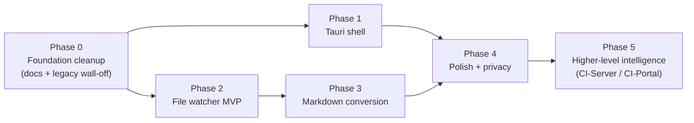

# CI-Applet — Plan Index

Detailed phase-by-phase plans that expand on the top-level [roadmap.md](../../roadmap.md). Each phase has a self-contained sub-document with goals, deliverables, file-level changes, server-side coordination, risks, and exit criteria.

| Phase | Doc | Tracks issue(s) | Branch (off `main`) |
|---|---|---|---|
| 0 — Foundation cleanup | [00-foundation.md](00-foundation.md) | prerequisite for #1 / #3 / #4 | `phase-0-foundation` |
| 1 — Tauri shell migration | [01-tauri-shell.md](01-tauri-shell.md) | [#1](https://github.com/companionintelligence/CI-Applet/issues/1) | `phase-1-tauri-shell` |
| 2 — File watcher MVP | [02-file-watcher.md](02-file-watcher.md) | [#4](https://github.com/companionintelligence/CI-Applet/issues/4) | `phase-2-file-watcher` |
| 3 — Markdown conversion pipeline | [03-conversion.md](03-conversion.md) | [#3](https://github.com/companionintelligence/CI-Applet/issues/3) | `phase-3-conversion` |
| 4 — Polish, privacy, security | [04-polish.md](04-polish.md) | post-MVP for #3 / #4 | `phase-4-polish` |
| 5 — Higher-level intelligence | [05-intelligence.md](05-intelligence.md) | cross-repo (CI-Server / CI-Portal) | n/a (cross-repo) |

## How the phases sequence

## Conventions used in these docs

- **Coordinate** = a change that has to land on another repo before this repo can use it. Each phase doc lists its coordinates explicitly.
- **Exit criteria** = the externally observable state that proves the phase is done. Not "code is merged" — "the user can do X end-to-end."
- **Risk** = something that could derail the phase. Each one is paired with a mitigation.
- File paths are relative to the repo root; line numbers (when given) are from the architecture-audit snapshot in [architecture.md](../../architecture.md).
