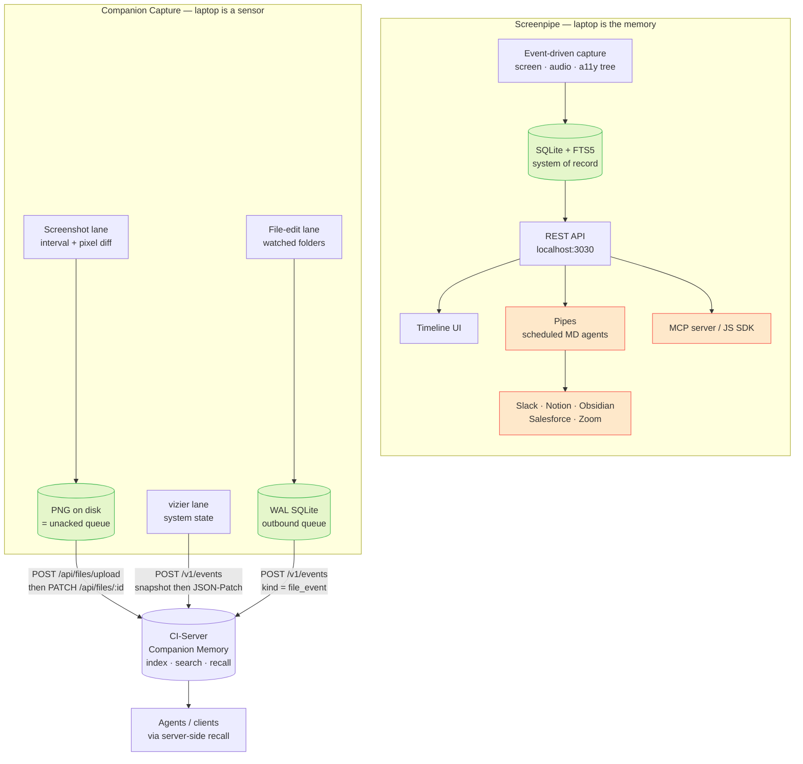

<p align="center"></p>

# Companion Capture vs Screenpipe

> **Internal planning document.** An honest read of where Screenpipe is ahead,
> where we are, and which of its capabilities are worth adopting. For how this
> applet is built see [`architecture.md`](architecture.md); for the lane-by-lane
> data path see [`plan/00-overview.md`](plan/00-overview.md).
>
> Screenpipe facts below were checked against its public docs and README in
> July 2026 (<https://docs.screenpipe.com/llms.txt>,
> <https://github.com/mediar-ai/screenpipe>). Companion Capture facts are cited
> as `path:line` against this checkout.

## 1. First: this repo is not a Screenpipe fork

Three agent-instruction files in this repo carry an identical "Screenpipe
ancestry" section stating that Companion Capture "forks the screenpipe capture
engine" and that "CI-specific additions live in `src/ci/`"
([`CLAUDE.md:50-52`](../CLAUDE.md), [`AGENTS.md:29-31`](../AGENTS.md),
[`.github/copilot-instructions.md:33-35`](../.github/copilot-instructions.md)).
A fourth, [`ANTIGRAVITY.md:12,19`](../ANTIGRAVITY.md), repeats only the fork
half — "a Companion Intelligence fork of Screenpipe" and "Screenpipe pipeline"
— and never mentions `src/ci/`. **Both halves are false**, and the evidence is
unambiguous:

| Check | Result |
|-------|--------|
| `grep -rni screenpipe --include='*.rs' --include='*.toml' .` | No matches. Zero source or manifest hits. |
| `git log -S screenpipe --all` (every ref in the repo; 84 commits on this branch) | Exactly one commit: `066dade "chore: add agentic coding config files"` — which touched only `CLAUDE.md`, `AGENTS.md`, `ANTIGRAVITY.md`, `.github/copilot-instructions.md`, `opencode.json`, `.claude/settings.json`. |
| `src/ci/` | Does not exist. |
| First code commit `88ee8b9` | `src/{analysis,capture,config,db,main,minio,settings_ui,svg_icon,worker}.rs` — all CI-authored from the start. |

In other words the ancestry note was introduced *by the agent-instruction files
themselves*, never by code. [`README.md:176`](../README.md) already carries the
correction — "No Tauri, no Screenpipe, no audio capture — those were earlier
descriptions and no longer reflect the code" — but the four agent files still
propagate the stale version to every model that reads them, and should be
fixed.

What is actually here: screen grabs via the `screenshots` crate
([`Cargo.toml:24`](../Cargo.toml)), UI via `egui`/`eframe` + `tao`/`tray-icon`
([`Cargo.toml:27,37,39,40`](../Cargo.toml)), and activity perception via the
in-tree `vizier` crate, vendored as a path dependency
([`Cargo.toml:42`](../Cargo.toml)).

**So nothing "diverged."** This is not a fork comparison — it is a competitive
comparison between two independently written products that happen to occupy
adjacent categories. Read the rest of the document that way.

## 2. Feature matrix

Ordered roughly by how load-bearing each capability is to the respective
product's core promise.

| Capability | Screenpipe | Companion Capture | Notes |
|---|---|---|---|
| **Screen capture trigger** | Event-driven — app switches, clicks, typing pauses, scrolling | Fixed `tokio` interval, default 300 s, floored to 30 s, plus a post-hoc pixel diff | [`config.rs:131-132`](../src/config.rs), [`worker.rs:30`](../src/worker.rs). Screenpipe is plainly better here — see §4.1. |
| **Diff / dedup** | Implicit in event triggering | Exact per-pixel RGBA equality vs the previous frame, dropped under `diff_threshold_percent` (default 10 %) | [`capture.rs:46-63`](../src/capture.rs), [`worker.rs:756-765`](../src/worker.rs) |
| **Displays** | Multi-monitor with device enumeration | **First display only** — `Screen::all()…into_iter().next()` | [`capture.rs:32-34`](../src/capture.rs). A straightforward correctness gap. |
| **Image format** | JPEG | PNG | [`capture.rs:16-24`](../src/capture.rs) |
| **OCR / screen text** | Real OCR with bounding boxes, on-demand re-OCR, accessibility-tree-first | None. Optional vision-model pass returns a model-written `ocr_text` string; **off by default** (`analysis.endpoint` empty → `analyze` returns an error before any request) | [`analysis.rs:16-27,51-53`](../src/analysis.rs), [`config.rs:77-91`](../src/config.rs) |
| **Accessibility tree** | Primary capture path; exposes AX text, nodes, URLs per frame | **Reads no AX API at all** — deliberate and documented | [`permissions.rs:9-19`](../src/permissions.rs) |
| **Audio + transcription** | Whisper/Deepgram, diarization, speaker CRUD | None. No audio crate in the manifest; `extractors/audio.rs` is a 5-line doc stub | [`extractors/audio.rs:1-5`](../src/extractors/audio.rs), [`Cargo.toml:6-60`](../Cargo.toml) |
| **Meeting intelligence** | Detection, transcription, speaker ID, meeting CRUD | None — structurally out of reach without audio | — |
| **System / environment state** | — | **vizier lane**: focus + full window list, cursor, displays, terminal cwd/shell, live network connections, filesystem delta events, idle time | [`vizier/src/observation.rs:169-232`](../vizier/src/observation.rs). Note `snapshot()` is the entire `Observer` trait ([`vizier/src/observer/mod.rs:26-28`](../vizier/src/observer/mod.rs)) and the applet calls it and nothing else ([`worker.rs:605`](../src/worker.rs)). vizier's richer `WakeObservation` profile — mounts, installed apps, listening ports, shell history, CPU/RAM/GPU ([`vizier/src/observation.rs:5-167`](../vizier/src/observation.rs)) — hangs off a separate `Waker` trait ([`vizier/src/observer/mod.rs:30-32`](../vizier/src/observer/mod.rs)) the applet **never constructs**; it is CLI-only. |
| **File-edit watching** | — | **Full lane**: notify → normalize → ignore → settle → sha256 → durable queue → Markdown → ingest | [`watcher/`](../src/watcher/), [`file_tracker.rs`](../src/file_tracker.rs) |
| **Document extraction** | — | Text/code family only. `docx`/`pptx`/`xlsx`/`pdf`/`zip`/`image`/`audio` are doc-comment stubs; `html`/`eml`/`epub` behind `rich-extractors` | [`extractors/mod.rs:7-10,48-72`](../src/extractors/mod.rs) |
| **Local storage model** | System of record — SQLite + FTS5, frames on disk, ~5–10 GB/month, retention policies, vault encryption | **Outbound queue only.** No content table, no FTS index. The PNG on disk *is* the queue; successful ingest deletes it | [`queue/schema.sql:7-55`](../src/queue/schema.sql), [`capture_store.rs:1-14`](../src/capture_store.rs) |
| **Local search** | Keyword + semantic over screen text, OCR, audio; filters by app / window / URL / time | **None.** `--search` builds a `/memory?search=…` URL and shells out to the browser | [`main.rs:704-728`](../src/main.rs), [`server_common.rs:179-190`](../src/server_common.rs) |
| **Timeline / DVR UI** | Yes — scrub the day's screen history | None. Three egui windows: Settings, onboarding, manual upload | [`settings_ui.rs`](../src/settings_ui.rs), [`onboarding_ui.rs`](../src/onboarding_ui.rs), [`upload_ui.rs`](../src/upload_ui.rs) |
| **Local HTTP API** | REST on `localhost:3030` (`/search/*`, `/frames/*`, `/elements/*`) | **None.** The only listening socket in the codebase is the ephemeral OIDC loopback callback | [`oidc.rs:250-256`](../src/oidc.rs) |
| **SDK / MCP server** | JS/TS SDK; MCP server for Claude, Cursor, Cline, Continue, Copilot CLI | None of either. Scriptable surface is CLI flags only | [`main.rs:65-115`](../src/main.rs) |
| **Plugin / agent model** | "Pipes" — scheduled markdown agents, one-click store, per-pipe data permissions | **None.** No plugin model, no scheduler, no extension point | — |
| **Third-party SaaS integrations** | Slack, Notion, Google Calendar, Obsidian, HubSpot, Salesforce, Zoom, PostHog, Sentry | **None for captured data.** Talks to CI-Server, CI-Portal, and an optional user-configured local vision endpoint. One exception, diagnostics only: **opt-in** Sentry crash reporting — off by default, panics only, scrubbed before send, and compiled out entirely unless a DSN was baked in at build time | [`server_common.rs:146-196`](../src/server_common.rs), [`portal_apps.rs`](../src/portal_apps.rs), [`telemetry.rs`](../src/telemetry.rs), [crash-reporting.md](crash-reporting.md) |
| **PII redaction** | Filter strips names, emails, phones, addresses, secrets before AI sees data | **None.** The vision model returns `contains_sensitive` / `contains_pii` booleans, but a default build parses them and drops them — nothing scrubs, and nothing even transmits them; only the opt-in `legacy-postgres` writer persists them | [`analysis.rs:21-22,133-134`](../src/analysis.rs), [`db.rs:292-293`](../src/db.rs) |
| **Sensitive-path denylist** | — | Non-disableable: `.ssh`, keychains, `.aws/credentials`, `.gnupg`, `.kube/config`, `.netrc`, `.pgpass`, `.env*`, `*.pem/key/p12/pfx/jks` — enforced before any file is hashed, and applied to vizier fs-events too | [`watcher/ignore.rs:56-78`](../src/watcher/ignore.rs), [`worker.rs:612-614`](../src/worker.rs) |
| **Durable outbound delivery** | Largely moot — writes locally first | WAL SQLite queue with attempts / `next_attempt_at` / `last_error`, adaptive batching, exponential backoff, persisted `dead_letters` | [`queue/schema.sql:4,12-35`](../src/queue/schema.sql), [`sync/batching.rs`](../src/sync/batching.rs) |
| **Wire efficiency** | Economy comes from not capturing | RFC-6902 JSON-Patch diffs against a server-confirmed baseline; payloads capped at 9 MiB | [`worker.rs:34,626-694`](../src/worker.rs), [`vizier/src/diff.rs`](../vizier/src/diff.rs) |
| **Auth** | Optional API key on the local REST API; SSO/SAML at Enterprise | OIDC Authorization Code + PKCE, loopback on port 0, background token refresh, or a pasted API key; Portal-driven server auto-discovery | [`oidc.rs`](../src/oidc.rs), [`portal_apps.rs`](../src/portal_apps.rs) |
| **Proxy policy** | — | Every reqwest client is `.no_proxy()` — an ambient `HTTP_PROXY` can never see screen content or the credential | [`analysis.rs:36-38`](../src/analysis.rs), [`server_ingest.rs:150-154`](../src/server_ingest.rs) |
| **Platform parity** | macOS (AS + Intel), Windows 10/11, Linux; Intune fleet deployment | Builds and ships all three (dmg/nsis/deb/AppImage) — but **the vizier Windows backend is a stub**: `windows.rs` delegates straight to the generic `BaselineObserver`, which on stock Windows returns an observation with no focus, no windows and no displays (see §4 item 4) | [`vizier/src/observer/windows.rs:1-10`](../vizier/src/observer/windows.rs), [`vizier/src/observer/common.rs:168-232`](../vizier/src/observer/common.rs) |
| **License / commercial** | Screenpipe Commercial License; $25 / $50-seat / $150-seat published tiers | CI-Commercial-1.0, private repo, no standalone SKU — a component of the CI appliance | [`LICENSE.md:1-8`](../LICENSE.md) |

## 3. What each product is *for*

The matrix undersells the divergence, because the two products answer different
questions. Screenpipe is a **local-first personal recall product**: it owns the
data, owns the retrieval surface, and monetizes an automation ecosystem on top.
Companion Capture is a **thin capture client for a server the user already
owns**: it perceives, batches, and ships, and holds essentially no retrieval
surface of its own.

| The user asks… | Screenpipe | Companion Capture |
|---|---|---|
| "What was I looking at at 3pm?" | Scrub the local timeline. Answered in-app, offline. | Not answerable in-app. Opens CI-Server's `/memory` page in a browser ([`main.rs:704-728`](../src/main.rs)). |
| "Find the doc where the migration plan was mentioned." | Local FTS5 + semantic search over screen text and OCR. | Server-side search over indexed events and files. Nothing local to query. |
| "Summarize yesterday's meetings." | A pipe over audio transcripts + diarization. | **Not possible.** No audio lane. |
| "Which files did I edit this week, and what changed?" | Not covered — Screenpipe parses the screen, not the filesystem. | Core competence. Extracted Markdown rides in the event `description` specifically so the server's indexer embeds it ([`server_ingest.rs:264-295`](../src/server_ingest.rs)). |
| "Which apps and windows did I have open, and what was my machine talking to?" | Not covered. | The vizier lane's whole purpose ([`vizier/src/observation.rs:169-232`](../vizier/src/observation.rs)). "What was listening / what was mounted" is **not** answered — that lives in vizier's unused wake profile. |
| "Let my coding agent use this context." | Local MCP server + JS SDK, agent talks to the laptop. | Agent talks to **CI-Server**, which serves recall over the indexed graph. The applet exposes nothing. |
| "Where does my data physically live?" | On the laptop that captured it, plus optional encrypted cloud archive. | On the appliance the user owns. The laptop holds only the **unacked backlog** — 14 days / 2048 MB caps bound it ([`config.rs:106-125`](../src/config.rs)). |

The intent difference in one line: Screenpipe makes the *laptop* the memory;
Companion Capture makes the laptop a *sensor* for a memory that lives
elsewhere. That is why "no local search" is a deliberate non-goal here rather
than a missing feature — and also why an offline Companion Capture is inert
while an offline Screenpipe is fully usable. Both halves of that trade are
real.

## 4. Gaps worth considering

Candid assessment. "Verdict" is a recommendation, not a decision.

| # | Gap | Screenpipe's answer | Verdict |
|---|---|---|---|
| 1 | **Interval capture** | Event-driven triggers on app switch / click / typing pause | **Adopt.** Biggest single quality gap; see below. |
| 2 | **Single display** | Multi-monitor enumeration | **Adopt.** Small, well-scoped fix to [`capture.rs:32-34`](../src/capture.rs). We currently claim desktop capture and silently ignore every secondary monitor. |
| 3 | **No PII redaction** | Filter strips names, emails, phones, addresses, secrets pre-AI | **Adopt (highest privacy value).** Our sensitive-path denylist protects the *file* lane well; the *screenshot* lane has no equivalent. A frame of an open password manager ships in full. `contains_pii` exists and does nothing ([`analysis.rs:21-22`](../src/analysis.rs)). |
| 4 | **vizier Windows stub** | Full Windows parity | **Adopt.** A parity claim we do not honour. `BaselineObserver::snapshot` fabricates its single `local-shell` window only when `$SHELL` is set ([`vizier/src/observer/common.rs:173-215`](../vizier/src/observer/common.rs)) — a Unix convention. On stock Windows `SHELL` is unset, so the lane takes the empty branch: `focus: None`, no windows, no displays, `idle_ms: 0` ([`vizier/src/observer/common.rs:218-230`](../vizier/src/observer/common.rs)). Under Git Bash/MSYS it instead reports the one synthetic terminal window with zero bounds. Either implement it or document the limitation. |
| 5 | **Real OCR** | Tesseract/AX with bounding boxes and re-OCR | **Probably not on the client.** CI-Server already describes frames by default. But be honest about the consequence: a screenshot's entire searchable substance is one VLM-written sentence. On the opt-in local-analysis path a failed metadata `PATCH` leaves that frame description-less — though not permanently: the PNG is deliberately kept on disk and CI-Server's content-hash dedup returns the same file id, so the store sweep repairs that very frame ([`worker.rs:349-373`](../src/worker.rs)). |
| 6 | **Screenshot encryption at rest** | Vault encryption, retention policies | **Consider.** The unsent PNG backlog is plaintext full-resolution screen content on disk, bounded only by age/size caps. Cheap to add, materially improves the story on a stolen laptop. |
| 7 | **Local search / timeline** | FTS5 + DVR timeline | **Decline.** Deliberate architectural non-goal — retrieval is CI-Server's job. Accept the cost: nothing works offline and there is no in-app way to see what was captured. |
| 8 | **Audio + meetings** | Whisper, diarization, meeting CRUD | **Decline.** Enormous surface, and the appliance model puts transcription server-side. Delete the aspirational stub rather than imply a roadmap. |
| 9 | **Plugin / pipe ecosystem** | Markdown agents + store + permissions | **Decline for this repo.** That layer belongs to CI-Hub and CI-Marketplace. Building it here would duplicate the platform. |
| 10 | **Local API / SDK / MCP** | REST on :3030, JS SDK, MCP server | **Decline the server; revisit the CLI.** A listening socket on a capture client is an attack surface we chose not to have. The eight CLI flags are the scriptable surface and they are thin. |
| 11 | **Office/PDF extraction** | n/a | **Adopt eventually.** Seven of the eleven format extractors are doc-comment stubs (`audio`, `docx`, `image`, `pdf`, `pptx`, `xlsx`, `zip`); only `text` ships by default, with `html`/`eml`/`epub` behind `rich-extractors` ([`extractors/mod.rs:14-31`](../src/extractors/mod.rs)). The manual upload window pushes pdf/docx/xlsx parsing to CI-Server ([`server_upload.rs:339-343`](../src/server_upload.rs)), which is a reasonable interim answer — but the watched-folder lane silently skips them. |

### 4.1 Why the capture trigger is the top item

The current design captures on a fixed 300 s interval and then decides whether
to keep the frame:

```rust
// src/worker.rs:750-758 (abridged)
let diff_percent = self
    .last_capture
    .as_ref()
    .map(|prev| diff_percent(prev, &capture))
    .unwrap_or(100.0);

self.last_capture = Some(capture.clone()); // baseline advances unconditionally

if diff_percent < self.config.capture.diff_threshold_percent {
```

Three consequences fall out, all worth naming plainly:

1. **We pay the full cost regardless.** Every tick grabs and decodes a
   full-screen RGBA buffer and walks it pixel by pixel
   ([`capture.rs:56-62`](../src/capture.rs)) even when the result is discarded.
   Event-driven capture pays nothing when nothing happens.
2. **We miss short-lived context.** Anything that opens and closes inside a
   five-minute window is never seen. An event-driven trigger catches exactly
   those transitions.
3. **The diff baseline is the previous *tick*, not the last *uploaded* frame.**
   `last_capture` is overwritten before the threshold test, so a slow drift
   below the threshold across many ticks accumulates without ever producing a
   capture. Worth deciding whether that is intended.

The vizier lane already samples the signals an event-driven trigger would need
— focus app, window title, idle time
([`vizier/src/observation.rs:169-182`](../vizier/src/observation.rs)) — and it
already runs on every tick regardless of the screenshot gate
([`worker.rs:150-161`](../src/worker.rs)). A focus-change trigger is a
plausible incremental step rather than a rewrite.

## 5. Architectures side by side



Red nodes mark the Screenpipe surfaces that have **no Companion Capture
counterpart at all** — the plugin runtime, the programmatic surface, and the
integration ecosystem. Everything to the right of CI-Server in our diagram is
another repo's responsibility, which is the architectural bet: we accept a much
smaller client in exchange for the server owning retrieval, and we live with
the client being useless on its own.

## 6. Follow-ups this document implies

- Correct the Screenpipe-ancestry and `src/ci/` claims in
  [`CLAUDE.md:15,22,47,50-52`](../CLAUDE.md),
  [`AGENTS.md:11,18,29-31`](../AGENTS.md),
  [`ANTIGRAVITY.md:12,19`](../ANTIGRAVITY.md) and
  [`.github/copilot-instructions.md:17,24,33-35`](../.github/copilot-instructions.md).
  [`README.md:176`](../README.md) is already right; the agent files are what
  keep reintroducing the error.
- Decide on §4.1 (capture trigger), §4 item 2 (multi-monitor) and §4 item 3
  (screenshot PII) — the three gaps where Screenpipe is ahead on something we
  actually claim to do.
- Either implement the vizier Windows backend or state the limitation in
  [`README.md`](../README.md) next to the platform-support table.
