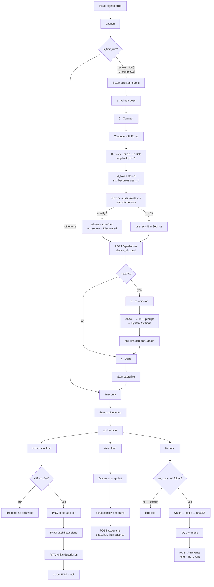

<p align="center"></p>

# Companion Capture — Test plan & coverage map

> **Private & Confidential — Property of Lifescope Inc. Do not distribute.**

**Scope.** What is covered by automated tests today, what can only be covered by
a human driving a signed build, and what is covered by nothing. Written against
the tree as of `0.2.0-alpha.1` ([`Cargo.toml:3`](../Cargo.toml)). For how the
lanes are wired see [`architecture.md`](architecture.md); for how a release is
produced see [`RELEASING.md`](RELEASING.md).

**Measured, not assumed.** Every count below came from running the suite in this
worktree:

| Command | Result |
|---|---|
| `cargo test` | **190 passed** (default features) |
| `cargo test --features rich-extractors` | **217 passed** in 15.3 s |
| `cd vizier && cargo test` | **13 passed** (1 unit + 9 CLI + 3 schema) |

The 27-test delta is exactly the three opt-in extractors:
[`extractors/html.rs`](../src/extractors/html.rs) (8),
[`extractors/eml.rs`](../src/extractors/eml.rs) (9),
[`extractors/epub.rs`](../src/extractors/epub.rs) (10).

---

## 0. The three things to know before reading further

**A. `vizier`'s 13 tests have never run in CI.** Neither
[`Cargo.toml`](../Cargo.toml) nor [`vizier/Cargo.toml`](../vizier/Cargo.toml)
declares a `[workspace]` table, so `vizier` is a plain path dependency, not a
workspace member — `cargo test` at the root skips it, and
[`ci.yml:44-48`](../.github/workflows/ci.yml) only ever runs cargo at the root.
The engine behind the entire system-activity lane is therefore unguarded in CI.
They pass when run by hand, so this is latent risk, not existing breakage: a
regression in vizier's snapshot schema or CLI contract merges green today. The
fix is one workflow step with `working-directory: vizier`, or a `[workspace]`
table.

**B. egui is immediate-mode, so most of the UI genuinely cannot be tested
headlessly.** Every widget function in
[`theme.rs`](../src/theme.rs) (1040 lines),
[`onboarding_ui.rs`](../src/onboarding_ui.rs) (967) and
[`upload_ui.rs`](../src/upload_ui.rs) (521) takes `&mut egui::Ui` and only
exists inside a live frame owned by a windowing backend. There is no DOM to
assert against and no way to instantiate a `Ui` without a platform surface.
Those three files have **zero** tests, and that is the correct call rather than
neglect — §3's manual script is the only coverage they will ever have.
[`settings_ui.rs`](../src/settings_ui.rs) shows what *is* reachable: its 5 tests
hit pure logic that takes no `Ui` at all
([`settings_ui.rs:1011-1063`](../src/settings_ui.rs)) — three on auth-mode
inference, two on `normalize_server_url`. §2 lists the pure functions in the
other UI files that deserve the same treatment.

**C. macOS TCC only registers a codesigned bundle.** Permission behaviour cannot
be exercised from `cargo run` or a hand-assembled `.app`. Screen Recording tests
require a real installer artifact from the Desktop Release workflow
([`release.yml:124`](../.github/workflows/release.yml)). §3 marks these steps
`[signed build only]`.

---

## 1. Coverage summary

Counts are `#[test]` + `#[tokio::test]` attributes per file. "Manual only" means
the behaviour is real and user-visible but has no automated seam.

| Area | Automated tests | Manual only | Untested |
|---|---:|---|---|
| **File watching** — `watcher/{normalizer,ignore,fingerprint,notify_glue,settle,mod}` | 49 | Watching a network/removable mount; watcher restart after sleep | `dispatch` fan-out ([`mod.rs:202`](../src/watcher/mod.rs)); `SettleOutcome::Unhashable`; `WatcherHandle` teardown |
| **Durable queue & backoff** — `queue/rusqlite_impl`, `sync/batching` | 25 | Multi-day outage drain | Concurrent access from two processes. `depth` ([`:328-376`](../src/queue/rusqlite_impl.rs)), `attempts_over` ([`:386-387`](../src/queue/rusqlite_impl.rs)) and `is_backing_off` ([`batching.rs:142-237`](../src/sync/batching.rs)) *are* asserted, single-threaded |
| **Document extractors** — `extractors/{text,eml,epub,html,mod}` | 47 | — | Feature-conditional routing ([`mod.rs:57-72`](../src/extractors/mod.rs)); the 7 stub formats (correctly — they have no implementation) |
| **Conversion helpers** — `conversion/{markdown,chunk}` | 26 | — | *n/a — nothing calls this code (see §2.9)* |
| **Server addressing & auth** — `server_common` | 12 | — | `AuthCredential::apply` ([`:283`](../src/server_common.rs)); `from_config`; `friendly_error`; `devices_urls`; `files_urls` |
| **OIDC / PKCE** — `oidc` | 10 | Real browser round-trip against CI-Portal | CSRF state mismatch in `login` ([`:358-360`](../src/oidc.rs)); `discover`/`exchange_code`/`refresh`; `LOGIN_TIMEOUT` |
| **Portal discovery** — `portal_apps` | 6 | 0 / 1 / ≥2 registered servers | `fetch_portal_apps` transport |
| **File-tracker lane e2e** — `file_tracker` | 4 (2 are full `run()` e2e vs a mock server) | — | `is_runnable` ([`:60`](../src/file_tracker.rs)); `TICK_BUDGET`; `MAX_PARKS_PER_TICK`; `PARK_AFTER`. `build_content` has no direct test, but the e2e asserts its output lands in `description` ([`:634-638`](../src/file_tracker.rs)) |
| **Config load/save** — `config` | 4 | Config written by three processes at once | `save` atomicity; `load_or_default`; `queue_db_path`; `default_storage_dir` |
| **Vision analysis** — `analysis` | 6 (parser only) | Pointing at a real LM Studio | `analyze` request shape; `ResponseFormat` negotiation |
| **Screenshot ingest** — `server_ingest` | 5 (pure helpers only) | — | `ingest_capture`; `capture_upload_form` flags; `set_file_metadata`; `ingest_vizier_event`; `post_capture_event`; `is_configured` |
| **Capture retention** — `capture_store` | 5 (`plan_sweep`) | Disk filling to the 2048 MB cap | `scan` filename filter ([`:97`](../src/capture_store.rs)) |
| **OS permissions** — `permissions` | 6 (5 run per platform; 2 are `cfg`-split) | **All real TCC behaviour** `[signed build only]` | `request_screen_recording` ([`:168`](../src/permissions.rs)) — never called by any test |
| **Tray icon rendering** — `svg_icon` | 3 | Icon legibility in the real menu bar, light + dark | — |
| **Settings form logic** — `settings_ui` | 5 | Every rendered control | `validate` ([`:456`](../src/settings_ui.rs)); `build_config` ([`:297`](../src/settings_ui.rs)) |
| **Screenshot capture** — `capture` | **0** | Multi-monitor; HiDPI | `diff_percent` ([`:46`](../src/capture.rs)); `to_png_bytes`; `save_to_path`. `capture_primary` needs a display — fairly excluded |
| **Capture worker** — `worker` | **1**, and it does not call worker code | Pause/resume; screensaver gate | vizier baseline resets; identity ladder; `ingest_capture_to_server` ordering; `sweep_capture_store`; `file_lane_changed`; `build_interval` |
| **Tray + CLI orchestration** — `main` | 4 (all on a display-only JWT decoder) | Every menu item | `refresh_labels` ([`:560`](../src/main.rs)); `resolve_core_url` ([`:890`](../src/main.rs)); `failure_backoff_ticks` ([`:1095`](../src/main.rs)); `parse_flag_value`; `is_first_run`; `open_url` |
| **Onboarding wizard** — `onboarding_ui` | **0** | **Entire wizard** | `normalized_server_url`; `has_credential`; `persist_merged` — all pure, all reachable |
| **Upload window** — `upload_ui` | **0** | **Entire window** | `ext_of`; phase→badge mapping |
| **Theme** — `theme` | **0** | Every painted surface | `mix`, `tint` — pure colour math |
| **Manual upload transport** — `server_upload` | **0** | Upload of each supported extension | `mime_for_filename`; `total_upload_bytes`; `should_try_next_endpoint`; `sanitize_parse_error`; `supported_extensions` |
| **Connection probes** — `connection_test` | **0** | Every "Test connection" button | `test_ci_server` ([`:27`](../src/connection_test.rs)); `test_vision` |
| **`--check-server`** — `server_check` | **0** | The command itself | `report`; `opt`; `join_urls` |
| **Token refresh** — `tokens` | **0** | 24 h soak | whole module |
| **Legacy paths** — `db`, `minio` | **0** | — | Feature-gated off by default; absence of tests defensible |
| **vizier engine** | 13 — **never run in CI** | Windows foreground app (stub, see §4) | `observer/common.rs` (727 lines, 0 tests); `util/net.rs` (288 lines, 0 tests); `diff::create_diff_envelope` |

---

## 2. Coverage gaps, prioritised

Ordered by (user-visible blast radius) × (cheapness of the fix). Every suggested
test names the function it would call.

### 2.1 — Wire `vizier` into CI *(highest value, lowest cost)*

The activity lane's engine is untested by CI entirely (§0.A). A schema or CLI
regression ships green.

> **Fix:** add a `working-directory: vizier` / `run: cargo test --locked` step to
> [`ci.yml`](../.github/workflows/ci.yml), or add a `[workspace]` table naming
> `vizier` as a member. No new test code required — 13 already exist and pass.

### 2.2 — `capture::diff_percent` has no test and decides whether anything is captured at all

[`capture.rs:46-64`](../src/capture.rs) is pure, dependency-free, and the sole
gate between a screen grab and disk. A regression either floods the server with
identical frames or silently stops capture, and neither surfaces as an error.

> **Suggested:** `diff_percent_returns_100_on_dimension_mismatch` (the early
> return at [`:47-49`](../src/capture.rs) — a monitor change must never read as
> "no change"); `diff_percent_returns_zero_for_empty_image` (the
> `total_pixels == 0` guard at [`:52-54`](../src/capture.rs), which would
> otherwise divide by zero); `diff_percent_counts_changed_rgba_pixels` (two
> hand-built 2×2 buffers, one pixel apart → 25.0).

### 2.3 — `SettingsApp::validate` gates every Save and takes only `&self`

[`settings_ui.rs:456-511`](../src/settings_ui.rs) is 55 lines of pure
`Result<(), String>`, needs no `egui::Ui`, and nothing tests it. The
loopback-only OIDC redirect rule at
[`:489-499`](../src/settings_ui.rs) is a security boundary: it rejects anything
that is not `http://127.0.0.1:<port>/…`. A regression that accepted a public
host would silently ship an auth-code exfiltration path.

> **Suggested:** `redirect_uri_must_be_loopback` (assert `http://evil.test/cb`,
> `https://127.0.0.1:1/cb` and `http://127.0.0.1/cb` — no port — all `Err`);
> `non_uuid_user_id_is_rejected`; `api_key_mode_requires_a_key_when_a_server_is_set`;
> `stale_postgres_port_zero_does_not_block_save` (pins the deliberate omission
> documented at [`:507-511`](../src/settings_ui.rs)).

### 2.4 — `main::refresh_labels` is the app's only status surface and nothing pins its precedence

[`main.rs:560-625`](../src/main.rs) resolves the tray status string in a
deliberate order — `⚠︎ Setup needed` before `⚠︎ Permissions needed` before
`Monitoring`/`Paused` — and greys out both memory items when
`config.server.portal_url` is blank ([`:622-624`](../src/main.rs)). Reordering
those branches would make an unconfigured applet read as "Monitoring".

> **Suggested:** extract the `if/else if` chain into a pure
> `fn status_label(configured: bool, needs_perms: bool, running: bool) -> &str`
> and test all four arms plus the two-warning-at-once case. Also
> `failure_backoff_ticks` ([`:1095-1101`](../src/main.rs)) is four lines of
> `2^(n-1)` capped at 60 with a zero case — trivially testable, untested.

### 2.5 — `worker.rs` is 917 lines with one test, and that test does not call worker code

`sensitive_scrub_tests::sensitive_fs_event_paths_are_dropped`
([`worker.rs:899`](../src/worker.rs)) re-implements the scrub inline rather than
invoking the production expression at
[`:612-614`](../src/worker.rs). Deleting the retain call from `capture_vizier`
leaves the test green — it guards `IgnoreRules::is_sensitive`, not the worker.

Highest-value untested behaviours, all user-visible:

| Behaviour | Location | Why it matters |
|---|---|---|
| vizier baseline reset on oversize | [`worker.rs:657-676`](../src/worker.rs) | Prevents a permanent server-side timeline desync |
| vizier baseline reset on send failure | [`worker.rs:677-694`](../src/worker.rs) | Same, for the routine sleep/wake case |
| Identity ladder skipping ticks while registration pends | [`worker.rs:575-601`](../src/worker.rs) | Stops nil-attributed events every tick |
| `capture_once` diff suppression | [`worker.rs:749-765`](../src/worker.rs) | `last_capture` is overwritten *before* the threshold test, so the baseline is the previous **tick**, not the last **upload** |
| Screensaver gate transitions | [`worker.rs:724-734`](../src/worker.rs) | Lock screens must never be timelined |
| `ingest_capture_to_server` ordering | [`worker.rs:288-387`](../src/worker.rs) | Analyse locally → set `skipDescription` → keep the PNG if the PATCH fails |
| `sweep_capture_store` prune-while-paused | [`worker.rs:236-282`](../src/worker.rs) | Retention must run even when uploads stop |
| `file_lane_changed` guard | [`worker.rs:492-523`](../src/worker.rs) | Exists so the hourly token refresh does not tear down the watcher |

> **Suggested first step:** make the baseline-reset rule a pure function —
> `fn next_baseline(send_result, payload_len) -> Option<Observation>` — and test
> the three reset triggers plus the advance-on-success case. That is the single
> invariant with the longest-lived failure mode.

### 2.6 — Nothing tests the `Authorization: Bearer` header, which every OIDC install uses

`AuthCredential::from_token` shape detection is tested both ways
([`server_common.rs:312-327`](../src/server_common.rs)), but `apply`
([`:283-288`](../src/server_common.rs)) is not, and only the `ApiKey` arm ever
reaches a real request — via the file-tracker e2e, which asserts `x-api-key`
([`file_tracker.rs:578`](../src/file_tracker.rs)).

> **Suggested:** `bearer_credential_sets_authorization_header` and
> `api_key_credential_sets_x_api_key` against a `reqwest::RequestBuilder`, plus a
> second e2e variant of
> `file_edit_reaches_server_with_content_and_api_key_and_drains_queue` seeded
> with a JWT-shaped token asserting `Authorization`.

### 2.7 — The OIDC CSRF check is unexercised

[`oidc.rs:358-360`](../src/oidc.rs) compares the returned `state` to the
generated one and bails on mismatch. `accept_code` is tested in isolation and
asserts state *extraction*, never *validation*.

> **Suggested:** `login_rejects_a_mismatched_state` — drive the loopback listener
> with a hand-written `GET /callback?code=x&state=wrong` and assert the error.

### 2.8 — Zero-coverage modules that back visible UI strings

[`connection_test.rs`](../src/connection_test.rs) (157 lines) is the four "Test
connection" buttons; [`server_upload.rs`](../src/server_upload.rs) (343 lines)
backs the whole Upload window; [`server_check.rs`](../src/server_check.rs) (241
lines) is the command users are pointed at when something is wrong. None has a
`#[cfg(test)]` module.

> **Suggested, all pure and cheap:** `mime_for_filename`
> ([`server_upload.rs:125`](../src/server_upload.rs)); `total_upload_bytes`
> ([`:139`](../src/server_upload.rs)); `sanitize_parse_error`
> ([`:307`](../src/server_upload.rs)) — a regression here leaks raw server
> internals into a user-facing dialog; `supported_extensions`
> ([`:339`](../src/server_upload.rs)) pinned against the picker filter;
> `join_urls` ([`server_check.rs:236`](../src/server_check.rs)); and
> `test_ci_server`'s blank-address refusal
> ([`connection_test.rs:28-31`](../src/connection_test.rs)).

### 2.9 — 26 tests (12% of the suite) cover code nothing calls

[`conversion/markdown.rs`](../src/conversion/markdown.rs) (17) and
[`conversion/chunk.rs`](../src/conversion/chunk.rs) (9) are declared via
`mod conversion;` at [`main.rs:6`](../src/main.rs), but no call site exists
outside their own modules —
[`conversion/mod.rs:1-14`](../src/conversion/mod.rs) says so ("Skeleton — not
yet wired in"), and `extractors/text.rs` builds its Markdown itself.

> **Not a bug; a budgeting fact.** Read the headline "217 tests" as ~191 tests of
> shipping code. Either wire the runner in or move these behind a feature so the
> count stops flattering the suite.

### 2.10 — Pure functions in the UI files that *can* be tested

Listed separately because §0.B's "egui can't be tested" does not extend to them:

| Function | Location | What it decides |
|---|---|---|
| `normalized_server_url` | [`onboarding_ui.rs:271`](../src/onboarding_ui.rs) | Whether step 2 holds or advances |
| `has_credential` | [`onboarding_ui.rs:243`](../src/onboarding_ui.rs) | Continue vs "Skip for now" |
| `SettingsApp::build_config` | [`settings_ui.rs:297`](../src/settings_ui.rs) | Exactly what gets persisted |
| `mix` / `tint` | [`theme.rs:268-279`](../src/theme.rs) | Every derived colour |
| `ext_of` | [`upload_ui.rs:409`](../src/upload_ui.rs) | The badge on each file row |

---

## 3. Manual QA script — release build

Run against a **downloaded installer artifact**, not `cargo run`. On macOS the
TCC database keys on the signed bundle identifier
(`com.compint.CompanionCapture`, [`Cargo.toml`](../Cargo.toml)
`[package.metadata.packager]`), so a hand-built `.app` will not reproduce
permission behaviour.

**Reset to a clean state before step 1.** The config file lives under the
`directories` project dir for qualifier `com.compint`, app name
`Companion Capture` ([`config.rs:9,19`](../src/config.rs)):

| Platform | Config | Data (screenshots + queue DB) |
|---|---|---|
| macOS | `~/Library/Application Support/com.compint.com.compint.Companion-Capture/config.json` | same dir → `screenshots/`, `file-tracker-queue.db` |
| Windows | `%APPDATA%\com.compint\Companion Capture\config\config.json` | `…\Companion Capture\data\` |
| Linux | `~/.config/companioncapture/config.json` | `~/.local/share/companioncapture/` |

The macOS path is verified on disk. The qualifier appears **twice** because
`ProjectDirs::from(APP_QUALIFIER, APP_QUALIFIER, APP_NAME)`
([`config.rs:376`](../src/config.rs)) passes the qualifier as the organization
too, and `directories` joins `qualifier.organization.application` with spaces
hyphenated. The Windows and Linux rows follow the same crate's documented layout
but were not verified on a live machine — take **Show Config Location**
([`main.rs:397-400`](../src/main.rs)) as authoritative.

### 3.1 First run

| # | Step | Expected result |
|---|---|---|
| 1 | Delete the config dir. Launch the app. | Setup assistant opens **by itself**. `is_first_run` is `!onboarding_completed && !is_configured` ([`main.rs:785-787`](../src/main.rs)), and a fresh install satisfies both. Window titled "Welcome to Companion Capture", 840×680, centered ([`onboarding_ui.rs:133-140`](../src/onboarding_ui.rs)). |
| 2 | Look at the menu bar / tray. | Icon present, tooltip "Companion Capture" ([`main.rs:141`](../src/main.rs)). Row 1 reads **`Status: ⚠︎ Setup needed`** ([`:563-564`](../src/main.rs)) and is greyed out — the status row is disabled at construction ([`:475`](../src/main.rs)). |
| 3 | Open the tray menu and count. | **16 items** in a default build, 4 separators ([`main.rs:506-531`](../src/main.rs)). Five are permanently disabled read-outs — Screenshot Interval, Diff Threshold, Identity, Portal URL, Vision ([`:496-504`](../src/main.rs)) — plus the Status row itself ([`:475`](../src/main.rs)), six disabled rows in total. Note the labels you see are the *refreshed* ones (`refresh_labels` runs inside `MenuState::new`, [`:556`](../src/main.rs)), so "Set Identity IDs" reads `Identity: …` and "Configure Vision Endpoint" reads `Vision: …`. **Open Companion Memory** and **Today's Activity** are *also* greyed — no server URL yet ([`:622-624`](../src/main.rs)). |
| 4 | On the wizard's step 1, click the **Companion Hub** link. | Browser opens `https://ci.computer/download` ([`onboarding_ui.rs:99-123`](../src/onboarding_ui.rs)). The capture-flow diagram above it animates on a ~9 s loop and is **not** clickable — `Sense::hover` ([`theme.rs:474`](../src/theme.rs)). |
| 5 | Read the step-chip row. | Four chips: What it does · Connect · Permission · Done. **On Windows and Linux the "Permission" chip is still drawn** even though the step is skipped — the row iterates `Step::ALL` ([`onboarding_ui.rs:443`](../src/onboarding_ui.rs)). The doc comment at [`:41-42`](../src/onboarding_ui.rs) claims it uses `Step::visible`; **no such function exists** (verified by grep). Cosmetic; log it, don't block on it. |
| 6 | Click **Get started →**. | Advances to Connect. No Back button existed on step 1 ([`:858-862`](../src/onboarding_ui.rs)). |

### 3.2 Sign-in

| # | Step | Expected result |
|---|---|---|
| 7 | On Connect, click **Continue with Portal** before typing anything. | Browser opens the issuer's authorize URL; the wizard shows a spinner and "Opening your browser to sign in…". Default issuer `https://hub.ci.computer/api/auth` ([`config.rs:258`](../src/config.rs)), client_id `ci-applet`, redirect `http://127.0.0.1:0/callback` — port 0 means the OS picks a free port, so a busy port cannot block login ([`config.rs:262-266`](../src/config.rs)). |
| 8 | Complete sign-in in the browser. | Wizard flips to the signed-in card: pulsing green dot + your email. Below it, either the discovered server URL or "Looking for your Companion Memory server…". |
| 9 | Note which discovery message appears. | `resolve_core_url` ([`main.rs:890-948`](../src/main.rs)) has **eight** message-producing arms — seven distinct strings, because the `Manual`-preserved early return and `Discovery::Unsupported` share one. **Exactly one** registered `ci-memory` app auto-fills the address (two wordings, depending on whether the app reports a device name). **Two or more must NOT auto-pick** — expect "pick which one this computer … should record to in Settings" (the literal at [`:926`](../src/main.rs) contains a run of spaces from a wrapped string; match loosely). **Zero** → the install-Companion-Hub message. A pre-existing `Manual` address is never overwritten ([`:894-898`](../src/main.rs)). |
| 10 | Expand **Set things up manually**, type `core-1:8642`, then advance. | The field is **rewritten in place** to `http://core-1:8642/` — note the trailing slash, `Url::to_string()`'s doing, pinned by [`server_common.rs:431`](../src/server_common.rs). A single-label host is treated as local and gets `http`, not `https` ([`:60-97`](../src/server_common.rs)). Typing `https://example.com` keeps `https`; an explicit scheme is never upgraded or downgraded. |
| 11 | Type junk (`://core-1`) and click Continue. | The step **holds**. Red status line, no advance ([`onboarding_ui.rs:872-897`](../src/onboarding_ui.rs)). Clearing the field entirely is a genuine skip and *does* advance. |
| 12 | With no credential yet, check the forward button. | Label reads **"Skip for now →"**, with the caption "You can sign in later from the menu bar." Once a credential exists it reads "Continue →". |
| 13 | Click **Test the connection**. | Disabled until a credential exists *and* no job is running ([`onboarding_ui.rs:659-667`](../src/onboarding_ui.rs)). The wizard prefixes the result with a green `✓` or red `✗` ([`:470-476`](../src/onboarding_ui.rs)). On success: `✓  Reachable · HTTP 200 · bearer auth accepted` ([`connection_test.rs:58-62`](../src/connection_test.rs)). On a bad key: `✗  Reached the server, but the credential was rejected (HTTP 401).` ([`:48-55`](../src/connection_test.rs)). |

### 3.3 Permission `[macOS only — signed build only]`

| # | Step | Expected result |
|---|---|---|
| 14 | Arrive at step 3. | **macOS only.** On Windows/Linux `Step::next` jumps Connect → Done ([`onboarding_ui.rs:73-96`](../src/onboarding_ui.rs)); if you land here on those platforms, that is a bug. Card: amber pulsing dot, "Screen Recording", "Without this, captures come out blank." |
| 15 | Click **Allow…**. | The system prompt appears **on the first call only** (`CGRequestScreenCaptureAccess`, [`permissions.rs:127`](../src/permissions.rs)), then System Settings opens at Privacy → Screen Recording via `x-apple.systempreferences:…Privacy_ScreenCapture` ([`:136-138`](../src/permissions.rs)). |
| 16 | Grant in System Settings, then switch back **without clicking anything**. | The card flips to green "Granted" on its own — `poll_permissions` re-reads at most once per second and repaints every 500 ms ([`onboarding_ui.rs:843-853`](../src/onboarding_ui.rs)). |
| 17 | Look for an Accessibility control. | **There must not be one.** Nothing reads AX APIs; AX is excluded from `all_ok`/`needs_attention` ([`permissions.rs:69-77`](../src/permissions.rs)) precisely because gating on it once pinned the tray to a permanent warning on working installs. |
| 18 | Click **Continue →** *without* granting (fresh VM). | It advances anyway — nothing here blocks. |

### 3.4 Finish and first capture

| # | Step | Expected result |
|---|---|---|
| 19 | Read the Done summary. | Three rows, ✓ green / • amber ([`onboarding_ui.rs:748-803`](../src/onboarding_ui.rs)). Row 2 ("Screen Recording allowed") is **absent entirely on Windows and Linux** ([`:767`](../src/onboarding_ui.rs)). Row 3 reads "Off. Add a folder in Settings whenever you want it." |
| 20 | Click **Start capturing**. | Window closes; `onboarding_completed = true` is written ([`:418-424`](../src/onboarding_ui.rs)). Tray status becomes **`Monitoring`**. |
| 21 | Quit and relaunch. | The wizard does **not** reopen. Closing it any other way (window X) leaves `onboarding_completed` false and it *will* reopen — that is intended, and worth confirming both ways. |
| 22 | Choose **Capture Now**, then open the screenshots dir. | A `capture_<UTC timestamp>_<uuid>.png` appears, then **disappears within seconds** on a healthy server. Deletion *is* the ack ([`worker.rs:288-387`](../src/worker.rs)) — a PNG that lingers means the upload has not succeeded. |
| 23 | Leave the desktop untouched and trigger a second capture. | **No new file.** Under the 10% default diff threshold nothing is written to disk at all ([`worker.rs:749-765`](../src/worker.rs), [`config.rs:131-132`](../src/config.rs)). |
| 24 | Change the screen substantially, capture again. | A file appears. Note the diff baseline is the **previous tick**, not the last successful upload — `last_capture` is overwritten before the threshold test ([`worker.rs:756-758`](../src/worker.rs)). |
| 25 | `[macOS]` Start the screensaver, wait past one interval, unlock. | Nothing captured while locked; log line "screensaver active; skipping capture ticks…" then "desktop unlocked; resuming capture ticks" ([`worker.rs:724-734`](../src/worker.rs)). `pgrep -x ScreenSaverEngine` is the probe ([`:873-879`](../src/worker.rs)) — **on Windows and Linux there is no lock detection at all**, so a locked screen *is* captured there. Confirm and log it. |
| 26 | Choose **Pause Captures**, wait, then **Resume Captures**. | Label flips both ways ([`main.rs:573-577`](../src/main.rs)); status flips `Monitoring` ⇄ `Paused`. While paused, retention pruning still runs but uploads stop ([`worker.rs:236-282`](../src/worker.rs)). |

### 3.5 Settings round-trip

| # | Step | Expected result |
|---|---|---|
| 27 | **Open Settings…**, then choose it again while open. | Exactly **one** window — guarded by `settings_open` ([`main.rs:280-305`](../src/main.rs)). Title "Companion Capture Settings", 1000×700, sidebar exactly 236 px and not resizable ([`settings_ui.rs:38-43,571`](../src/settings_ui.rs)). |
| 28 | Count the sidebar tabs. | **Three** in a default build: Connection, Capture, Advanced. Storage and Database are `#[cfg]`-gated behind `legacy-minio` / `legacy-postgres` — **compiled out, not hidden** ([`settings_ui.rs:237-241`](../src/settings_ui.rs)). Seeing them in a shipped installer is a packaging bug. |
| 29 | Read the sidebar status card. | Derived from *form contents*, not a live probe ([`settings_ui.rs:400-413`](../src/settings_ui.rs)) — it can read "Connected" while the server is down. Three lane dots and "3 lanes" beneath. |
| 30 | Set the address to `http://some-public-host:8642`. | Amber "⚠ This address isn't encrypted…" appears. It is **advisory only** and does not block Save. It is suppressed for `//localhost` and `//127.0.0.1` ([`settings_ui.rs:774-791`](../src/settings_ui.rs)). |
| 31 | Confirm the auth mode after an OIDC sign-in. | Segmented control shows **OIDC browser login**, and the API-key field is absent. Inference order: session → non-blank token → issuer → API key ([`settings_ui.rs:100-160`](../src/settings_ui.rs)). Landing on "API key" with your raw JWT visible in the field is the regression this guards. |
| 32 | On Advanced, set Endpoint to `http://localhost:1234/v1`, Save, reopen. | The "Use a vision model on this computer instead" disclosure is **auto-expanded** (`default_open(local)`, [`settings_ui.rs:978`](../src/settings_ui.rs)), the status card is amber, and the amber third-party warning is shown. The tray's Vision row changes from "handled by your Companion Memory server" to "this computer · {model}". |
| 33 | Look for **Test connection** on Advanced. | **There is none** — `has_connection()` excludes Capture and Advanced ([`settings_ui.rs:228-230`](../src/settings_ui.rs)). `run_test` has an unreachable `Advanced → test_vision` arm at [`:375`](../src/settings_ui.rs); the vision endpoint cannot be probed from the UI. Known, not a new defect. |
| 34 | On Capture, click **−** repeatedly. | Floors at **30 s** and never reaches 0 (`saturating_sub(30).max(30)`, [`settings_ui.rs:1081-1107`](../src/settings_ui.rs)). **+** steps by 30 up to 86 400. |
| 35 | Try to click a Capture lane row. | **Nothing happens.** The three lane rows are display-only `Sense::hover` ([`theme.rs:780-802`](../src/theme.rs)) — there is no toggle for the screens or activity lanes anywhere in the UI. |
| 36 | Click **Add folder…**, pick a folder, then re-add the same one; then add its parent. | Native "Watch a folder" picker opens at the parent of the last watched path, else `$HOME`. Exact duplicates are ignored; a path already covered by a watched folder is ignored; adding a **parent** `retain`s away nested children already listed ([`settings_ui.rs:1194-1229`](../src/settings_ui.rs)). A successful add force-sets `file_tracking_enabled = true`. |
| 37 | Remove every folder. | The **"File tracking enabled" toggle disappears** — it is rendered only when the list is non-empty ([`settings_ui.rs:1286-1292`](../src/settings_ui.rs)). Lane tag flips to `off`. |
| 38 | Set User ID to `not-a-uuid`, Save. | Save is **refused**: red dot + "User ID must be a valid UUID." in the footer, config unchanged ([`settings_ui.rs:456-460`](../src/settings_ui.rs)). |
| 39 | Edit a field, then click **Close**. | Window closes, edits discarded — Close never saves ([`settings_ui.rs:664`](../src/settings_ui.rs)). Reopen and confirm the old value. |
| 40 | Change the interval, Save, then re-open the tray menu. | The disabled read-out row updates to the new value — the parent reloads config on child exit ([`main.rs:280-305`](../src/main.rs)). |

### 3.6 File-edit lane

| # | Step | Expected result |
|---|---|---|
| 41 | Watch a folder, then save a `.md` file inside it. | Within ~5 s a `file_event` reaches the server. Pipeline: 750 ms debounce → ignore rules → 500 ms settle poll → sha256 → SQLite queue → 5 s drain tick ([`architecture.md` §2](architecture.md)). |
| 42 | Save via an atomic-save editor (vim, VS Code). | **One** `FileModified` on the target, not three events on a temp file ([`watcher/normalizer.rs`](../src/watcher/normalizer.rs)). |
| 42b | Rename a file inside the watched folder. | **Platform-dependent, and that is expected.** macOS/Linux: **one** `FileRenamed` carrying both paths. Windows: a `FileDeleted` **plus** a `FileCreated`, because `file_id` is `None` there ([`fingerprint.rs:86-93`](../src/watcher/fingerprint.rs)). Do not file the Windows behaviour as a bug; do confirm the old path is not left looking live in Companion Memory. |
| 43 | Create `.env` and `id_rsa` inside the watched folder. | **Neither is hashed or sent.** The sensitive list is non-disableable and applied before fingerprinting ([`watcher/ignore.rs:56-87`](../src/watcher/ignore.rs) — `**/.env` at [`:67`](../src/watcher/ignore.rs), `**/id_rsa*` at [`:79`](../src/watcher/ignore.rs)). Verify by absence in the server log *and* by an unchanged queue depth. |
| 44 | Create `node_modules/x.js` and `.git/HEAD`. | Ignored by the default rules ([`watcher/ignore.rs:23-51`](../src/watcher/ignore.rs)). |
| 45 | Stop the server, edit three files, restart it. | Nothing is lost. Rows persist in `file-tracker-queue.db` and drain on the next tick, with 1 s → 5 min doubling backoff in between ([`sync/batching.rs:22-30`](../src/sync/batching.rs)). |
| 46 | Confirm content actually reached recall. | The extracted Markdown must be in the event's top-level `description`, not only `payload` — CI-Server's indexer reads top-level fields only ([`server_ingest.rs:267-295`](../src/server_ingest.rs)). Search your Companion Memory for a distinctive phrase *from inside the file*. |
| 47 | Remove the last watched folder while the app runs. | Lane stops; queue file remains. `is_runnable` requires enabled + ≥1 folder + a credential ([`file_tracker.rs:60-64`](../src/file_tracker.rs)). |

### 3.7 Upload window

| # | Step | Expected result |
|---|---|---|
| 48 | Choose **Upload Document…** three times. | **Three windows open.** Unlike Settings and the wizard there is no open-guard ([`main.rs:307-316`](../src/main.rs)). Known; confirm it still behaves. |
| 49 | Check the auth row. | Green "Signed in" ([`upload_ui.rs:335`](../src/upload_ui.rs)) when a token exists; otherwise amber "Not signed in — choose “Login to Portal” in the menu bar first" ([`:343`](../src/upload_ui.rs)). That string is stale — the tray row actually reads `Login via <issuer host>` (§3.8 step 59). Log it; it is a copy fix, not a behaviour bug. There is **no sign-in control in this window**. |
| 50 | Drag a file onto the dashed drop zone. | **Nothing happens.** The zone is decorative — `Sense::hover`, and there is no `DroppedFile` handling anywhere in `src/` (verified by grep) ([`upload_ui.rs:414-418`](../src/upload_ui.rs)). Use **Add Files…**. |
| 51 | Click **Add Files…**. | Native "Select Documents" picker filtered to `pdf docx xlsx xls doc csv txt md markdown` ([`server_upload.rs:339-343`](../src/server_upload.rs)). Re-adding an already-listed path is skipped. |
| 52 | Upload a mixed batch, watch the badges. | Queued → Uploading → Processing → **Ready** (green). Other terminal states: Parse failed (red, error on hover), Already uploaded, Uploaded · not parsed, Upload failed ([`upload_ui.rs:484-521`](../src/upload_ui.rs)). |
| 53 | After the batch finishes, look at **Upload**. | **Disabled** — it needs at least one entry still `Queued` ([`upload_ui.rs:352-360`](../src/upload_ui.rs)). There is no per-row remove or retry; closing the window is the only way to clear the list. |

### 3.8 CLI and quit

| # | Step | Expected result |
|---|---|---|
| 54 | `companion-capture --check-server` | Prints "Companion Capture → server connection check" with a rule sized from the title, then Portal URL, Origin, GraphQL candidates, File upload candidates ([`server_check.rs:41-69`](../src/server_check.rs)). **Windows release builds** are GUI-subsystem (`windows_subsystem = "windows"`, see `attach_parent_console` in [`main.rs`](../src/main.rs)): an interactive `cmd` prompt or PowerShell invoking the exe directly does not wait for it, so the report prints after the prompt returns and `%ERRORLEVEL%` / `$LASTEXITCODE` are not set from it. To observe it in a script use `cmd /c start /wait "" companion-capture.exe --check-server`, `Start-Process … -Wait -NoNewWindow -PassThru`, or capture the output (`$out = & .\companion-capture.exe --check-server`). The exit code is 0 whenever config loaded and the runtime built, even when every probe prints ✗ — assert on the printed report. |
| 55 | `companion-capture --check-server --portal core-1:8642` | The override is canonicalized through the same `normalize_server_url` the GUI uses, and applied **in memory only** — re-run without the flag and confirm `config.json` is untouched ([`main.rs:755-767`](../src/main.rs)). |
| 56 | `companion-capture --search "tailscale"` | Browser opens `{origin}/memory?search=tailscale&view=list`; the URL is also printed. Works whether or not the tray app is running ([`main.rs:704-728`](../src/main.rs)). Test a query containing `&` — the Windows `raw_arg` quoting exists so `cmd.exe` cannot truncate at the first `&` ([`main.rs:666-697`](../src/main.rs)). |
| 57 | Blank the server address, then `--search x`. | "No Companion Memory server configured. Set one in Settings, or run --login." |
| 58 | Choose **Show Config Location**. | Info dialog titled "Config Path" containing the absolute path ([`main.rs:397-400`](../src/main.rs)). |
| 59 | Choose the sign-in row twice quickly. | The row is labelled **`Login via <issuer host>`** — e.g. `Login via hub.ci.computer`. The constructor string "Login to Portal" ([`main.rs:485`](../src/main.rs)) is overwritten by `refresh_labels` ([`:598-599`](../src/main.rs)) before the menu is ever shown, so it is never visible. Second click raises "Portal login is already in progress." ([`:359-395`](../src/main.rs)). |
| 60 | Choose **Quit Companion Capture**. | Worker shuts down, tray icon disappears, process exits. Confirm no orphan process and that no `.json.tmp.<pid>` file is left beside `config.json` ([`config.rs:356-373`](../src/config.rs)). |
| 61 | Relaunch and check the queue DB. | `file-tracker-queue.db` reopens cleanly; any un-acked rows drain. |

---

## 4. Cross-platform matrix

| Scenario | macOS | Windows | Linux | What differs, and why |
|---|---|---|---|---|
| Installer format | `.dmg` (arm64 + x86_64) | `.exe` (NSIS, per-user) | `.deb`, `.AppImage`, pacman | [`release.yml:124`](../.github/workflows/release.yml). NSIS is `currentUser` so no elevation ([`Cargo.toml`](../Cargo.toml) `[…packager.nsis]`) |
| Code signing | Developer ID + notarization ([`release.yml:243-429`](../.github/workflows/release.yml)) | Azure Artifact Signing ([`:431-462`](../.github/workflows/release.yml)) | packages themselves unsigned; a **detached GPG `.asc`** is attached per artifact when `LINUX_GPG_PRIVATE_KEY` is set ([`:615`](../.github/workflows/release.yml)) | Secrets shared with CI-Hub ([`DESKTOP-RELEASE-SECRETS.md`](DESKTOP-RELEASE-SECRETS.md)) |
| Permission model | **TCC** — Screen Recording gate is real | none | none | `permissions_relevant()` is literally `cfg!(target_os = "macos")` ([`permissions.rs:179-181`](../src/permissions.rs)) |
| `PermissionStatus` off macOS | `Granted`/`Denied` from CoreGraphics | **`NotRequired`** | **`NotRequired`** | Non-macOS arms are stubs ([`permissions.rs:143-157`](../src/permissions.rs)); pinned by `non_macos_requires_nothing` |
| Onboarding step count | **4** | **3** (Permission skipped) | **3** (Permission skipped) | `Step::next`/`prev` jump the step ([`onboarding_ui.rs:73-96`](../src/onboarding_ui.rs)) — but the **chip is still drawn** (§3.1 step 5) |
| Done-screen permission row | shown | **absent** | **absent** | Gated on `permissions_relevant()` ([`onboarding_ui.rs:767`](../src/onboarding_ui.rs)) |
| Lock / screensaver suppression | **yes** — `pgrep -x ScreenSaverEngine` | **no** | **no** | `is_capture_blocked` returns `false` off macOS ([`worker.rs:860-870`](../src/worker.rs)). A locked Windows/Linux screen **is** captured |
| vizier focus app + window list | real (CGWindowList, CGDisplay) | **synthetic** | real | [`observer/windows.rs`](../vizier/src/observer/windows.rs) is 10 lines handing back `BaselineObserver`, which fabricates one `local-shell` window from `$SHELL`/`$TERM` with zero bounds and `idle_ms: 0` ([`observer/common.rs:168-215`](../vizier/src/observer/common.rs)) |
| vizier net connections + fs events | yes | **yes** — these survive the stub | yes | Same `BaselineObserver` still calls `collect_active_connections` and `collect_fs_events` |
| Accessibility APIs | **not read** (reported for diagnostics only) | n/a | n/a | [`permissions.rs:9-16`](../src/permissions.rs) (field comment at [`:61-63`](../src/permissions.rs)). Window titles come from CGWindowList, idle from CGEventSource — neither is AX |
| File-watch backend | FSEvents | ReadDirectoryChangesW | inotify | via `notify` ([`watcher/notify_glue.rs`](../src/watcher/notify_glue.rs)) |
| Rename inference | inode | **none — degrades to delete + create** | inode | `file_id` returns `Some(meta.ino())` on unix and **unconditionally `None` on Windows** ([`fingerprint.rs:80-93`](../src/watcher/fingerprint.rs)) — a stable Windows file ID needs the unstable `windows_by_handle` API. A rename therefore emits two events on Windows and one on macOS/Linux |
| Deep-link URL scheme | `companioncapture://` registered | not registered | not registered | [`packaging/macos/Info.plist`](../packaging/macos/Info.plist). **Not** usable as an OIDC redirect — CI-Portal permits `cihub:` only, so sign-in stays on loopback |
| Dock / taskbar presence | none (`LSUIElement`) | tray only | tray only | [`packaging/macos/Info.plist`](../packaging/macos/Info.plist) |
| System-deps to build | none extra | none extra | gtk3, xdo, ayatana-appindicator3, xcb, xkbcommon, wayland | [`ci.yml:26-33`](../.github/workflows/ci.yml) |
| CI coverage | build + test ×2 profiles | same | same | [`ci.yml:19-22`](../.github/workflows/ci.yml). No clippy, no fmt, no vizier |
| Native pickers | AppKit via tinyfiledialogs | Win32 | GTK/zenity | Same call sites; appearance and start-dir behaviour differ |

**Test-count note.** [`permissions.rs`](../src/permissions.rs) carries 6 `#[test]`
attributes but only 5 compile on any one platform —
`non_macos_requires_nothing` and `macos_gates_capture_and_has_settings_links`
are mutually exclusive `cfg`s. That is why a grep says 218 and the runner says
217.

---

## 5. Rebrand regression checklist — frozen wire values

The product renamed from CI-Applet to Companion Capture. Several identifiers
were **deliberately not renamed** because they are wire values: already-ingested
CI-Server rows, an OAuth client registration, and a Postgres producer column all
key on them. Changing any one silently orphans existing data or breaks sign-in.
Treat every row below as a hard gate on any rename PR.

| Frozen value | Where | Breaks if changed |
|---|---|---|
| `source_system: "ci-applet"` | [`server_ingest.rs:245`](../src/server_ingest.rs) (file events), [`:317`](../src/server_ingest.rs) (vizier events) | Every already-ingested `ci.capture_events` row stops matching. CI-Server also humanizes this token into the search document, so historical rows become unfindable by source |
| OIDC `client_id: "ci-applet"` | [`config.rs:264`](../src/config.rs) (default), [`oidc.rs:377`](../src/oidc.rs) (test fixture), [`settings_ui.rs:861`](../src/settings_ui.rs) (field hint) | CI-Portal rejects the authorization request — **sign-in stops working entirely** |
| `producer = "ci-applet-vizier"` | [`db.rs:172`](../src/db.rs) *(`legacy-postgres` only)* | Orphans `ci.user_snapshots` rows on legacy self-hosted installs |
| `device_name: "ci-applet-{hostname}"` | [`main.rs:1034`](../src/main.rs) | Device registration creates a **duplicate** device instead of matching the existing one, splitting a user's history |
| `com.compint` / `Companion Capture` | [`config.rs:9,19`](../src/config.rs) | Changes the config **and data** directories → existing users lose their config, their unsent screenshot backlog, and their queue DB. **This already happened — see below** |
| `com.compint.CompanionCapture` | [`Cargo.toml`](../Cargo.toml) `[…packager]`, [`Info.plist`](../packaging/macos/Info.plist) | macOS TCC keys on this. Changing it **revokes Screen Recording** and re-prompts every user |
| `companioncapture://` | [`Info.plist`](../packaging/macos/Info.plist) | Breaks Shortcuts/Spotlight deep links |
| Endpoint order: `/v1/events` then `/api/v1/events` | [`server_common.rs:162-164`](../src/server_common.rs) | Reversing it makes every event take a 404 round-trip first. Pinned by `origin_without_path_returns_prefixed_then_bare_candidates` ([`:330`](../src/server_common.rs)) |

### `APP_NAME` already moved the data directory — twice

This is not hypothetical. On a developer machine that ran all three names, three
sibling directories exist, each with its own `config.json` **and its own
`screenshots/` backlog**:

```
~/Library/Application Support/com.compint.com.compint.CI-Applet/
~/Library/Application Support/com.compint.com.compint.Companion-Memory-App/
~/Library/Application Support/com.compint.com.compint.Companion-Capture/
```

Because [`config.rs:19`](../src/config.rs) feeds `APP_NAME` straight into
`ProjectDirs`, each rename silently started the app from scratch: sign-in lost,
watched folders lost, and any un-uploaded screenshots stranded in a directory
nothing will ever sweep again — `sweep_capture_store` only ever looks at
`config.capture.storage_dir` ([`worker.rs:236-282`](../src/worker.rs)), and a
fresh config points at the new path.

Nothing in the code migrates or even detects the old directories. **Decide
explicitly** whether that is acceptable for the alpha (arguably yes — the
installed base is small) or whether a one-shot migration belongs in
`load_or_default` ([`config.rs:338`](../src/config.rs)). Either way it must not
happen a fourth time without a deliberate decision: `APP_NAME` is now a wire
value in the same sense as the others above.

### How to verify

```bash
# 1. The frozen string literals are still present, in the right files.
grep -rn '"ci-applet"\|ci-applet-vizier\|ci-applet-{hostname}' src/ --include='*.rs'
grep -n 'APP_QUALIFIER\|APP_NAME' src/config.rs
grep -n 'identifier' Cargo.toml

# 2. The tests that pin wire shape still pass. The `--` is required: cargo
#    takes a single positional TESTNAME, so `cargo test a:: b::` errors with
#    "unexpected argument". Everything after `--` goes to libtest, which does
#    accept several filters. Expect 27 passed / 163 filtered out.
cargo test --locked -- server_common:: oidc:: server_ingest::

# 3. Nothing regressed anywhere.
cargo test --locked && cargo test --locked --features rich-extractors
(cd vizier && cargo test --locked)     # not covered by CI — run it by hand
```

Then, on a **signed build against a live CI-Server**:

1. Sign in. The authorize URL in the browser must carry `client_id=ci-applet`.
   Anything else means CI-Portal will reject it.
2. Trigger one capture and one file edit. Query CI-Server for
   `source_system = 'ci-applet'` and confirm **both** new rows land under the
   same value as pre-rename rows.
3. Upgrade **over** an existing install rather than a clean one. **Show Config
   Location** must report the same path as before, and the pre-existing
   `identity.device_id` must be unchanged. A new device id here means
   `device_name` drifted.
4. `[macOS]` After the upgrade, confirm Screen Recording is **still granted**
   without re-prompting. A re-prompt means the bundle identifier moved.

---

## 6. Happy-path first run

What steps 1–22 of §3 look like end to end. Everything from `A` down to
`M` ("POST /api/devices") happens before any capture is attributable to a user.



The three end states a tester should be able to produce on demand:

| End state | How to force it | Tray status |
|---|---|---|
| Fully working | complete §3.1–3.4 | `Monitoring` |
| Signed in, no permission `[macOS]` | skip step 15 | `⚠︎ Permissions needed` |
| Never signed in | skip §3.2 entirely | `⚠︎ Setup needed` |

The precedence between the two warnings is fixed —
[`main.rs:563-571`](../src/main.rs) checks `is_configured` first, so an applet
that is *both* unconfigured and unpermissioned reads `⚠︎ Setup needed`. That
ordering is deliberate (fix the cause, not the symptom) and is exactly the
behaviour §2.4 asks for a test on.
