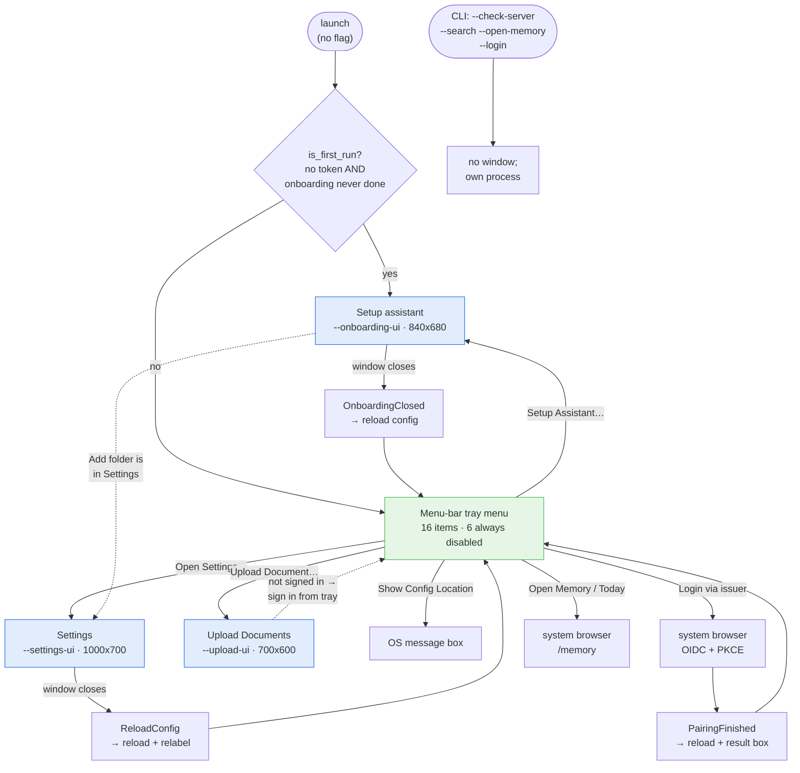
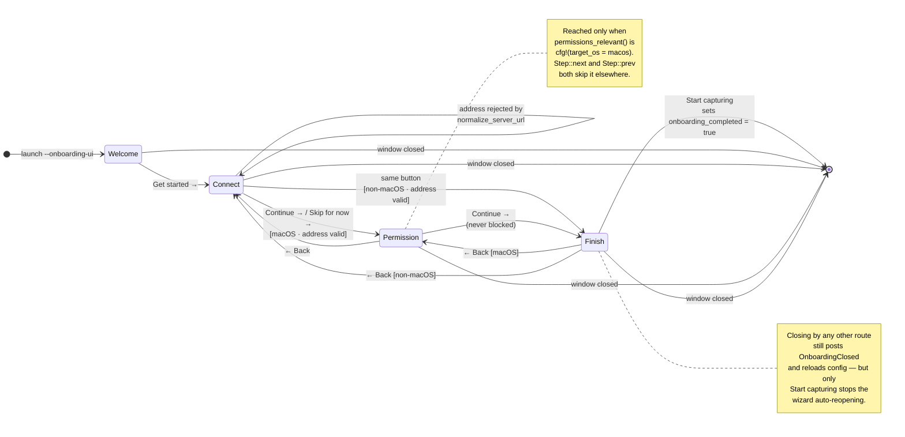

# Companion Capture — User Flows

> **Companion Intelligence — Capture layer.** This document maps every GUI
> surface the app actually ships to the use case it serves and the user stories
> it satisfies. For how the data moves once a control is clicked, see
> [`architecture.md`](architecture.md); for the visual system see
> [`assets/brand.md`](assets/brand.md).

Companion Capture has **four visual surfaces** — one menu-bar menu and three
windows — plus OS-owned modal dialogs and a set of scriptable CLI entry points.
The three windows are **separate processes**: the tray re-executes
`current_exe` with a flag and watches the child, which is why the tray keeps
`settings_open` / `onboarding_open` guards and why closing a window is what
triggers a config reload ([`src/main.rs:280-346`](../src/main.rs)).

Two conventions run through everything below and are worth stating once:

- **A disabled control is a deliberate statement, not an oversight.** Six tray
  rows are permanently disabled because they are read-outs, and two more grey
  out when there is nothing to open. The comment at
  [`src/main.rs:620-621`](../src/main.rs) puts the rule plainly: greying out is
  honest, where a click that pops an error dialog is not.
- **One field gates everything.** `server.applet_auth_token` being non-blank is
  the whole definition of "configured" — it drives the tray status label, the
  wizard's `has_credential()`, the upload window's auth row, and all three
  capture lanes ([`src/server_ingest.rs:115-121`](../src/server_ingest.rs)).

---

## 1. Surface map

The dotted edges are the two places the app tells the user to go somewhere
else rather than doing the job in place: the wizard's Finish summary points at
Settings for watched folders ([`src/onboarding_ui.rs:788`](../src/onboarding_ui.rs)),
and the upload window points at the tray for sign-in
([`src/upload_ui.rs:343`](../src/upload_ui.rs)).

### Roles used below

| Role | Who they are |
|------|--------------|
| **New user** | Just installed; has not signed in; may not own a Companion Memory server yet |
| **Daily user** | Signed in, capturing, interacting through the menu bar only |
| **Privacy-minded user** | Wants to know and control exactly what leaves the machine |
| **Self-hoster / operator** | Runs their own CI-Server; edits addresses, keys and endpoints |
| **macOS user** | Subject to TCC; the only role that meets the Permission step |
| **Support-seeking user** | Something is wrong and they need to read out or test their configuration |

---

## 2. Menu-bar tray menu

**Entry point:** launching the app with no CLI flag. Built once in
`MenuState::new` and re-labelled by `refresh_labels` on every config reload and
every pause/resume ([`src/main.rs:471-531`](../src/main.rs),
[`src/main.rs:560-625`](../src/main.rs)). Tooltip is `Companion Capture`; the
icon comes from `svg_icon::load_tray_icon()` with a drawn fallback
([`src/main.rs:139-145`](../src/main.rs), [`src/main.rs:628-635`](../src/main.rs)).

### 2.1 Controls

Menu order, with the four separators omitted. "Gating" is the condition under
which the row is enabled.

| # | Control | What it does | Gating |
|---|---------|--------------|--------|
| 1 | **Status: …** | Read-out. `⚠︎ Setup needed` → `⚠︎ Permissions needed` → `Monitoring` → `Paused`, in that precedence | **Never enabled** — `MenuItem::new(…, false, …)` plus an explicit `set_enabled(false)` ([main.rs:474-475](../src/main.rs)) |
| 2 | **Pause Captures** / **Resume Captures** | `worker.pause()` / `worker.resume()`, then re-labels | Always |
| 3 | **Capture Now** | `worker.capture_now()` — fires the screenshot *and* vizier lanes off-cycle | Always |
| 4 | **Upload Document…** | Spawns `--upload-ui` | Always. **No open-guard** — repeat clicks spawn repeat windows ([main.rs:307-316](../src/main.rs)) |
| 5 | **Open Companion Memory** | Opens `{origin}/memory` in the default browser | `!portal_url.trim().is_empty()` |
| 6 | **Today's Activity** | Same URL with `from`=today 00:00 UTC, `to`=now, `view=list` | Same as #5 ([main.rs:221-228](../src/main.rs)) |
| 7 | **Screenshot Interval: {n}s** | Read-out of `capture.screenshot_interval_secs` | **Never enabled**; no handler branch |
| 8 | **Diff Threshold: {x.x}%** | Read-out of `capture.diff_threshold_percent` | **Never enabled**; no handler branch |
| 9 | **Identity: user {short} / device {short}** | Read-out; each id is the first UUID segment, or `unset` | **Never enabled** ([main.rs:769-779](../src/main.rs)) |
| 10 | **Portal URL: {url}** | Read-out of the configured server address | **Never enabled** |
| 11 | **Login via {issuer}** | `launch_portal_login()` — OIDC on a background thread, posts `PairingFinished` | Always. Refuses with a dialog if a login is already running or the issuer is blank ([main.rs:359-395](../src/main.rs)) |
| 12 | *(`legacy-postgres`)* **Postgres: {host}:{port} / {db}** | Read-out | **Never enabled**; compiled out by default |
| 13 | *(`legacy-minio`)* **MinIO: {bucket} @ {endpoint}** | Read-out | **Never enabled**; compiled out by default |
| 14 | **Vision: handled by your Companion Memory server** / **Vision: this computer · {model}** | Read-out; text flips on whether `analysis.endpoint` is blank | **Never enabled** ([main.rs:610-618](../src/main.rs)) |
| 15 | **Setup Assistant…** | Spawns `--onboarding-ui` | Always; early-returns while `onboarding_open` |
| 16 | **Open Settings…** | Spawns `--settings-ui` | Always; early-returns while `settings_open` |
| 17 | **Show Config Location** | Info box titled `Config Path` containing `manager.path()` | Always ([main.rs:397-400](../src/main.rs)) |
| 18 | **Quit Companion Capture** | `shutdown()` — worker shutdown, drop the tray icon — then `ControlFlow::Exit` | Always |

A default build renders **16 items**; the two legacy read-outs bring it to 18
only when both features are compiled in. Note that declaration order in
`MenuState::new` differs from menu order — `setup_item` and `settings_item` are
constructed at [main.rs:486-487](../src/main.rs) but appended after the legacy
and vision rows at [main.rs:527-528](../src/main.rs).

### 2.2 Use case

The tray is the app's only persistent surface, so it has to answer three
questions without opening anything: *is it working*, *what is it configured to
do*, and *how do I stop it*. Everything else on the menu is a launcher. That is
why the fourth block is **five** inert read-out rows plus one live action —
**Login via …**, the only enabled row in that block ([main.rs:485](../src/main.rs),
[main.rs:516-525](../src/main.rs)) — rather than six submenus. The interval,
threshold, server URL and vision mode those read-outs mirror are all editable
one click away in Settings, and a menu that both displays and edits the same
value in two places drifts. Identity is the exception: it is a read-out in
*both* surfaces, because the Settings "This device" card renders User and Device
as static mono labels ([settings_ui.rs:886-905](../src/settings_ui.rs)).

The status precedence at [main.rs:563-571](../src/main.rs) encodes the one
non-obvious rule: an unconfigured or permission-blocked applet must never read
as "Monitoring". `⚠︎ Setup needed` outranks `⚠︎ Permissions needed` because
granting Screen Recording on a machine with no server would still capture
nothing anywhere.

### 2.3 User stories

| ID | Story |
|----|-------|
| **TRAY-1** | As a **new user**, I want the menu bar to say `⚠︎ Setup needed` rather than `Monitoring`, so that I don't spend a week assuming my work is being remembered when nothing has been sent. |
| **TRAY-2** | As a **privacy-minded user**, I want one click to pause every capture lane, so that I can take a confidential call without editing config or quitting the app. |
| **TRAY-3** | As a **daily user** with no server configured, I want "Open Companion Memory" to be greyed out, so that I learn the app's state from the menu itself instead of from an error dialog. |
| **TRAY-4** | As a **support-seeking user**, I want the interval, threshold, identity, server URL and vision mode readable in one glance, so that I can report my configuration without hunting for `config.json`. |

---

## 3. Setup assistant (`--onboarding-ui`)

**Entry points:** the tray's "Setup Assistant…", or automatically at launch
when `is_first_run(&config)` — no credential *and* `onboarding_completed` is
false ([`src/main.rs:162-164`](../src/main.rs),
[`src/main.rs:785-787`](../src/main.rs)). Window title
"Welcome to Companion Capture", 840x680, min 720x600, centered
([`src/onboarding_ui.rs:133-140`](../src/onboarding_ui.rs)).

### 3.1 Step machine

The skip is implemented once, in the step machine itself: `Step::next` and
`Step::prev` walk `Step::ALL` and step over `Permissions` when
`permissions::permissions_relevant()` is false
([`src/onboarding_ui.rs:73-96`](../src/onboarding_ui.rs),
[`src/permissions.rs:179-181`](../src/permissions.rs)). One consequence is
visible: the chip row iterates `Step::ALL` directly at
[onboarding_ui.rs:443](../src/onboarding_ui.rs), so the "Permission" chip is
still *drawn* on Linux and Windows even though it can never be reached. The
doc comment at [onboarding_ui.rs:41-42](../src/onboarding_ui.rs) refers to a
`Step::visible` helper that does not exist in the tree.

The `Connect → Connect` self-loop is the deliberate hold: a typed address that
`normalize_server_url` rejects keeps the step so the message lands next to the
field that caused it, rather than a screen later
([onboarding_ui.rs:883-892](../src/onboarding_ui.rs)).

### 3.2 Persistent chrome (all steps)

| Control | What it does | Gating |
|---------|--------------|--------|
| Step chips ("What it does / Connect / Permission / Done") | Progress indicator: `✓ label` on a teal tint when complete, solid teal when current, CARD+FAINT when future | **Not navigation** — allocated `Sense::hover` ([onboarding_ui.rs:458](../src/onboarding_ui.rs)) |
| **← Back** (ghost) | `self.step = prev` | Rendered only when `self.step.prev().is_some()` — absent on step 1 |
| Forward button (right) | One per step; label varies | Always present. There is exactly one forward control per step so Finish is always reachable ([onboarding_ui.rs:873-876](../src/onboarding_ui.rs)) |

All four step bodies live in one `ScrollArea` with `auto_shrink([false,false])`
and fade/rise in over a 0.3 s ease-out-cubic; the header and nav bar are
excluded from the fade so the chips update instantly
([onboarding_ui.rs:945-964](../src/onboarding_ui.rs)). The nav bar is a single
`TopBottomPanel` with the stable id `onboarding_nav` for every step — four
per-step panels made the bar jump as the user advanced
([onboarding_ui.rs:926-934](../src/onboarding_ui.rs)).

### 3.3 Step 1 — "What it does" (Welcome)

Title "Companion Capture". Content is read-only except for one link.

| Control | What it does | Gating |
|---------|--------------|--------|
| Animated capture-flow diagram (150 px) | `theme::capture_flow` — three lanes flowing from a device to a memory node, ~9 s loop, repainted every frame | Decorative; `Sense::hover` ([theme.rs:474](../src/theme.rs)) |
| Lane card: Screens / Activity / Files | Status dot + title + caption. The "Files" caption ends "Off until you pick one." ([onboarding_ui.rs:513-516](../src/onboarding_ui.rs)) | Display only |
| **Companion Hub** inline link | `open_url("https://ci.computer/download")`; hover text is the URL | Always ([onboarding_ui.rs:99-123](../src/onboarding_ui.rs)) |
| **Get started →** | Advance to Connect | Always |

**Use case.** A recorder needs somewhere to record *to*, and a user who
installs this before installing a server has no way to guess that the answer is
"Companion Hub". The step exists to state what the three lanes capture *before*
asking for a credential or an OS grant, and to make the missing-server case one
click rather than a support question. The caption at
[onboarding_ui.rs:536-540](../src/onboarding_ui.rs) commits to the one
guarantee that cannot be toggled off — passwords, SSH keys, `.env` files and
keychains are never read — which is enforced by the non-disableable
`SENSITIVE_PATTERNS` list, not by a setting.

| ID | Story |
|----|-------|
| **SA-1** | As a **privacy-minded user**, I want the first screen to name exactly what the three lanes capture, so that I can decide whether to continue before I hand over any credential. |
| **SA-2** | As a **new user** who found this app before finding the server, I want to be told where to get a Companion Memory server, so that I'm not stuck at a hostname field with nothing to type into it. |

### 3.4 Step 2 — "Connect"

Title "Connect your Companion Memory". Two mutually exclusive top states,
switched on `has_credential()`.

| Control | What it does | Gating |
|---------|--------------|--------|
| Signed-in card (pulsing green dot, `who()`, server URL) | `who()` resolves session email → subject → "Signed in with an access key" → "Signed in". Server line falls back to "Looking for your Companion Memory server…" when blank | Shown when `has_credential()` ([onboarding_ui.rs:557-579](../src/onboarding_ui.rs)) |
| **Continue with Portal** (primary) | `start_login()` — persists the fields, then runs `login_with_portal()` on a thread | Shown when *not* signed in; wrapped in `add_enabled_ui(!running)`. Refuses with a message if `oidc_issuer` is blank |
| **Companion Hub** link | Same download link as step 1 | Shown when not signed in |
| Spinner + "Working…" | Progress for either async job | `job_running()` = login or test channel open |
| Status line | Green `✓ msg` / red `✗ msg` | `status_line.is_some()` |
| **Set things up manually** disclosure | Collapsed by default (`id_salt("onboarding_advanced")`) | Always available |
| ↳ **Your Companion Memory server** field | Canonicalized through `normalize_server_url` on save and **rewritten in place**, so a gained scheme or a stripped `/feed` is visible rather than a silent edit | Always |
| ↳ **Portal sign-in URL** field | Sets `oidc.issuer`; hint/default `https://hub.ci.computer/api/auth` | Always |
| ↳ **…or paste an access key** (password) + **Save** | `start_api_key_save()`: errors "Paste an API key first." when blank; otherwise stores the key, clears `oidc_session`, and chains straight into a connection test | Always |
| ↳ **Test the connection** | `connection_test::test_ci_server` | `add_enabled(!running && has_credential())` — **disabled until a credential exists** |
| **Continue →** / **Skip for now →** | Saves the fields; advances only if the address canonicalized. An *empty* address is a genuine skip and advances | Label flips on `has_credential()`; the caption "You can sign in later from the menu bar." appears when there is none |

**Use case.** This is the step that decides whether the app ever works, and its
design goal is that a correct install requires **zero typing** — the subtitle
says so. Sign-in is browser OIDC, and the server address is then discovered
from the Portal rather than asked for; the manual block is an escape hatch,
which is why it is collapsed and why nothing in it is prefilled with someone
else's hostname ([onboarding_ui.rs:608-610](../src/onboarding_ui.rs)).

Two failure modes are handled explicitly. A mistyped address is the field a new
user is most likely to get wrong, and a bad value saved here surfaces much
later as an opaque ingest error with nothing pointing back at this screen — so
it is canonicalized and rejected *here*
([onboarding_ui.rs:265-288](../src/onboarding_ui.rs)). And a user with no
credential is never trapped: the forward button becomes "Skip for now →" so
Finish — the only thing that sets `onboarding_completed` and stops the wizard
reopening — stays reachable.

| ID | Story |
|----|-------|
| **SA-3** | As a **new user**, I want to sign in through my browser and have my server address found for me, so that I never have to look up a hostname or a port. |
| **SA-4** | As a **self-hoster**, I want a manual address field that tells me immediately when what I typed can't work, so that I find out now instead of debugging silent ingest failures next week. |
| **SA-5** | As an **operator** provisioning a machine, I want to paste a server API key instead of doing a browser login, so that I can set up a box that has no interactive session on it. |
| **SA-6** | As a **new user** without a server yet, I want to skip this step and finish setup anyway, so that the wizard stops reopening on every launch while I go install one. |

### 3.5 Step 3 — "Permission" (macOS only)

Title "One permission". Subtitle: "macOS needs your permission before anything
can see the screen."

| Control | What it does | Gating |
|---------|--------------|--------|
| Permission card | Amber pulsing dot + "Without this, captures come out blank." when not granted; green dot + "Granted — screens and activity will be captured." when granted | `self.perms.screen_recording.is_ok()` |
| **Allow…** (primary) | `permissions::request_screen_recording()` (which triggers `CGRequestScreenCaptureAccess` on the first call only), then opens `x-apple.systempreferences:com.apple.preference.security?Privacy_ScreenCapture` | Shown only when **not** granted |
| **Granted** badge | Static status badge | Shown only when granted ([onboarding_ui.rs:719](../src/onboarding_ui.rs)) |
| **← Back** / **Continue →** | Standard nav | Nothing here blocks advancing |

The card flips on its own: `poll_permissions` re-reads `permissions::status()`
at most once a second while this step is displayed and requests a repaint every
500 ms ([onboarding_ui.rs:843-853](../src/onboarding_ui.rs)). The comment there
states the reason — the grant happens in a *different application*, so making
the user come back and press "Re-check" is asking them to do the computer's
job.

**There is deliberately no Accessibility control on this screen.** Nothing in
the applet or in vizier reads a single Accessibility API — window titles come
from `CGWindowListCopyWindowInfo`, which Screen Recording already gates — and
asking for AX pinned the tray to `⚠︎ Permissions needed` on working installs
([onboarding_ui.rs:740-743](../src/onboarding_ui.rs),
[src/permissions.rs:9-16](../src/permissions.rs); the gate itself is
`needs_attention`, which reads Screen Recording only,
[permissions.rs:74-76](../src/permissions.rs)).

| ID | Story |
|----|-------|
| **SA-7** | As a **macOS user**, I want one button that both prompts and opens the right System Settings pane, so that I don't have to find Privacy & Security → Screen Recording myself. |
| **SA-8** | As a **macOS user**, I want this page to notice the grant on its own, so that I don't have to alt-tab back and click a re-check button. |
| **SA-9** | As a **Linux or Windows user**, I want never to be shown a macOS-only permission step, so that the wizard doesn't ask me to do something my OS has no concept of. |

### 3.6 Step 4 — "Done" (Finish)

Title "You're set". No editable controls — a read-only summary of three
`summary_row`s (✓ green when ok, • amber when not).

| Row | "ok" condition | Detail when not ok |
|-----|----------------|--------------------|
| **Connected to your Companion Memory** | `has_credential()` | "Not signed in — captures will wait on this machine until you are." |
| **Screen Recording allowed** | fresh `permissions::status().screen_recording.is_ok()` | "Captures will be blank until you allow it in System Settings." — **row rendered only when `permissions_relevant()`** ([onboarding_ui.rs:767](../src/onboarding_ui.rs)) |
| **Watching folders for file edits** | `file_tracker.watched_paths.len() > 0` | "Off. Add a folder in Settings whenever you want it." / "1 folder." / "{n} folders." |

| Control | What it does | Gating |
|---------|--------------|--------|
| **← Back** | Permission on macOS, Connect elsewhere | Always |
| **Start capturing** (primary) | `finish()` — reload config from disk, set `onboarding_completed = true`, save, latch `completed`, `ViewportCommand::Close` | Always ([onboarding_ui.rs:418-424](../src/onboarding_ui.rs)) |

**Use case.** The wizard's last job is to be honest about a partial setup. A
user can legitimately arrive here signed out, ungranted, and watching no
folders — and the summary says so per-lane rather than declaring success. The
`finish()` reload-then-mutate is not incidental: the tray process's
token-refresh loop may have rotated `applet_auth_token` while this window sat
open, so writing the startup snapshot back would silently disarm refresh (the
same reload-merge rule as `persist_merged`,
[onboarding_ui.rs:247-263](../src/onboarding_ui.rs)).

| ID | Story |
|----|-------|
| **SA-10** | As a **new user**, I want a per-lane summary of what is actually on before I finish, so that I leave setup knowing whether file tracking is running rather than assuming it is. |
| **SA-11** | As a **daily user**, I want finishing the wizard once to stop it opening on every launch, so that a deliberate skip isn't punished forever. |

---

## 4. Settings window (`--settings-ui`)

**Entry point:** the tray's "Open Settings…", single-instance via the tray's
`settings_open` flag. Title "Companion Capture Settings", 1000x700, min
820x600, centered ([`src/settings_ui.rs:38-43`](../src/settings_ui.rs)).

### 4.1 Chrome — sidebar, footer, shared test row

| Control | What it does | Gating |
|---------|--------------|--------|
| Sidebar nav items | One per `SettingsTab::all()`: Connection / "Your Memory & sign-in", Capture / "What gets captured", Advanced / "Rarely needed" | Fixed 236 px, `resizable(false)`. **No tab is ever runtime-hidden** — Storage and Database are `#[cfg]`-compiled out ([settings_ui.rs:599-608](../src/settings_ui.rs)) |
| Connection status card (bottom of sidebar) | Green "Connected" / amber "Almost there" / red "Not set up", derived from **form contents only** | Never a live probe — the doc comment says so explicitly ([settings_ui.rs:398-413](../src/settings_ui.rs)) |
| Three lane dots + "3 lanes" | Decorative; `Sense::hover` | Display only |
| **Save** (primary) | `validate()` first; on failure writes into `self.error` and returns without saving. Then applies the identity rules, conditionally clears `oidc_session`, writes config, closes the window | Always clickable; blocked by validation |
| **Close** (ghost) | `ViewportCommand::Close`, discarding unsaved edits | Always |
| Config path (mono, left) | `.truncate()`d with a hover tooltip. `truncate` is load-bearing — an egui label does not clip to its rect, so a long path renders over the buttons ([settings_ui.rs:677-679](../src/settings_ui.rs)) | Replaced by a red dot + red error text whenever `self.error` is set |
| **Test connection** row | Ghost button, amber spinner + "Testing…", then a green "Connected" / red "Failed" badge and the detail in mono | Rendered only when `tab.has_connection()` = `!matches!(self, Capture \| Advanced)` |

**What blocks Save** ([settings_ui.rs:456-512](../src/settings_ui.rs)):
non-UUID User ID; a blank server address whenever the mode is OIDC *at all*, or
whenever the mode is API key and a key has been pasted — note that
`has_oidc_issuer` at [settings_ui.rs:463](../src/settings_ui.rs) tests the
selected **mode**, not whether an issuer is actually present, so OIDC mode with
an empty issuer still demands an address;
an address `normalize_server_url` rejects; a blank API key in API-key mode with
a non-blank address; in OIDC mode — a blank or unparseable issuer, a blank
client ID, blank scopes, an unparseable redirect URI, or a redirect that is not
`http://127.0.0.1:<port>/…`; `screenshot_interval_secs == 0`; a diff threshold
outside 0–100. **Postgres port is deliberately not validated** — the default
build never opens a database connection, so a stale `postgres.port: 0` in an
old `config.json` must not block saving a perfectly valid server URL
([settings_ui.rs:507-510](../src/settings_ui.rs)).

Editing any field on a tab clears `self.error` and discards that tab's cached
test result ([settings_ui.rs:544-548](../src/settings_ui.rs)).

> **Observed dead branch.** `run_test` has an `Advanced → test_vision` arm at
> [settings_ui.rs:375](../src/settings_ui.rs), but `has_connection()` excludes
> `Advanced` at [settings_ui.rs:229](../src/settings_ui.rs), so no test row is
> ever rendered on that tab and the vision probe is unreachable from the UI.

| ID | Story |
|----|-------|
| **SET-1** | As a **self-hoster**, I want Save refused with a specific message when a field can't work, so that I never persist a configuration that fails silently at ingest time. |
| **SET-2** | As a **support-seeking user**, I want the config file path visible in the footer, so that I can open or attach it without guessing the platform's data directory. |
| **SET-3** | As a **daily user**, I want Close to discard my edits, so that opening Settings to *look* at something can't accidentally change it. |

### 4.2 Connection tab (default)

Header: "Connection" / "Sign in with Companion and we'll connect this computer
to your Memory." Portal-first guided state machine (mirrors onboarding Connect).
Manual URL / API key / OIDC client wiring live under **Advanced → Manual
connection**.

| Control | What it does | Gating |
|---------|--------------|--------|
| **Status hero** | Live card: Not set up / Signing in / Choose a Memory / Find your Memory / Connected (plus account + Memory target when known) | Always |
| **Sign in with Companion** | Primary CTA — runs `login_with_portal` (browser OIDC), reloads config, auto-discovers Memory when possible | Signed out |
| **Memory cards** + **Use this Memory** | One-click bind via `portal_apps::apply_discovered_memory`, then probes | Signed in and multiple Memories, or Switch Memory |
| **Find my Memory** | Retries Portal `/api/users/me/apps` discovery | Signed in, no Memory URL yet / empty list |
| **Check connection** | `connection_test::test_ci_server` with Connected/Failed badge (same rect radius as ghost buttons) + actionable hint | Connected |
| **Switch Memory** / **Sign out** | Ghost actions — re-open picker, or clear session (discovered URL cleared; manual URL kept) | Connected + OIDC for Switch |
| **This device** card | Read-only User / Device UUIDs | Connected only |

Footer **Test connection** is **not** shown on Connection (`has_connection()` is
false for this tab); the probe is the hero CTA.

| ID | Story |
|----|-------|
| **SET-4** | As a **daily user**, I want one Sign in with Companion button on Connection, so that I never have to type a Memory hostname. |
| **SET-5** | As a **multi-Hub user**, I want one-click Memory cards after sign-in, so that I can pick which device this Capture sends to. |
| **SET-6** | As a **signed-in daily user**, I want Settings never to render my JWT into an API-key box on Connection (manual key stays under Advanced). |
| **SET-7** | As a **support-seeking user**, I want Check connection with a Failed/Connected badge and a hint that distinguishes credential rejection from unreachable Memory. |

### 4.3 Capture tab

Header: "Capture" / "What gets recorded from this computer, and how often."

| Control | What it does | Gating |
|---------|--------------|--------|
| Interval **−** | `saturating_sub(30).max(30)` — floors at 30 s, can never reach 0 | Always |
| Interval **+** | `+30`, capped at 86 400 | Always |
| Interval readout | Large number + "s". Caption "Floored to 30s · default 300s" — the config default is 300 ([src/config.rs:131](../src/config.rs)) and the worker itself floors at `MIN_INTERVAL_SECS = 30` ([src/worker.rs:30](../src/worker.rs), [worker.rs:389-394](../src/worker.rs)) | Display |
| Diff threshold slider | `Slider::new(…, 0.0..=100.0).show_value(false)`; the value is drawn separately as a large teal number + "%" | Always |
| **Start when you log in** toggle | "Open Companion Capture automatically the next time you log in." Writes `config.autostart.enabled`; the *tray*, not this window, applies it — `main::sync_autostart` runs on every config reload and registers/removes the login item through `auto-launch` (LaunchAgent plist on macOS, HKCU `Run` on Windows, XDG autostart `.desktop` on Linux). Because it is re-applied on every reload rather than only on change, it also self-heals an entry deleted by hand or a binary that moved | Always. **On by default after onboarding** (`onboarding_ui::mark_onboarding_complete`) but off in `AutostartConfig::default()`, so a `config.json` restored from backup or synced from another machine never silently gains a login item |
| Lane rows: Screens / Activity / Files | `theme::lane_row` — accent dot, title, subtitle, mono tag. Files is tagged `on` only when `watched_paths` is non-empty | **Display only** — `lane_row` allocates `Sense::hover` and has no click handling ([src/theme.rs:780-802](../src/theme.rs)). **There is no toggle for the Screens or Activity lanes anywhere in this UI** |
| **Add folder…** (primary) | `tinyfiledialogs::select_folder_dialog("Watch a folder", start)`, starting at the parent of the last watched path → home dir → empty. On pick, also force-sets `file_tracking_enabled = true` | Always |
| Empty state card | "No folders watched yet — file tracking is off. …" | `watched_paths.is_empty()` |
| Per-folder card | Green dot when `path.is_dir()`, amber otherwise; basename + full path in mono (amber when missing) + "This folder is missing — it will be skipped." | One per watched path |
| **Remove** (ghost) | Deletes that entry | One per watched path |
| **File tracking enabled** toggle | "Turn off to stop watching without losing the folder list." | **Rendered only when the folder list is non-empty** ([settings_ui.rs:1286-1292](../src/settings_ui.rs)) |
| *(no test row)* | — | `has_connection()` is false for Capture, and `run_test` early-returns for this tab ([settings_ui.rs:380](../src/settings_ui.rs)) |

Folder-picker rules, applied before a pick reaches the list
([settings_ui.rs:1207-1227](../src/settings_ui.rs)): an exact duplicate is
ignored; a path already covered by an existing watched folder is ignored and
logged; adding a parent `retain`s away any nested children already listed —
keeping both would emit duplicate events.

**Use case.** This tab is where the file lane is *armed*. Until the picker
existed, the wizard told users to "open Settings to add folders you want
tracked" against a Settings window that had no such control, leaving the whole
watcher → queue → extractor path reachable only by hand-editing `config.json`
([settings_ui.rs:1181-1186](../src/settings_ui.rs)). The lane's consent gate is
`watched_paths` being non-empty, which is why the empty state is a full card
saying the lane is off rather than an empty list, and why adding a folder
force-enables tracking.

The screens and activity lanes have no off switch here because pausing them is
the tray's job (`Pause Captures`) and their per-lane behaviour is governed by
interval and threshold rather than a boolean.

The Screens lane's subtitle promises "Paused while locked", and as of
`clau/xplat-autostart-lock-idle` that is true on every OS rather than macOS
only — it used to be a `.macos` locale sibling. The screenshot lane is also
skipped after a full interval with no keyboard or mouse input on macOS and
Windows; the Activity lane deliberately keeps running through idle time, since
a build or a video still produces focus/window/fs activity worth timelining.
Linux has no idle probe, so nothing is skipped there. See
[`src/lock_detect.rs`](../src/lock_detect.rs) and `worker::is_idle_past_interval`.

| ID | Story |
|----|-------|
| **SET-8** | As a **daily user**, I want to pick which folders are watched from a normal folder picker, so that arming the file lane doesn't require editing JSON. |
| **SET-9** | As a **privacy-minded user**, I want no folder watched until I explicitly add one, so that installing the app never starts reading my documents. |
| **SET-10** | As a **daily user**, I want to stop file tracking without losing my folder list, so that a temporary pause doesn't cost me the setup. |
| **SET-11** | As a **user on a metered or slow link**, I want to raise the screenshot interval and the diff threshold, so that I control how much this machine sends. |
| **SET-12** | As a **daily user**, I want the applet to come back by itself after a reboot, so that a machine that restarts overnight doesn't quietly stop capturing until I notice. |

### 4.4 Advanced tab

Header: "Advanced" / "You shouldn't need anything on this page. It's here for
unusual setups." Everything here is about *who describes screenshots*;
`local` = `analysis_endpoint` is non-blank.

| Control | What it does | Gating |
|---------|--------------|--------|
| Status card | Green + "Your Companion Memory server describes them" when the endpoint is blank; amber + "This computer describes them" when set | Read-only |
| Amber warning | "⚠ Full screenshots are POSTed to this address. … a public API endpoint here would send your screen contents to a third party." | Shown only when `local` ([settings_ui.rs:957-970](../src/settings_ui.rs)) |
| **Use a vision model on this computer instead** disclosure | `id_salt("settings_local_vision")`, `default_open(local)` — collapsed on a default install, auto-expanded when an endpoint already exists | Always present |
| ↳ **Endpoint** (mono) | Base URL; the client POSTs `{endpoint}/chat/completions` (OpenAI protocol). Hint says "leave blank to use your Companion Memory server" | Always |
| ↳ **API key** (password) | Bearer for that endpoint. Hint: "lm-studio (local endpoints often ignore this)" | Always |
| ↳ **Model** (mono) | Model id sent in the request | Always |
| *(no test row)* | — | `has_connection()` excludes Advanced — see the dead-branch note in §4.1 |

**Use case.** The empty endpoint is the correct default and is pinned by a test
([`src/config.rs:412`](../src/config.rs) —
`default_endpoint_is_empty_so_server_analyses`), because a non-empty default
once broke installs into zero-metadata frames. An empty value tells the worker
to set `skipDescription=false` and let CI-Server run its own description. This
page exists for the minority who want the vision pass on the laptop, and its
whole job is to make the *consequence* of filling the field impossible to miss
before it is filled — the field is an unrestricted URL that will happily accept
a public cloud API ([settings_ui.rs:954-956](../src/settings_ui.rs)).

| ID | Story |
|----|-------|
| **SET-12** | As a **self-hoster with a local VLM**, I want to point screenshot description at LM Studio on this machine, so that image analysis never leaves the laptop at all. |
| **SET-13** | As a **privacy-minded user**, I want an explicit warning that full screenshots are POSTed to whatever I type here, so that I don't paste a cloud endpoint without understanding what it does. |

### 4.5 Storage / Database tabs (legacy, compiled out by default)

Neither tab exists in a default build: the variant, its `all()` entry, its
label/subtitle/accent arms and its render function are all behind
`#[cfg(feature = "legacy-minio")]` / `#[cfg(feature = "legacy-postgres")]`
([settings_ui.rs:182-186](../src/settings_ui.rs),
[settings_ui.rs:237-241](../src/settings_ui.rs)). Hiding them at runtime was
worse than useless — the Storage tab configured a module that is not even
compiled into a default build, so every field in it was inert
([settings_ui.rs:168-176](../src/settings_ui.rs)).

| Tab | Controls | Test probe |
|-----|----------|------------|
| **Storage** (`legacy-minio`) | Endpoint (mono); Bucket + Region side by side; Access Key (mono) + Secret Key (password); **Use SSL** toggle row | `connection_test::test_minio` — reports "Bucket '{name}' reachable" or the error |
| **Database** (`legacy-postgres`) | Host (mono) + **Port** — the only `DragValue` in the app, ranged `1..=65535` at speed 1.0; Database + User; Password; **Require SSL** toggle row | `connection_test::test_postgres` — refuses with "Set a database host first." when the host is blank |

| ID | Story |
|----|-------|
| **SET-14** | As an **operator migrating an old install**, I want the legacy MinIO and Postgres panes to be absent from a normal build, so that nobody configures a data path this laptop cannot use. |
| **SET-15** | As an **operator with a legacy build**, I want a test button on each legacy pane, so that I can confirm the bucket or database is reachable before saving. |

---

## 5. Upload Documents window (`--upload-ui`)

**Entry point:** the tray's "Upload Document…". Title "Upload Documents —
Companion Capture", 700x600, min 560x440, centered
([`src/upload_ui.rs:19-24`](../src/upload_ui.rs)). Single central panel, no
tabs. Single-instance via the tray's `upload_pid`, the same guard Settings and
the wizard use: a second "Upload Document…" raises the live window instead of
spawning another, and the `UploadClosed` event clears the PID when the child
exits. Raising is real on macOS and Windows; on Linux the duplicate is still
suppressed but the window is not brought forward
([`src/main.rs`](../src/main.rs) `open_upload_window`, `bring_pid_to_front`).

| Control | What it does | Gating |
|---------|--------------|--------|
| Auth row | Green dot + "Signed in", or amber dot + "Not signed in — choose "Login to Portal" in the menu bar first" | `is_authenticated()` = non-blank `applet_auth_token`. **There is no sign-in control in this window** ([upload_ui.rs:331-348](../src/upload_ui.rs)) |
| **Upload** (primary) | `start_upload` — flips every `Queued` entry to `Uploading` and spawns the batch | `add_enabled_ui(can_upload)` where `can_upload = authed && !uploading && any Queued`. Disabled hover text: "Sign in first: menu bar → "Login to Portal"." |
| **Add Files…** (ghost) | `tinyfiledialogs::open_file_dialog_multi("Select Documents", …)` filtered to `*.pdf *.docx *.xlsx *.xls *.doc *.csv *.txt *.md *.markdown`; paths already listed are skipped | Always ([upload_ui.rs:133-164](../src/upload_ui.rs), [src/server_upload.rs:339-343](../src/server_upload.rs)) |
| Red error label | Bound to `self.upload_error` | **Unreachable** — the field is initialised to `None` and only ever reset to `None` in `start_upload`; nothing assigns `Some`. Batch failures surface per-row instead ([upload_ui.rs:98](../src/upload_ui.rs), [upload_ui.rs:119](../src/upload_ui.rs), [upload_ui.rs:179](../src/upload_ui.rs)) |
| Dropzone (84 px, dashed, "Drop documents to upload") | — | **Decorative** — allocated `Sense::hover` and there is no `dropped_files` / `DroppedFile` handling anywhere in `src/`, so dragging files onto it does nothing ([upload_ui.rs:414-418](../src/upload_ui.rs)) |
| Empty state card | "No files added yet." | `files.is_empty()` |
| File row | Coloured extension badge + filename + status pill | One per file; **no remove or retry control** — closing the window is the only way to clear the list |

Status pills ([upload_ui.rs:484-521](../src/upload_ui.rs)):

| Pill | Colour | Meaning / hover |
|------|--------|-----------------|
| Queued | muted | Not yet sent |
| Uploading | amber | Upload request in flight |
| Processing | amber | Covers both `Polling` and `AlreadyUploaded` |
| Ready | green | Parse completed |
| Parse failed | red | Hover shows the server error |
| Already uploaded | muted | "This file already exists on the server. Parsing may take a few minutes for larger documents." |
| Uploaded · not parsed | muted | "File type is not parsed, but the file was uploaded successfully." |
| Upload failed | red | Hover shows the error |

**Use case.** The three capture lanes only see what you look at, run, or edit
inside a watched folder. This window is the manual door for documents that
never pass through any of them — a PDF someone emailed, a spreadsheet from a
share. It deliberately does no parsing itself: it uploads and then polls
CI-Server for parse status, which is why the per-row pill distinguishes
*uploaded* from *parsed* from *not a parseable type*. The Upload button
re-enables only when nothing is still `Uploading`/`Polling`/`AlreadyUploaded`
and something new is `Queued` ([upload_ui.rs:286-297](../src/upload_ui.rs)).

| ID | Story |
|----|-------|
| **UP-1** | As a **daily user**, I want to add a PDF someone sent me to my Companion Memory, so that documents I never edit locally are still recallable. |
| **UP-2** | As a **daily user**, I want per-file status, so that I can tell a parse failure from a network failure from a file type the server doesn't parse. |
| **UP-3** | As a **new user** who opened this before signing in, I want the Upload button disabled with hover text naming the menu-bar item, so that I know exactly where to go. |
| **UP-4** | As a **daily user** re-uploading a file, I want "Already uploaded" rather than a duplicate, so that I don't have to track what I've already sent. |

---

## 6. Modal dialogs and native pickers

These are OS-owned surfaces the app raises. All message boxes are
single-button OK dialogs via `tinyfiledialogs::message_box_ok`, raised from the
**tray process** ([`src/main.rs:654-656`](../src/main.rs)).

| Dialog | Title / icon | Raised by |
|--------|--------------|-----------|
| Error box | "Companion Capture" / Error | Executable not found for any of the three windows; launch failure for any of the three; "Unable to reload configuration…"; "Linked account, but failed to reload configuration."; "Portal login is already in progress."; "OIDC issuer is not configured (config.json → oidc.issuer)."; the multi-line sign-in failure naming the issuer and the OIDC client id; "Can't work out your Companion Memory server address: {err}"; "Couldn't open {url}: {err}" |
| Config path | "Config Path" / Info | Tray → Show Config Location ([main.rs:397-400](../src/main.rs)) |
| Sign-in result | "Companion Capture" / Info | `PairingFinished { success: true }` — body is `Signed in as {who}.` followed by the discovery note built by `resolve_core_url` ([main.rs:872-878](../src/main.rs), [main.rs:264-276](../src/main.rs), [main.rs:890-948](../src/main.rs)) |

The sign-in note — the second sentence of that dialog — is the one dialog text
that is load-bearing, because it is where server auto-discovery reports what it
did:

| Portal result | Discovery note |
|---------------|----------------|
| Exactly one `ci-memory` app | "Saving to your Companion Memory server on {device}." / "Connected to {url}." — **and the address is written with `url_source = Discovered`** |
| Zero registered | "No Companion Memory server is registered to your account yet. Install Companion Hub from ci.computer/download to run one, then add its address in Settings." |
| Two or more | "You have Companion Memory on {n} machines — pick which one this computer should record to in Settings." — picking one would silently stream this machine's captures to the wrong box ([main.rs:923-928](../src/main.rs)) |
| Manual address already set, or Portal has no discovery endpoint | "Captures will now be attributed to that account." |
| Portal refused the access token | "Signed in, but your portal wouldn't share your server address — add it in Settings." |
| Discovery errored | "Signed in. Add your Companion Memory server in Settings." |

Native pickers:

| Picker | Opens at | Filter |
|--------|----------|--------|
| **Watch a folder** (folder select) | Parent of the most recent watched path → home dir → empty | — |
| **Select Documents** (multi-select) | — | "Supported Documents" = `*.pdf *.docx *.xlsx *.xls *.doc *.csv *.txt *.md *.markdown` |
| macOS System Settings → Privacy → Screen Recording | `x-apple.systempreferences:com.apple.preference.security?Privacy_ScreenCapture` | Off macOS this constant is the empty string ([src/permissions.rs:156](../src/permissions.rs)) |

| ID | Story |
|----|-------|
| **DLG-1** | As a **user with two Companion Memory servers**, I want to be told to choose rather than have one picked for me, so that my captures don't silently land on the wrong machine. |
| **DLG-2** | As a **support-seeking user**, I want sign-in failures to name the issuer and the OIDC client id, so that I can hand my operator something actionable. |

---

## 7. Command-line surfaces (no window)

Argument handling runs **before config load**, in this order, each returning
immediately ([`src/main.rs:65-115`](../src/main.rs)).

| Flag | What it does | Failure surface |
|------|--------------|-----------------|
| `--settings-ui` / `--upload-ui` / `--onboarding-ui` | Open the three windows directly; also how the tray spawns them | — |
| `--check-server [--portal <url>\|--portal=<url>]` | Prints a plain-text self-test titled "Companion Capture → server connection check" with a rule sized from the title, listing Portal URL, parsed Origin, GraphQL candidates and file-upload candidates, then a live probe | "✗ cannot parse portal URL: {err}". The `--portal` override is canonicalized through `normalize_server_url` exactly as the GUI forms do, and applies to an **in-memory** config only ([main.rs:755-767](../src/main.rs), [src/server_check.rs:25-70](../src/server_check.rs)) |
| `--search <query>` / `--search=<query>` | Opens `/memory?search=…&view=list` in the browser and prints the URL | "No Companion Memory server configured. Set one in Settings, or run --login." / ""{addr}" isn't a usable Companion Memory server address. Fix it in Settings." |
| `--open-memory` | Same without query params | Same |
| `--login` | Runs the browser OIDC Authorization Code + PKCE flow headlessly, stores tokens, prints the sign-in message plus subject, email, expiry, the id_token's `aud` and `iss`, `user_id` and `device_id` | "Portal sign-in failed: {err}" to stderr, exit 1 |

`--search` and `--open-memory` run in the **invoking** process rather than
messaging the tray, so they work whether or not the menu-bar app is running —
a Shortcut should not fail because the user quit the tray
([main.rs:700-703](../src/main.rs)). That is the entire reason these exist:
they are meant to be driven by macOS Shortcuts' "Run Shell Script" action,
which is what people mean when they ask for Siri
([main.rs:85-89](../src/main.rs), see [`siri-test-plan.md`](siri-test-plan.md)).

| ID | Story |
|----|-------|
| **CLI-1** | As a **support-seeking user**, I want a self-test that prints exactly which URLs the app will call, so that I can see whether the problem is my address, my proxy, or my credential. |
| **CLI-2** | As a **daily user**, I want to ask Siri to search my memory, so that recall works without finding the menu bar. |
| **CLI-3** | As an **operator** provisioning a headless box, I want `--login` to complete a full OIDC sign-in and print the resolved audience, so that I can verify CI-Server's `PORTAL_OIDC_AUDIENCE` matches without guessing. |

---

## 8. Traceability

Where a story's *behaviour* is pinned by an automated test, it is named. Where
it is not, the entry says **manual only** — egui/eframe is immediate mode, so
every widget function takes `&mut egui::Ui` and only exists inside a live frame
with a windowing backend; `theme.rs`, `onboarding_ui.rs` and `upload_ui.rs`
have no test modules at all, and `settings_ui.rs`'s five tests cover pure form
state, not rendering.

| Story | Screen | Automated test |
|-------|--------|----------------|
| TRAY-1 | Tray | **manual only** — `refresh_labels` status precedence ([main.rs:563-571](../src/main.rs)) has no test; the underlying `is_configured` is untested directly |
| TRAY-2 | Tray | **manual only** — worker pause/resume has no test |
| TRAY-3 | Tray | Partial: `server_common::memory_url_rejects_an_unset_server` ([server_common.rs:405](../src/server_common.rs)) pins the error case; the `set_enabled(has_server)` gate itself is manual |
| TRAY-4 | Tray | **manual only** — every read-out string is composed in `refresh_labels` ([main.rs:560-625](../src/main.rs)), which has no test. (`svg_icon::embedded_tray_mark_rasterizes_at_every_platform_size` ([svg_icon.rs:101](../src/svg_icon.rs)) covers the tray *icon* rasterizing, which is not what this story is about.) |
| SA-1 | Setup · Welcome | **manual only**; the guarantee it states is pinned by `worker::sensitive_fs_event_paths_are_dropped` ([worker.rs:900](../src/worker.rs)) |
| SA-2 | Setup · Welcome | **manual only** |
| SA-3 | Setup · Connect | `oidc::authorize_url_has_all_pkce_params` ([oidc.rs:424](../src/oidc.rs)); `oidc::ephemeral_port_is_resolved_into_the_redirect_uri` ([oidc.rs:384](../src/oidc.rs)); `oidc::loopback_captures_code_and_state` ([oidc.rs:500](../src/oidc.rs)). Discovery (`resolve_core_url`) is **untested** |
| SA-4 | Setup · Connect | `server_common::scheme_less_address_gets_one_instead_of_becoming_hostless` ([server_common.rs:414](../src/server_common.rs)); `local_addresses_get_http_and_public_ones_get_https` ([:429](../src/server_common.rs)); `an_explicit_scheme_is_always_respected` ([:447](../src/server_common.rs)); `junk_is_rejected_rather_than_saved` ([:468](../src/server_common.rs)) |
| SA-5 | Setup · Connect | `server_common::detects_ci_server_api_key_shape` ([server_common.rs:313](../src/server_common.rs)); end-to-end `x-api-key` delivery by `file_tracker::file_edit_reaches_server_with_content_and_api_key_and_drains_queue` ([file_tracker.rs:578](../src/file_tracker.rs)) |
| SA-6 | Setup · Connect | **manual only** — `is_first_run` ([main.rs:785](../src/main.rs)) is untested |
| SA-7 | Setup · Permission | `permissions::macos_gates_capture_and_has_settings_links` ([permissions.rs:244](../src/permissions.rs)) pins the deep link; `request_screen_recording` is never called by any test |
| SA-8 | Setup · Permission | **manual only** — `poll_permissions` needs a live `egui::Context` |
| SA-9 | Setup · Permission | `permissions::non_macos_requires_nothing` ([permissions.rs:233](../src/permissions.rs)) pins the platform predicate; the `Step::next`/`prev` skip itself is **untested** |
| SA-10 | Setup · Finish | `permissions::accessibility_does_not_gate_capture_readiness` ([permissions.rs:203](../src/permissions.rs)) and `missing_screen_recording_is_still_a_problem` ([:213](../src/permissions.rs)) pin the row's ok/not-ok rule; the row itself is manual |
| SA-11 | Setup · Finish | `config::config_loads_with_every_section_absent` ([config.rs:431](../src/config.rs)) guards the persistence path; the `onboarding_completed` latch is **untested** |
| SET-1 | Settings · chrome | **manual only** — `SettingsApp::validate` ([settings_ui.rs:456](../src/settings_ui.rs)) is pure, takes only `&self`, and has no test despite needing none |
| SET-2 | Settings · chrome | **manual only** |
| SET-3 | Settings · chrome | **manual only** |
| SET-4 | Settings · Connection | `settings_ui::feed_page_url_normalizes_to_origin` ([settings_ui.rs:1045](../src/settings_ui.rs)); `api_base_path_is_preserved` ([:1057](../src/settings_ui.rs)); `server_common::origin_without_path_returns_prefixed_then_bare_candidates` ([server_common.rs:330](../src/server_common.rs)) |
| SET-5 | Settings · Connection | **manual only** |
| SET-6 | Settings · Connection | `settings_ui::oidc_session_infers_oidc_mode_not_api_key` ([settings_ui.rs:1017](../src/settings_ui.rs)); `pasted_key_without_session_infers_api_key_mode` ([:1031](../src/settings_ui.rs)); `issuer_only_infers_oidc_mode` ([:1038](../src/settings_ui.rs)) |
| SET-7 | Settings · Connection | **manual only** — `connection_test.rs` has no test module |
| SET-8 | Settings · Capture | **manual only** — the picker is a native modal; the dedupe rules at [settings_ui.rs:1207-1227](../src/settings_ui.rs) are untested |
| SET-9 | Settings · Capture | **manual only** — the `file_tracker::is_runnable` gate ([file_tracker.rs:60-63](../src/file_tracker.rs)) is untested, and **no test asserts the empty `watched_paths` default** ([config.rs:187](../src/config.rs)): `config_loads_with_every_section_absent` ([config.rs:431](../src/config.rs)) checks only the interval, the Postgres port, the portal URL and `onboarding_completed` |
| SET-10 | Settings · Capture | **manual only** |
| SET-11 | Settings · Capture | Partial: `capture_store::fresh_frames_are_left_alone` ([capture_store.rs:142](../src/capture_store.rs)), `age_cap_prunes_and_zero_disables` ([:167](../src/capture_store.rs)), `size_cap_evicts_oldest_first_and_zero_disables` ([:182](../src/capture_store.rs)) cover retention. `capture::diff_percent` — which the threshold drives — has **no test at all** |
| SET-12 | Settings · Advanced | **manual only** — `analysis::analyze` has no request-level test; only the response parser is covered |
| SET-13 | Settings · Advanced | `config::default_endpoint_is_empty_so_server_analyses` ([config.rs:412](../src/config.rs)) pins that the lane is off by default |
| SET-14 | Settings · legacy | Compile-time: the tabs are `#[cfg]`-gated, so the default `cargo test` build cannot reach them |
| SET-15 | Settings · legacy | **manual only** |
| UP-1 | Upload | **manual only** — `server_upload.rs` has no test module |
| UP-2 | Upload | **manual only** — `sanitize_parse_error` ([server_upload.rs:307](../src/server_upload.rs)) is pure and untested |
| UP-3 | Upload | **manual only** |
| UP-4 | Upload | **manual only** |
| DLG-1 | Sign-in dialog | **manual only** — `resolve_core_url` ([main.rs:890-948](../src/main.rs)) is untested, including the multi-server safety branch |
| DLG-2 | Error dialog | **manual only** |
| CLI-1 | `--check-server` | **manual only** — `server_check::report` has no test; the URL builders it prints are covered by `server_common::origin_without_path_returns_prefixed_then_bare_candidates` ([server_common.rs:330](../src/server_common.rs)) |
| CLI-2 | `--search` | `server_common::memory_url_targets_the_spa_on_the_ingest_origin` ([server_common.rs:374](../src/server_common.rs)); `memory_url_percent_encodes_query_values` ([:390](../src/server_common.rs)) — an unencoded `&` would read as a second parameter and truncate the Windows shell invocation. `parse_flag_value` itself is **untested** |
| CLI-3 | `--login` | `main::decodes_string_aud_and_iss` and siblings ([main.rs:1332-1373](../src/main.rs)) cover only the display-only JWT decoder; the flow is covered by the `oidc.rs` tests listed under SA-3 |

### Coverage summary

| Surface | Stories | Automated (full or partial) | Manual only |
|---------|---------|------------------------------|-------------|
| Tray menu | 4 | 1 (partial) | 3 |
| Setup assistant | 11 | 7 | 4 |
| Settings | 15 | 5 | 10 |
| Upload | 4 | 0 | 4 |
| Dialogs | 2 | 0 | 2 |
| CLI | 3 | 2 | 1 |

The shape of that table is expected but not entirely fair to itself. The
genuinely untestable part is *rendering* — an immediate-mode widget cannot be
driven without a windowing backend. The part that is testable and untested is
smaller and more specific: `SettingsApp::validate` and `build_config`
([settings_ui.rs:456](../src/settings_ui.rs),
[settings_ui.rs:297](../src/settings_ui.rs)), the wizard's
`normalized_server_url` and `has_credential`
([onboarding_ui.rs:243-288](../src/onboarding_ui.rs)), `is_first_run`
([main.rs:785](../src/main.rs)), `resolve_core_url`
([main.rs:890](../src/main.rs)), and `capture::diff_percent`
([src/capture.rs:46](../src/capture.rs)) are all pure or near-pure functions
that need no `Ui` at all.

---

## 9. Observed states worth knowing

Four things a reader will find in the UI that the code says are not what they
appear to be. None is load-bearing; all four are recorded here so the next
person does not rediscover them from scratch.

| Surface | State | Why |
|---------|-------|-----|
| Upload window | The dashed "Drop documents to upload" zone accepts no drops | Allocated `Sense::hover` ([upload_ui.rs:415-418](../src/upload_ui.rs)); no `dropped_files` / `DroppedFile` handling exists anywhere in `src/` |
| Upload window | The red `upload_error` label can never appear | The field is initialised to `None` and only ever reset to `None`; nothing assigns `Some`. Batch failures surface per-row ([upload_ui.rs:98](../src/upload_ui.rs), [:179](../src/upload_ui.rs)) |
| Settings · Advanced | No "Test connection" row, despite `run_test` having an `Advanced → test_vision` arm | `has_connection()` excludes `Advanced` ([settings_ui.rs:229](../src/settings_ui.rs)), so the row is never rendered and [settings_ui.rs:375](../src/settings_ui.rs) is unreachable from the UI |
| Setup assistant | The "Permission" chip is drawn on Linux and Windows | The chip row iterates `Step::ALL` ([onboarding_ui.rs:443](../src/onboarding_ui.rs)) rather than the runtime-visible set that `Step::next`/`prev` walk. The doc comment at [onboarding_ui.rs:41-42](../src/onboarding_ui.rs) names a `Step::visible` helper that does not exist |
