# CI-Applet — Roadmap

> Derived from the three open issues on [companionintelligence/CI-Applet](https://github.com/companionintelligence/CI-Applet/issues) and from the gaps the current source tree makes obvious. The current build is a Rust/`tao`/`tray-icon` screenshot+vizier capture loop ([architecture.md](architecture.md)); these issues redirect it toward a broader **personal activity mirror** that handles file lifecycle events and LLM-ready document conversion in addition to screen capture.

---

## 1. Open issues at a glance

| # | Title | State | Theme | Status today |
|---|---|---|---|---|
| [#1](https://github.com/companionintelligence/CI-Applet/issues/1) | App refresh with Tauri | Open | Shell migration | Not started. Current shell is Rust + `tao` + `tray-icon` + `eframe/egui` sub-windows. |
| [#3](https://github.com/companionintelligence/CI-Applet/issues/3) | Add "Activity Sync & LLM Indexer" | Open | Capture pivot | Not started. Current capture is screen-only; no filesystem watcher, no Markdown converter. |
| [#4](https://github.com/companionintelligence/CI-Applet/issues/4) | Redesign around file tracking — **activity events** + **document versions** | Open | Data model pivot | Not started. Today only `ci.screen_captures` + `ci.user_snapshots` exist on the wire. |

> **Reading these three together:** #3 and #4 are essentially the same product pivot at different levels of detail (#3 = pipeline & formats; #4 = product/data model). #1 is the shell change that should ride along with that pivot. The roadmap below treats #3 and #4 as one program of work.

---

## 2. Where we are vs. where the issues point

```mermaid
flowchart LR
    subgraph Today["Today"]
      T1["Screenshot every ≥30s"]
      T2["Vision LLM analysis"]
      T3["vizier observations"]
      T4["Tray (tao) + egui sub-windows"]
      T5["Paired ingest to CI-Server<br/>(/api/files/upload + ingestUserSnapshot)"]
    end
    subgraph Target["After #1 + #3 + #4"]
      G1["File watcher (native: FSEvents/inotify/ReadDirectoryChangesW)"]
      G2["Activity event normalizer<br/>(create/modify/move/rename/delete)"]
      G3["Markdown conversion pipeline<br/>(PDF/DOCX/PPTX/XLSX/HTML/CSV/JSON/EPUB/ZIP)"]
      G4["OCR + audio transcription"]
      G5["Local SQLite queue, offline-first sync"]
      G6["Tauri v2 shell, multi-platform installers"]
      G7["File / version / event / document data model on CI-Server"]
    end
    Today --> Target
```

| Capability | Today | Target |
|---|---|---|
| Capture surface | Screen frames + machine state | Screen + filesystem activity + extracted document content |
| Shell | Rust + `tao` + `tray-icon` + `eframe` | Tauri v2 (per [#1](https://github.com/companionintelligence/CI-Applet/issues/1)) |
| Offline buffering | Bounded in-memory queue (cap 2) | Durable local SQLite queue with backoff/DLQ |
| Data model | `ci.files`, `ci.screen_captures`, `ci.user_snapshots` | + devices, file entities, file versions, activity events, extracted documents |
| Sync lanes | Single lane (each capture → upload) | Two lanes: small/frequent events, heavy async content |
| Privacy controls | Pause/resume from tray, manual UUID override | Watched-folder selection, ignore lists, per-folder policy, metadata-only mode |

---

## 3. Phased plan

### Phase 0 — Foundation cleanup _(prerequisite, not in any issue)_

Land before pivoting so the bigger work doesn't drag legacy code with it.

| Item | Why | Files |
|---|---|---|
| Delete or wall off legacy direct-DB / direct-MinIO path now that paired ingest is canonical. | Two ingest branches double the test surface for every new event type. | [src/db.rs](src/db.rs), [src/minio.rs](src/minio.rs), [src/worker.rs](src/worker.rs) |
| Add module docs for the four files without `.md` siblings. | Brings docs to 100% before the surface area grows. | [src/capture.rs](src/capture.rs), [src/minio.rs](src/minio.rs), [src/server_common.rs](src/server_common.rs), [src/server_upload.rs](src/server_upload.rs), [src/upload_ui.rs](src/upload_ui.rs) |
| Write the missing top-level [README.md](README.md). | Issue #1 explicitly calls this out ("Document this applet and Build a readme"). | [README.md](README.md) |

---

### Phase 1 — Tauri shell ([#1](https://github.com/companionintelligence/CI-Applet/issues/1))

| Item | Notes |
|---|---|
| Stand up Tauri v2 project skeleton alongside current `main.rs`. | Tauri v2 supports tray + windows natively; the existing Rust capture/analysis/ingest crates can be reused as library modules behind a Tauri command interface. |
| Migrate tray menu actions to Tauri. | Replaces `tao` + `tray-icon` + tray menu in [src/main.rs](src/main.rs). |
| Port the two `eframe` sub-windows (`--settings-ui`, `--upload-ui`) to Tauri webviews. | Removes `eframe`/`egui` deps; settings becomes a Tauri window with a small TS/React UI. |
| Build pipeline → signed installers for macOS (.dmg / .app), Windows (.msi / .exe), Linux (.deb / .AppImage). | Issue calls for Mac/Windows/Linux. |
| Verify pairing flow still works end-to-end after the shell swap. | `server_auth.rs` should be untouched. |

**Exit criteria:** the current capture + ingest behaviour is preserved bit-for-bit on the wire, but ships through a Tauri-built installer on each OS.

---

### Phase 2 — File watcher MVP ([#4](https://github.com/companionintelligence/CI-Applet/issues/4) & [#3](https://github.com/companionintelligence/CI-Applet/issues/3) Phase 1)

| Item | Notes |
|---|---|
| Adopt a cross-platform watcher (`notify` crate). | Issue #3 §3 explicitly recommends `notify`. |
| Event normalizer: collapse storms, infer rename vs. delete+create, hold until file settles before fingerprinting. | Issue #4 §7.3 is the spec. |
| Local SQLite queue for events + extraction jobs + per-device cursor. | Replaces the in-memory bounded queue for file work. Screen capture can keep its in-memory queue. |
| New CI-Server endpoints (coordinate with that repo): `POST /devices/{register,heartbeat}`, `POST /history/file-events/batch`, `POST /history/files/upsert`, `POST /history/file-versions/upsert`. | Names and shapes per issue #4 §9. |
| Watched-folder picker + ignore list in the (now Tauri) settings UI. | Issue #4 §12 lists `node_modules`, `.git`, browser profiles, etc. as defaults. |

**Exit criteria:** a user picks a folder, edits a file, and within seconds sees a `file.modified` row land on CI-Server with hash + version metadata. No content extraction yet.

---

### Phase 3 — Markdown conversion pipeline ([#3](https://github.com/companionintelligence/CI-Applet/issues/3) Phases 2–3)

| Format | Approach |
|---|---|
| TXT / CSV / JSON / XML | Direct normalize → Markdown code block or table. |
| HTML | Strip scripts/CSS → headings/links/lists. |
| DOCX | `pandoc` sidecar **or** native Rust (`docx-rs`) → headings/lists/tables. |
| PPTX | Slide title → `## Slide N`, bullets → list, speaker notes → blockquote. |
| XLSX | Each sheet → Markdown table section. |
| PDF | Text + heading hierarchy; OCR fallback for scanned PDFs. |
| Images | EXIF → frontmatter; Tesseract OCR for in-image text. |
| Audio | Metadata + local Whisper transcription (lightweight model). |
| ZIP | Recursive iteration with parent/child link records. |
| EPUB | Chapters → sections; TOC preserved. |

| Cross-cutting | Notes |
|---|---|
| Two output artifacts per file version: human-readable Markdown **and** a structured extraction payload. | Issue #4 §7.4 — do not rely on Markdown alone as canonical ingest. |
| Extractor isolation. | Lean toward an in-process worker pool first; spin out a sidecar conversion service only if specific extractors prove crashy. |
| Two sync lanes — small/frequent events vs. heavy async content. | Issue #4 §7.6. |
| Server endpoints: `POST /history/documents/upsert`, `POST /history/blobs/upload`, `POST /history/documents/{id}/chunks`. | Issue #4 §9. |

**Exit criteria:** a Word doc save lands on CI-Server with both raw blob and converted Markdown + structured sections, dedup'd by content hash, searchable in the server UI.

---

### Phase 4 — Personal memory UX & polish ([#3](https://github.com/companionintelligence/CI-Applet/issues/3) Phase 4 + [#4](https://github.com/companionintelligence/CI-Applet/issues/4) Phase 3)

| Item | Where it lives |
|---|---|
| API-rate limiting + batching for uploads. | Applet sync engine. |
| Default ignore list (node_modules / .git / temp / browser caches / VM disk images). | Applet config defaults. |
| Tray UI: start/stop, recent activity count, sync health, exclusions. | Tauri shell. |
| Timeline view: "what did I work on last Tuesday?" | CI-Server web UI (this repo only contributes the data). |
| Per-file version history & diff view. | CI-Server. |
| Privacy: pause sync, LAN-only mode, no-binary-upload mode, encrypted local cache. | Applet. |
| Security: device-scoped tokens (already done via pairing), short-lived signed upload URLs, revocable devices. | Applet + CI-Server. |

---

### Phase 5 — Higher-level intelligence _(post-MVP, from [#4](https://github.com/companionintelligence/CI-Applet/issues/4) §19 Phase 4)_

- Daily-summary digests of work activity.
- Folder / project clustering inferred from access patterns.
- Proactive recall ("you were last looking at this deck on Friday").
- LLM agent queries over the unified personal-activity timeline.

These belong primarily to CI-Server / CI-Portal; the applet's job here is making sure the underlying event + document streams are clean enough to support them.

---

## 4. Sequencing & dependency map

```mermaid
gantt
    title CI-Applet roadmap (logical sequence, not calendar)
    dateFormat  X
    axisFormat  %s
    section Foundation
    P0 Cleanup + README + module docs           :p0, 0, 1
    section #1 Shell
    P1 Tauri v2 migration                       :p1, after p0, 2
    section #4 File model
    P2 File watcher + event ingest              :p2, after p0, 3
    section #3 Conversion
    P3 Markdown conversion pipeline             :p3, after p2, 4
    section Polish
    P4 UX, privacy, security polish             :p4, after p1 p3, 2
    section Memory
    P5 Higher-level intelligence (cross-repo)   :p5, after p4, 3
```

| Dependency | Why it matters |
|---|---|
| **#4 before #3** | The event/version/document data model in #4 is what #3's converted Markdown attaches to. Build the skeleton first, then the flesh. |
| **#1 can run in parallel with Phase 2** | Different code areas; only conflict point is the settings window, which Phase 1 owns. |
| **Server changes lead client changes** | Each new endpoint (file events, file versions, documents) needs to ship on CI-Server **before** the applet starts posting to it, so coordinate PRs across repos. |
| **`vizier` stays put** | Embedded `../../vizier` keeps generating machine-state snapshots independently of the new file-event lane. |

---

## 5. Open product questions to resolve before Phase 2

1. **Binary backup default.** Issue #4 §4 says full binary backup is *out of scope for MVP*, but the existing applet already uploads PNG blobs. Decide: are file blobs uploaded by default, opt-in per folder, or never?
2. **Coexistence with screenshots + vizier.** Should file-event capture stay on the same worker, or split into its own runtime? (Issue #4 §7.6 implies two sync lanes; the worker.rs structure today is single-lane.)
3. **Server schema ownership.** Today the applet auto-creates `ci.screen_captures` if missing ([src/db.md](src/db.md)). For the new tables (file/version/event/document) the convention should be flipped: server migrations own the schema, applet never CREATEs.
4. **Where does conversion run** — bundled in the Rust client, sidecar Python service, or pushed server-side after raw blob upload? Issue #3 §15 lists this as an explicit choice; trade-off is offline support (bundle) vs. extractor agility (server).
5. **Cross-device dedup.** Same DOCX synced from laptop + desktop should land as one logical file with two activity sources. Decide whether dedup is content-hash only or includes path/inode heuristics.

---

## 6. Out of scope (do not let scope-creep pull these in)

From [#4](https://github.com/companionintelligence/CI-Applet/issues/4) §4, explicitly:

- Full Dropbox-style bidirectional file syncing.
- Default full binary backup of all files.
- Kernel-level activity monitoring.
- Browser history capture.
- Keystroke logging.
- Process-level surveillance.
- Full endpoint management.

These may become future companion apps in the [CI-Marketplace](https://github.com/companionintelligence/CI-Marketplace), but they are **not** CI-Applet's job.
